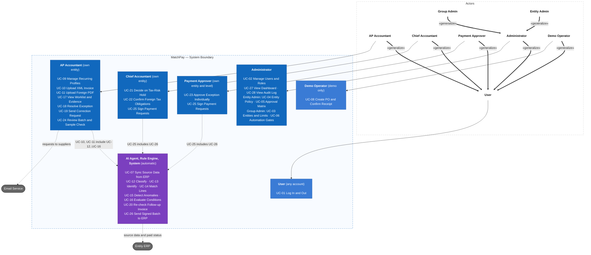

# MatchPay

MatchPay is a shared platform for a group of several legal entities. AI checks every incoming invoice against its purchase order and goods receipt, and the Rule Engine admits invoices that pass six conditions into a payment batch. Authorised people then sign consolidated payment requests per supplier, many in one action, and only exceptions need to be handled one by one. The goal is to pay the right amount, to the right entity, on time, without losing tax deductions.

AI helps at nine points: it classifies the invoice flow, reads the document, identifies the entity and the order, matches invoice lines, detects anomalies, explains and drafts the handling of exceptions, flags foreign tax duties, selects the sample for the sample check, and summarises the batch for the signer. **The AI provides evidence, the Rule Engine decides, and a person signs and is accountable.** The AI never signs and never sends anything outside the system by itself.

MatchPay serves the finance teams of a group, not the purchasing or warehouse teams. Those teams keep working in their ERP, and their data is synced in. Examples and sample data use one fictional group, **Calderwood Group**, with three fictional entities. The real source documents (invoices, laws) are Vietnamese; all documentation is written in English. "MatchPay" is a working name (O-01).

## Steps and status

The work is done in nine steps. A step is only approved when the user approves it.

| Step | Content | Status |
|---|---|---|
| 1 | Research and problem analysis | Draft for review |
| 2 | Use cases and user stories (INVEST, acceptance criteria, business rules, MoSCoW) | Draft for review |
| 3 | Information architecture (sitemap, routes and permissions, navigation, screen inventory, user flows, UI states) | Draft for review |
| 4 | UI/UX and wireframes | Not started |
| 5 | Database | Not started |
| 6 | API contract | Not started |
| 7 | C4 architecture, tech stack, and LLM provider | Not started |
| 8 | Code structure | Not started |
| 9 | Implementation | Not started |

## 1. Requirements — Research, Use Cases, and Acceptance Criteria

Requirements define what MatchPay must do, who uses it, the value delivered, and the observable conditions of success. User stories are reviewed with INVEST and mapped to use cases, business rules, and acceptance criteria.

### 1.1 Product mind map

See the [product mind map](docs/mindmap.md).

### 1.2 Step 1 summary: research and problem analysis

Step 1 analyses four problems: manual matching of invoice, order, and receipt (P-01); item names and units that differ between documents (P-02); invoices from risky suppliers or issued to the wrong entity (P-03); and payment approval by email and chat with no approval matrix (P-04). It sets seven measurable goals, G-01..G-07, of which the touchless rate (G-01) is always reported together with the AI misplacement rate (G-02), and defines ten MVP modules, M-01..M-10.

The brief's facts were checked against sources opened on 2026-10-31. Four points matter most:

- **The legal base moved.** The e-invoice decree and circular in force changed on 2026-07-01. This rests on one secondary source (an EY summary); the official texts were not opened. The brief's 2025 sentence about all businesses with revenue of VND 1 billion was wrong and is replaced by a rationale that holds ([Decisions](docs/01-research/00-decisions.md), D-15..D-17).
- **A tax rule ties payment to deduction.** A purchase of VND 5 million or more keeps its VAT deduction only if it is paid by non-cash means ([Regulatory context](docs/01-research/10-regulatory-context.md)). Step 2 turns this into rule BR-32 (D-25).
- **The market gap is still an assumption.** Cost does not support it, Vietnam e-invoice support of international products is unpublished rather than disproven, and data location is a compliance step ([Similar products](docs/01-research/04-similar-products.md)).
- **Open items remain** for the user, the manager, an accountant, or a lawyer, including the name, the legal effect of policy delegation, and the usage-based non-coded invoices of D-24 ([Decisions](docs/01-research/00-decisions.md), O-01..O-16).

Start with the [Step 1 index](docs/01-research/README.md).

### 1.3 INVEST requirements, use cases, and business rules

#### 1.3.1 INVEST requirements

The MVP backlog includes 28 user stories, one per use case and numbered like it (US-01 is UC-01). They cover access and configuration, source data, intake and AI understanding, exceptions, the batch with its sample check and signing, and oversight. Before a user story is ready for development, it is checked using the INVEST criteria.

| Criterion | Meaning in MatchPay |
|---|---|
| **Independent** | Each story delivers one clear outcome and names its prerequisites (login, synced source data, the checks before the Rule Engine). |
| **Negotiable** | Screens and technical choices can change as long as the outcome, permissions, and AI guardrails stay the same. |
| **Valuable** | Each story gives value to a named role; system behaviours are written for the role that benefits. |
| **Estimable** | Roles, inputs, limits, and failure cases (including AI failure) are documented, and every story has a size. |
| **Small** | Each story covers one use case; a larger story groups its criteria by part. |
| **Testable** | Every story has Given/When/Then acceptance criteria with concrete values. |

```text
US-01–US-06   Access and configuration (log in with entity scope, users and roles, entities and group limits,
              entity policy, approval matrix, automation gates)
US-07–US-09   Source data (sync from the ERP, ERP simulator, recurring profiles)
US-10–US-16   Intake and AI understanding (XML and foreign PDF upload, flow, identification, line matching,
              anomalies, the six batch conditions)
US-17–US-23   Exceptions (worklist and evidence, resolve, correction requests, follow-up invoices,
              tax-risk hold, foreign tax duties, individual approval)
US-24–US-26   Batch and signing (sample check, signing of payment requests, sending to the ERP)
US-27–US-28   Oversight (dashboard, audit log)
```

Stories are prioritized with MoSCoW: 20 Must, 8 Should, 0 Could, and 18 Won't (Advanced items W-01..W-18). The complete backlog and per-story INVEST review are in [User Stories (INVEST)](docs/02-usecases-userstories/03-user-stories-invest.md), the Given/When/Then criteria in [Acceptance Criteria](docs/02-usecases-userstories/04-acceptance-criteria.md), and the priorities in [MoSCoW Prioritization](docs/02-usecases-userstories/05-moscow-prioritization.md). The goals G-03, G-04, and G-06 are measured on named evaluation sets and a permissions test suite, defined in the acceptance criteria.

#### 1.3.2 Use cases



Thick arrows show actor generalization: every role inherits UC-01 from User, and a Group Admin and an Entity Admin are two scopes of the Administrator. An Administrator is not a finance role and never signs or approves. For detailed actors and the full use case diagram, see [Actors and Use Cases](docs/02-usecases-userstories/01-use-cases.md); for the flows, see [Use Case Specifications](docs/02-usecases-userstories/02-use-case-specifications.md).

#### 1.3.3 Roles and permissions

| Capability | AP Accountant | Chief Accountant | Payment Approver | Entity Admin | Group Admin |
|---|---|---|---|---|---|
| Log in and out | Yes | Yes | Yes | Yes | Yes |
| Upload XML and foreign PDF invoices, manage recurring profiles | Own entity | No | No | No | No |
| Resolve exceptions, send requests to suppliers, run the sample check | Own entity | No | No | No | No |
| Decide on tax-risk holds and foreign tax duties | No | Own entity | No | No | No |
| Approve a single exception | No | No | Own entity, own level | No | No |
| Sign payment requests | No | Own entity, first | Own entity, own level, second | No | No |
| View the invoice worklist and evidence | Own entity | Own entity (read-only) | Own entity (read-only) | No | No |
| View the dashboard | Own entity | Own entity | Own entity | Own entity | Per-entity counts and rates |
| View the audit log | No | Own entity | No | Own entity | Group events only |
| Manage users and roles | No | No | No | Own entity | All entities |
| Configure entity policy and approval matrix | No | No | No | Own entity | No |
| Manage entities, group limits, and automation gates | No | No | No | No | Yes |

The Demo Operator, who plays the buyer and the warehouse keeper in the ERP simulator, appears only in the demo. The Rule Engine alone admits an invoice to a batch, from stored evidence and without an LLM; the AI supplies evidence and never decides. The server enforces roles and entity scope, and hiding a control in the screen serves only the user interface. The rules, including the lifecycles of invoices, exceptions, and batches, are in [Business rules](docs/requirements/business-rules.md).

## 2. Information Architecture and Screen Hierarchy

Step 3 places the 28 stories on 37 screens: 19 pages and 18 modals. Each role has a left sidebar with only the pages it may open, and a top bar with the entity name, the user, and Log out. Pages are grouped into areas by the roles that use them, and decisions, confirmations, and forms are modals on their parent page. The Rule Engine's work and the other system behaviour has no screen of its own; its results appear on the invoice worklist, the invoice evidence, the batch review, the payment request, and the group overview.

| Role | Home page after login (DF-28) | Sidebar pages |
|---|---|---|
| AP Accountant | Invoice Worklist | Invoices, Batch, Recurring profiles, Dashboard |
| Chief Accountant | Decision Queue | Decisions, Signing queue, Invoices (read-only), Dashboard, Audit log |
| Payment Approver | Signing Queue | Signing queue, Approvals, Invoices (read-only), Dashboard |
| Entity Admin | Entity Policy | Entity policy, Approval matrix, Users, Dashboard, Audit log |
| Group Admin | Group Overview | Group overview, Automation gates, Entities and limits, Users, Dashboard, Audit log |
| Demo Operator | ERP Simulator (demo only) | ERP simulator |

Source: [Sitemap by Role](docs/03-information-architecture/01-sitemap.md) with the diagram of areas and page cards. Routes and the page-permission table are in [Routes and Permissions](docs/03-information-architecture/02-routes-and-permissions.md), navigation in [Navigation](docs/03-information-architecture/03-navigation.md), screen IDs and the requirement-to-screen mapping in [Screen Inventory](docs/03-information-architecture/04-screen-inventory.md), flows in [Primary User Flows](docs/03-information-architecture/05-user-flows.md), and states in [UI/UX States and Accessibility](docs/03-information-architecture/06-ui-states-and-accessibility.md). The calls of this step await review in [Decisions and Defaults](docs/03-information-architecture/00-decisions.md).

## Documentation

- Research: [Context and problem](docs/01-research/01-context-and-problem.md), [Goals and metrics](docs/01-research/02-goals-and-metrics.md), [Stakeholders](docs/01-research/03-stakeholders.md), [Similar products](docs/01-research/04-similar-products.md), [MVP scope](docs/01-research/05-scope.md), [Risks](docs/01-research/06-risks.md), [AI vs rule-based](docs/01-research/07-ai-vs-rule-based.md), [Glossary](docs/01-research/08-glossary.md), [Decisions](docs/01-research/00-decisions.md), [Future work](docs/01-research/09-future-work.md), [Regulatory context](docs/01-research/10-regulatory-context.md), [Invoice flows and data](docs/01-research/11-invoice-flows-and-data.md).
- Requirements: [Actors and use cases](docs/02-usecases-userstories/01-use-cases.md), [Use case specifications](docs/02-usecases-userstories/02-use-case-specifications.md), [User stories (INVEST)](docs/02-usecases-userstories/03-user-stories-invest.md), [Acceptance criteria](docs/02-usecases-userstories/04-acceptance-criteria.md), [MoSCoW](docs/02-usecases-userstories/05-moscow-prioritization.md), [Decisions and defaults](docs/02-usecases-userstories/00-decisions.md).
- Requirements catalogs: [Business rules](docs/requirements/business-rules.md).
- Information architecture: [Step 3 index](docs/03-information-architecture/README.md), [Decisions and defaults](docs/03-information-architecture/00-decisions.md), [Sitemap](docs/03-information-architecture/01-sitemap.md), [Routes and permissions](docs/03-information-architecture/02-routes-and-permissions.md), [Navigation](docs/03-information-architecture/03-navigation.md), [Screen inventory](docs/03-information-architecture/04-screen-inventory.md), [User flows](docs/03-information-architecture/05-user-flows.md), [UI states and accessibility](docs/03-information-architecture/06-ui-states-and-accessibility.md).
- Traceability: [Master traceability matrix](docs/traceability/master-traceability.md).

## Project Progress

- [x] Define the problem, measurable goals, stakeholders, and user roles (draft for review)
- [x] Compare similar products, define the MVP scope, risks, and AI vs rule-based reasoning (draft for review)
- [x] Draw the product mind map (draft for review)
- [x] Write the use cases and the use case diagram (draft for review)
- [x] Write user stories following INVEST (draft for review)
- [x] Write acceptance criteria (Given/When/Then) and business rules (draft for review)
- [x] Prioritize the backlog with MoSCoW (draft for review)
- [x] Design the information architecture, sitemap per role, and user flows (draft for review)
- [ ] Design the UI/UX wireframes
- [ ] Design the database
- [ ] Write the API documentation in OpenAPI 3.0
- [ ] Design the C4 model and choose the tech stack and LLM provider
- [ ] Design the code structure
- [ ] Implement the modules
