# MatchPay

MatchPay is a shared platform for a group of several legal entities. AI checks every incoming invoice against its purchase order and goods receipt, and the Rule Engine admits invoices that pass six conditions into a payment batch. The MVP reads XML e-invoices only; foreign invoices and the cash payment flag are Advanced. Authorised people then sign consolidated payment requests per supplier, many in one action, and only exceptions need to be handled one by one. The goal is to pay the right amount, to the right entity, on time, without losing tax deductions.

## 1. Requirements — Research, Use Cases, and Acceptance Criteria

Requirements define what MatchPay must do, who uses it, the value delivered, and the observable conditions of success. User stories are reviewed with INVEST and mapped to use cases, business rules, and acceptance criteria.

### 1.1 Product mind map

See the [product mind map](docs/mindmap.md), including the [feature map F01–F12](docs/mindmap.md#feature-map-f01f12).

The original Vietnamese feature mind map is displayed below:


### 1.2 Research and Problem Analysis Summary

This research identifies four problems: manual matching of invoice, order, and receipt (P-01); item names and units that differ between documents (P-02); invoices from risky suppliers or issued to the wrong entity (P-03); and payment approval by email and chat with no approval matrix (P-04). It sets seven measurable goals, G-01..G-07, of which the touchless rate (G-01) is always reported together with the AI misplacement rate (G-02), and defines ten MVP modules, M-01..M-10.

The brief's facts were checked against sources opened on 2026-10-31. Four points matter most:

- **The legal base moved.** The e-invoice decree and circular in force changed on 2026-07-01. This rests on one secondary source (an EY summary); the official texts were not opened. The brief's 2025 sentence about all businesses with revenue of VND 1 billion was wrong and is replaced by a rationale that holds ([Decisions](docs/01-research/00-decisions.md), D-15..D-17).
- **A tax rule ties payment to deduction.** A purchase of VND 5 million or more keeps its VAT deduction only if it is paid by non-cash means ([Regulatory context](docs/01-research/10-regulatory-context.md)). It stays as regulatory background and in the "why now" rationale. A rule that flagged cash payments (BR-32, D-25) was removed from the MVP by the user's decision D-33 and is Advanced (W-21); a signed batch is a non-cash transfer instruction by design.
- **The market gap is still an assumption.** Cost does not support it, Vietnam e-invoice support of international products is unpublished rather than disproven, and data location is a compliance step ([Similar products](docs/01-research/04-similar-products.md)).
- **Open items remain** for the user, the manager, an accountant, or a lawyer, including the name, the legal effect of policy delegation and of a delegated e-signature (O-05, O-17), and the usage-based non-coded invoices of D-24 ([Decisions](docs/01-research/00-decisions.md), O-01..O-17).

Start with the [Research and Problem Analysis](docs/01-research/README.md).

### 1.3 INVEST requirements, use cases, and business rules

#### 1.3.1 INVEST requirements

The MVP backlog includes 30 user stories, one per use case and numbered like it (US-01 is UC-01). The user removed foreign invoices and the cash payment flag from the MVP (D-33), so UC-11, UC-22, US-11, and US-22 are removed and their numbers are not reused. On 2026-11-01 the user attached a feature mind map and asked to sync the documents to it (D-88), which added four Should stories, UC-29..UC-32 (service acceptance by the Requesting Department, signing delegation while absent, invoices by email, and notifications and reminders), and extended some existing ones; the readings behind them are calls approved by the user (2026-11-01) (D-89..D-99). They cover access and configuration, source data, intake and AI understanding, exceptions, the batch with its sample check and signing, and oversight. Before a user story is ready for development, it is checked using the INVEST criteria.

| Criterion | Meaning in MatchPay |
|---|---|
| **Independent** | Each story delivers one clear outcome and names its prerequisites (login, synced source data, the checks before the Rule Engine). |
| **Negotiable** | Screens and technical choices can change as long as the outcome, permissions, and AI guardrails stay the same. |
| **Valuable** | Each story gives value to a named role; system behaviours are written for the role that benefits. |
| **Estimable** | Roles, inputs, limits, and failure cases (including AI failure) are documented, and every story has a size. |
| **Small** | Each story covers one use case; a larger story groups its criteria by part. |
| **Testable** | Every story has Given/When/Then acceptance criteria with concrete values. |

```text
US-01–US-06   Access and configuration (log in with entity scope, users and roles, entities and group limits,
              entity policy, approval matrix, automation gates)
US-07–US-09   Source data (sync from the ERP, ERP simulator, recurring profiles)
US-10–US-16   Intake and AI understanding (XML upload, flow, identification, line matching,
              anomalies, the six batch conditions; US-11 removed)
US-17–US-23   Exceptions (worklist, search, and evidence, resolve, correction requests, follow-up invoices,
              tax-risk hold, individual approval; US-22 removed)
US-24–US-26   Batch and signing (sample check with expansion and reopening, signing of payment requests,
              sending to the ERP with a manual resend)
US-27–US-28   Oversight (dashboard, audit log)
US-29–US-32   Added by D-88 (service acceptance, signing delegation, invoices by email,
              notifications and reminders)
```

Stories are prioritized with MoSCoW: 20 Must, 10 Should (US-29..US-32 are Should), 0 Could, and 21 Won't (Advanced items W-01..W-21; W-05 and W-13 now mean the supplier portal and the real tax-authority connection). The complete backlog and per-story INVEST review are in [User Stories (INVEST)](docs/02-usecases-userstories/03-user-stories-invest.md), the Given/When/Then criteria in [Acceptance Criteria](docs/02-usecases-userstories/04-acceptance-criteria.md), and the priorities in [MoSCoW Prioritization](docs/02-usecases-userstories/05-moscow-prioritization.md). The goals G-03, G-04, and G-06 are measured on named evaluation sets and a permissions test suite, defined in the acceptance criteria.

#### 1.3.2 Use cases

The model is drawn as one actor diagram and four use case diagrams, one per group of modules, so each picture stays readable. Human actors carry the person icon; systems are rounded nodes, and purple nodes use an LLM. UC-11 and UC-22 are not drawn (removed by D-33). UC-29 to UC-32 are drawn in the intake and the batch diagrams (D-88).

Thick arrows marked «generalize» point from a child actor to the parent whose use cases it inherits. A Group Admin and an Entity Admin are two scopes of the Administrator.

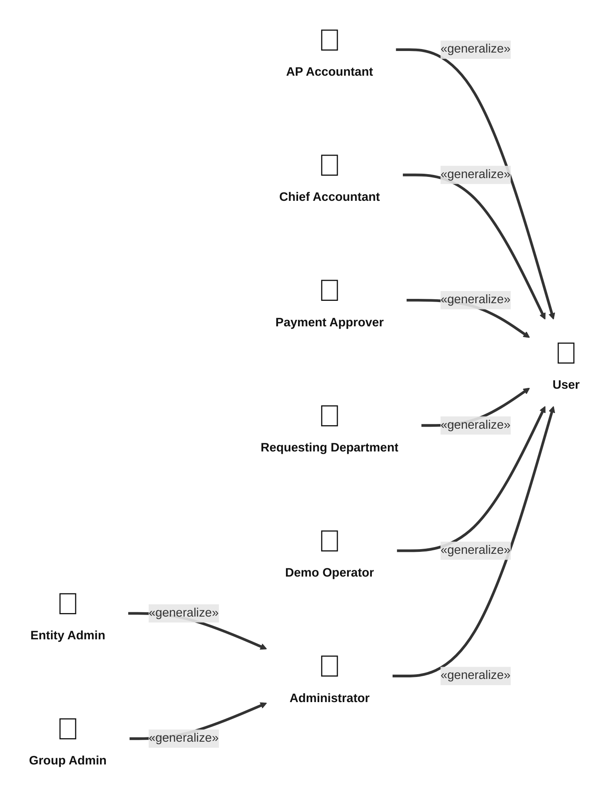

Everyone logs in; the two administrator scopes manage users, entities, policy, the approval matrix, and the automation gates.

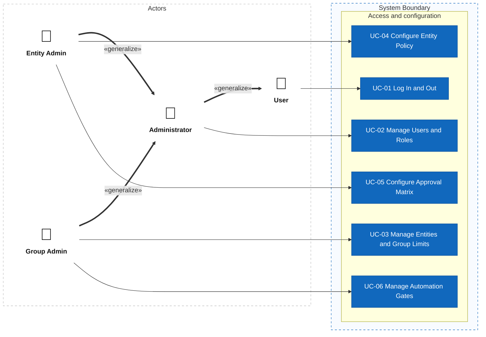

The Demo Operator creates orders and receipts in the simulator, the Requesting Department confirms service acceptances, the AP Accountant adds profiles, uploads XML invoices, and watches the invoice mailbox, and the AI Agent and the Rule Engine do the reading, matching, and routing. The Invoice Status Lookup Service (simulated) answers UC-10, and the Email Service holds the mailbox that UC-31 reads.

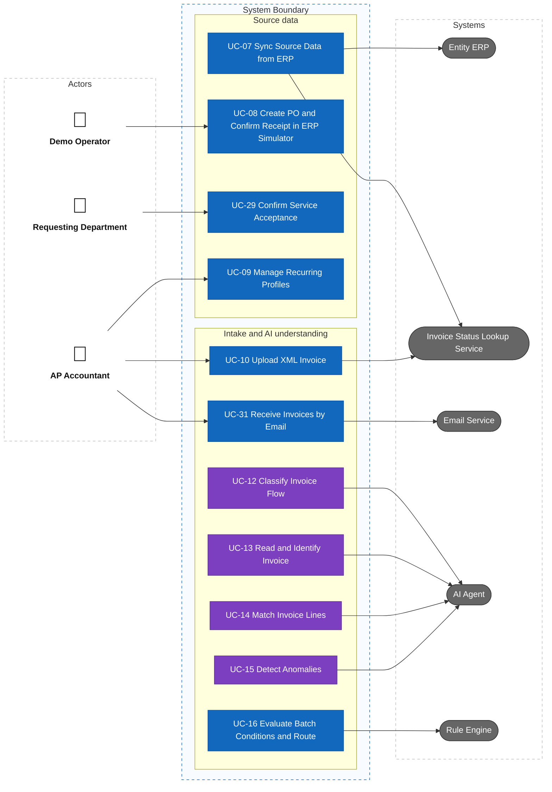

The AP Accountant resolves exceptions, the Chief Accountant decides tax-risk holds, and the Payment Approver approves single exceptions. The AI Agent drafts the request, and the Email Service delivers it.


The AP Accountant reviews the batch, the Chief Accountant and the Payment Approver sign and can name a delegate, the Entity Admin sees and revokes delegations, and the System sends the signed batch to the ERP; the AP Accountant and the Chief Accountant can resend it by hand. All three finance roles receive notifications and reminders. The Administrator views the dashboard and the audit log; a Group Admin and an Entity Admin do the same because they inherit from the Administrator (see the actor diagram above, and the matrix for the scope).


An Administrator is not a finance role and never signs or approves. For the actors, the role and use case matrix, and the included and extending use cases, see [Actors and Use Cases](docs/02-usecases-userstories/01-use-cases.md); for the flows, see [Use Case Specifications](docs/02-usecases-userstories/02-use-case-specifications.md).

#### 1.3.3 Roles and permissions

| Capability | AP Accountant | Chief Accountant | Payment Approver | Requesting Department | Entity Admin | Group Admin |
|---|---|---|---|---|---|---|
| Log in and out | Yes | Yes | Yes | Yes | Yes | Yes |
| Upload XML invoices, manage recurring profiles | Own entity | No | No | No | No | No |
| Resolve exceptions, send requests to suppliers, run the sample check | Own entity | No | No | No | No | No |
| Decide on tax-risk holds | No | Own entity | No | No | No | No |
| Approve a single exception | No | No | Own entity, own level | No | No | No |
| Confirm the acceptance of a service | No | No | No | Own entity | No | No |
| Name a delegate for signing while absent | No | Own delegation | Own delegation | No | Own entity (view, revoke) | No |
| Sign payment requests | No | Own entity, first | Own entity, own level, second | No | No | No |
| Receive notifications and reminders | Own entity | Own entity | Own entity | No | No | No |
| View the invoice worklist and evidence | Own entity | Own entity (read-only) | Own entity (read-only) | No | No | No |
| View the dashboard | Own entity | Own entity | Own entity | No | Own entity | Per-entity counts and rates |
| View the audit log | No | Own entity | No | No | Own entity | Group events only |
| Manage users and roles | No | No | No | No | Own entity | All entities |
| Configure entity policy and approval matrix | No | No | No | No | Own entity | No |
| Manage entities, group limits, and automation gates | No | No | No | No | No | Yes |

The Demo Operator, who plays the buyer and the warehouse keeper in the ERP simulator, appears only in the demo. The Rule Engine alone admits an invoice to a batch, from stored evidence and without an LLM; the AI supplies evidence and never decides. The server enforces roles and entity scope, and hiding a control in the screen serves only the user interface. The rules, including the lifecycles of invoices, exceptions, and batches, are in [Business rules](docs/requirements/business-rules.md).

## 2. Information Architecture, Screen Hierarchy, and UI/UX

The information architecture (approved by the user, then synced to the feature mind map as approved) places the 30 stories on 45 screens: 22 pages and 23 modals. The sync (D-88) added the seventh role, the Requesting Department, ten screens (the acceptance queue, the mailbox log, signing delegations, the notification list, and six modals), three flows, and a notification centre that reverses D-41. SCR-13 and SCR-17 were removed by D-33 and their numbers are not reused. Each role has a left sidebar with only the pages it may open, and a top bar with the entity name, the user, and Log out. Pages are grouped into areas by the roles that use them, and decisions, confirmations, and forms are modals on their parent page. The Rule Engine's work and the other system behaviour has no screen of its own; its results appear on the invoice worklist, the invoice evidence, the batch review, the payment request, and the group overview.

### 2.1 Information architecture

Solid lines connect a parent page to a child page; dashed arrows show which areas each actor uses; purple cards are pages with AI features.

Finance-side roles: the AP Accountant, the Chief Accountant, the Payment Approver, and the Requesting Department, with the areas each one uses. The Delegations area is drawn again in the second diagram because the Entity Admin reads and revokes delegations.

```mermaid
flowchart TB
    ap["<span style='font-size:40px'>👤</span><br/><b>AP Accountant</b>"]
    ca["<span style='font-size:40px'>👤</span><br/><b>Chief Accountant</b>"]
    pa["<span style='font-size:40px'>👤</span><br/><b>Payment Approver</b>"]
    rd["<span style='font-size:40px'>👤</span><br/><b>Requesting Department</b>"]

    subgraph access["Access"]
        direction TB
        scr01["<b>SCR-01 Login</b><br/>• Email, password<br/>• Goes to the role home page"]
    end

    subgraph prep["AP preparation (AP Accountant)"]
        direction TB
        scr20["<b>SCR-20 Recurring Profiles</b><br/>• Profiles, earlier amounts<br/>• Add, deactivate"]
        scr24["<b>SCR-24 Mailbox Log</b><br/>• Messages and attachments with results<br/>• Fetch now<br/>• Last fetch time or failure"]
        scr30["<b>SCR-30 Batch Review</b><br/>• Close batch, AI sample, OK or Error<br/>• Expand sample, reopen for review<br/>• Release for signing<br/>• Request, ERP send status, resend"]
    end

    subgraph acceptance["Service acceptance (Requesting Department)"]
        direction TB
        scr22["<b>SCR-22 Acceptance Queue</b><br/>• Service invoices waiting for acceptance<br/>• Confirm or reject with a note<br/>• Own entity only"]
    end

    subgraph invoices["Invoices (AP: full · Chief Accountant, Payment Approver: read-only)"]
        direction TB
        scr10["<b>SCR-10 Invoice Worklist</b><br/>• Search by number, supplier, total<br/>• Filters by state, Due soon, source<br/>• Last ERP sync, upload XML only (AP)"]
        scr12["<b>SCR-12 Invoice Detail and Evidence</b><br/>• Document, order, receipt, line matches<br/>• Anomalies, six conditions, authority status<br/>• State history, AI text labelled AI<br/>• Action panel for the role that must decide<br/>• Record a cancellation notice (AP)"]
        scr10 --> scr12
    end

    subgraph decisions["Decisions (Chief Accountant, Payment Approver)"]
        direction TB
        scr40["<b>SCR-40 Decision Queue</b><br/>• CA: tax-risk holds<br/>• PA: exceptions at my level<br/>• Each row opens the invoice"]
    end

    subgraph signing["Signing (Chief Accountant, Payment Approver)"]
        direction TB
        scr50["<b>SCR-50 Signing Queue</b><br/>• Requests to sign, select many<br/>• Sign in one action, On behalf of mark<br/>• ERP status"]
        scr51["<b>SCR-51 Payment Request Detail</b><br/>• AI summary labelled AI<br/>• Totals, large invoices, flags<br/>• Lines, remove, decline, resend<br/>• Paid status and reference"]
        scr50 --> scr51
    end

    subgraph delegations["Signing delegations (Chief Accountant, Payment Approver; Entity Admin reads and revokes)"]
        direction TB
        scr55["<b>SCR-55 Signing Delegations</b><br/>• Delegations given and received<br/>• New delegation, revoke<br/>• Scheduled, Active, Ended, Revoked"]
    end

    subgraph notifications["Notifications (AP Accountant, Chief Accountant, Payment Approver)"]
        direction TB
        scr62["<b>SCR-62 Notifications</b><br/>• Own notices and reminders<br/>• Unread count in the top bar<br/>• Each item opens its object"]
    end

    subgraph oversight["Oversight"]
        direction TB
        scr60["<b>SCR-60 Dashboard</b><br/>• Touchless rate and AI misplacement rate<br/>• Exception backlog by state and age<br/>• Group Admin: per-entity figures only"]
        scr61["<b>SCR-61 Audit Log</b><br/>• AI, rule, human, signature entries<br/>• Filters, read-only<br/>• Group Admin: group events only"]
    end

    scr30 --> scr12
    scr40 --> scr12
    scr51 --> scr12
    scr62 --> scr12
    scr62 --> scr30
    scr62 --> scr50
    scr62 --> scr51

    ap -.-> access
    ap -.-> invoices
    ap -.-> prep
    ap -.-> notifications
    ap -.-> oversight
    ca -.-> access
    ca -.-> invoices
    ca -.-> decisions
    ca -.-> signing
    ca -.-> delegations
    ca -.-> notifications
    ca -.-> oversight
    pa -.-> access
    pa -.-> invoices
    pa -.-> decisions
    pa -.-> signing
    pa -.-> delegations
    pa -.-> notifications
    pa -.-> oversight
    rd -.-> access
    rd -.-> acceptance

    classDef actor fill:none,stroke:none,color:#111
    classDef screen fill:#fff,color:#111,stroke:#1168bd,text-align:left
    classDef ai fill:#f3ecfb,color:#111,stroke:#7b3fbf,text-align:left
    class ap,ca,pa,rd actor
    class scr01,scr10,scr20,scr22,scr24,scr40,scr50,scr55,scr60,scr61,scr62 screen
    class scr12,scr30,scr51 ai
```

Administration and demo: the Entity Admin, the Group Admin, and the Demo Operator, with the areas each one uses. Access and Oversight are drawn again because the finance roles share them.

```mermaid
flowchart TB
    entityAdmin["<span style='font-size:40px'>👤</span><br/><b>Entity Admin</b>"]
    groupAdmin["<span style='font-size:40px'>👤</span><br/><b>Group Admin</b>"]
    demo["<span style='font-size:40px'>👤</span><br/><b>Demo Operator</b>"]

    subgraph access["Access"]
        direction TB
        scr01["<b>SCR-01 Login</b><br/>• Email, password<br/>• Goes to the role home page"]
    end

    subgraph oversight["Oversight"]
        direction TB
        scr60["<b>SCR-60 Dashboard</b><br/>• Touchless rate and AI misplacement rate<br/>• Exception backlog by state and age<br/>• Group Admin: per-entity figures only"]
        scr61["<b>SCR-61 Audit Log</b><br/>• AI, rule, human, signature entries<br/>• Filters, read-only<br/>• Group Admin: group events only"]
    end

    subgraph delegations["Signing delegations (Chief Accountant, Payment Approver; Entity Admin reads and revokes)"]
        direction TB
        scr55["<b>SCR-55 Signing Delegations</b><br/>• Delegations given and received<br/>• New delegation, revoke<br/>• Scheduled, Active, Ended, Revoked"]
    end

    subgraph useradmin["User administration"]
        direction TB
        scr70["<b>SCR-70 Users</b><br/>• Users, roles, ERP link<br/>• Create, deactivate<br/>• Group Admin: entity filter"]
    end

    subgraph entityconfig["Entity configuration (Entity Admin)"]
        direction TB
        scr73["<b>SCR-73 Entity Policy</b><br/>• Tolerance, batch threshold<br/>• Sample rate, grouping mode<br/>• Group limit beside each field"]
        scr74["<b>SCR-74 Approval Matrix</b><br/>• Tiers, levels, approvers<br/>• Gap and overlap errors"]
    end

    subgraph groupadmin["Group administration (Group Admin)"]
        direction TB
        scr75["<b>SCR-75 Group Overview</b><br/>• Entities, open and closed gates<br/>• Gate alerts<br/>• Last ERP sync per entity"]
        scr76["<b>SCR-76 Entities and Group Limits</b><br/>• Entities, group maximums<br/>• Non-coded invoice sectors"]
        scr78["<b>SCR-78 Automation Gates</b><br/>• Pair state, compared count<br/>• Accuracy against 98%<br/>• Open or close"]
    end

    subgraph demoarea["Demo only"]
        direction TB
        scr80["<b>SCR-80 ERP Simulator</b><br/>• Entity and persona<br/>• Purchase orders, receipts<br/>• Marked Demo only"]
    end


    entityAdmin -.-> access
    entityAdmin -.-> oversight
    entityAdmin -.-> useradmin
    entityAdmin -.-> entityconfig
    entityAdmin -.-> delegations
    groupAdmin -.-> access
    groupAdmin -.-> oversight
    groupAdmin -.-> useradmin
    groupAdmin -.-> groupadmin
    demo -.-> access
    demo -.-> demoarea

    classDef actor fill:none,stroke:none,color:#111
    classDef screen fill:#fff,color:#111,stroke:#1168bd,text-align:left
    classDef ai fill:#f3ecfb,color:#111,stroke:#7b3fbf,text-align:left
    class entityAdmin,groupAdmin,demo actor
    class scr01,scr55,scr60,scr61,scr70,scr73,scr74,scr75,scr76,scr80 screen
    class scr78 ai
```

### 2.2 Screen hierarchy

Login takes each role to its home page (DF-28, D-39, DF-44), as the table below shows. Lists open full detail pages; decisions, forms, and confirmations are modals on their parent page. SCR-13 and SCR-17 were removed by D-33.

| Role | Home page after login (DF-28) | Sidebar pages |
|---|---|---|
| AP Accountant | Invoice Worklist | Invoices, Batch, Mailbox, Recurring profiles, Notifications, Dashboard |
| Chief Accountant | Decision Queue | Decisions, Signing queue, Delegations, Invoices (read-only), Notifications, Dashboard, Audit log |
| Payment Approver | Signing Queue | Signing queue, Approvals, Delegations, Invoices (read-only), Notifications, Dashboard |
| Requesting Department | Acceptance Queue | Acceptance queue |
| Entity Admin | Entity Policy | Entity policy, Approval matrix, Users, Delegations, Dashboard, Audit log |
| Group Admin | Group Overview | Group overview, Automation gates, Entities and limits, Users, Dashboard, Audit log |
| Demo Operator | ERP Simulator (demo only) | ERP simulator |

Source: [Sitemap by Role](docs/03-information-architecture/01-sitemap.md) with the diagram of areas and page cards. Routes and the page-permission table are in [Routes and Permissions](docs/03-information-architecture/02-routes-and-permissions.md), navigation in [Navigation](docs/03-information-architecture/03-navigation.md), screen IDs and the requirement-to-screen mapping in [Screen Inventory](docs/03-information-architecture/04-screen-inventory.md), flows in [Primary User Flows](docs/03-information-architecture/05-user-flows.md), and states in [UI/UX States and Accessibility](docs/03-information-architecture/06-ui-states-and-accessibility.md). The D-33 adjustments, the diagram presentation, and the mind map sync (D-100..D-107, DF-69..DF-72) are approved by the user (2026-11-01) in [Decisions and Defaults](docs/03-information-architecture/00-decisions.md).

### 2.3 UI wireframes

The UI/UX (approved by the user) draws the 45 active screens as 22 high-fidelity page files; modals are states of their parent page. The design concept is "three hands": what the **AI proposed** (dotted rail, round dashed tag), what the **Rule Engine decided** (double rail, square tag, six conditions with their values), and what a **person decided or signed** (solid rail, filled tag, signature record) are always distinguishable, in text and in shape. Only four core screens are shown here. Every screen and state, in every role, is in the wireframe gallery: open `docs/04-uiux/wireframes/index.html` in a browser from a local clone (GitHub shows `.html` files as source code). Revision R1 (2026-11-01) redesigned the layout of these screens (object pages with a stepper and tabs, lists with tiles and saved views, drawers for forms) and is approved; the images below are the R1 exports and keep their paths. The mind map sync (D-88, 2026-11-01, approved) added four pages and six modals or drawers for the Requesting Department, the signing delegations, the mailbox log, and the notifications, and states on six existing pages; the new calls are D-108..D-117 and DF-73..DF-76.

**Invoice worklist (AP Accountant, SCR-10):** every state chip, reasons with numbers, "Due soon", and the sync time.

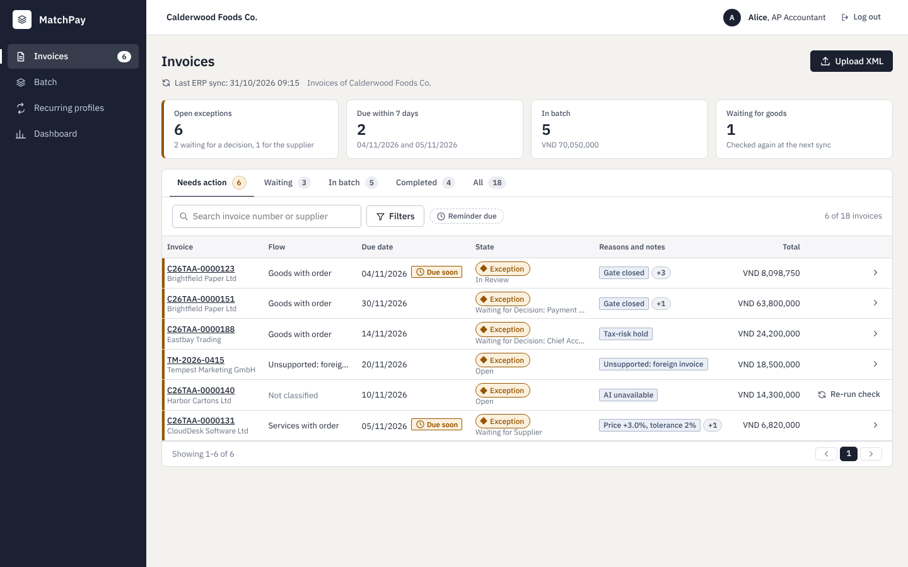

**Invoice detail with evidence (SCR-12):** AI evidence, the six conditions of BR-05 with values, line matches with method and probability, the decision history, and an action panel for the role.

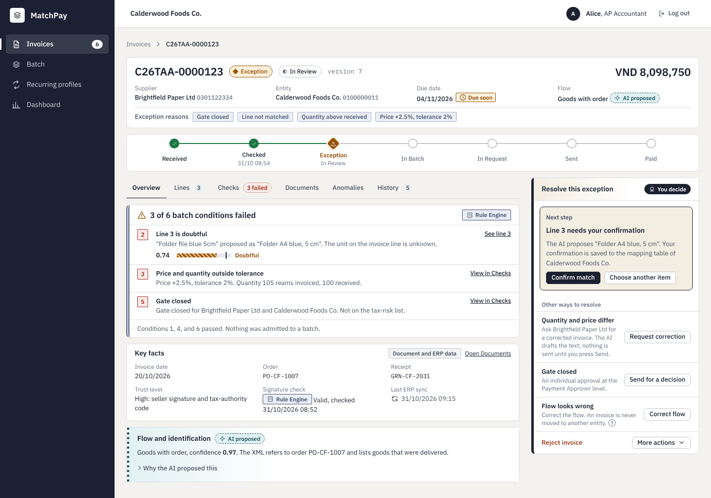

**Batch review (SCR-30):** the AI-selected sample the AP Accountant marks before release.

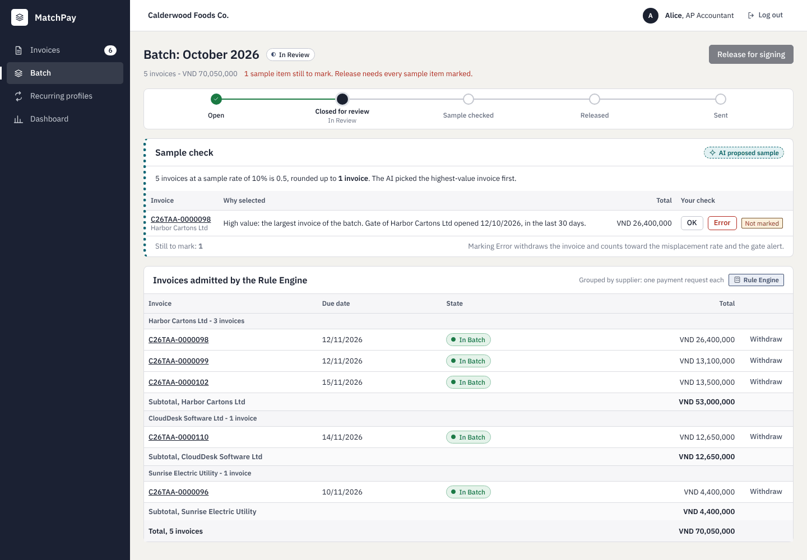

**Payment request (Chief Accountant, SCR-51):** the AI summary labelled as AI, Rule Engine totals, and the signature records.

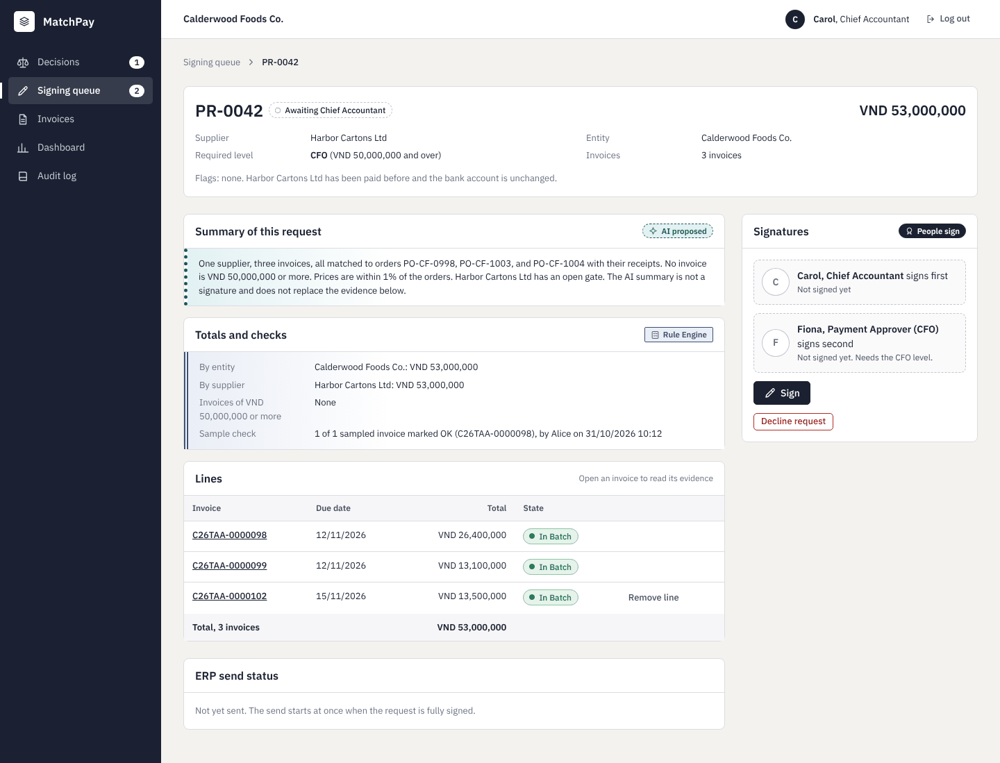

Sources: [Design system](docs/04-uiux/01-design-system.md), [Screen notes and states](docs/04-uiux/02-screen-notes.md), [Decisions](docs/04-uiux/00-decisions.md).

## 3. C4 Architecture

The architecture (draft for review) documents MatchPay at four levels, from outside in: the [system context](docs/07-architecture/01-system-context.md) (seven roles, the outside systems), the [containers](docs/07-architecture/02-container.md), the [components](docs/07-architecture/03-component.md) of the backend, and the [code](docs/07-architecture/04-code.md) of the Rule Engine's six conditions and of signing many requests at once. MatchPay is a modular monolith (D-165): one Python codebase run as an `api` process for the 121 operations and a `worker` process for the ten background jobs, in front of one PostgreSQL 16 database with pgvector. The web application is React with TypeScript, built with Vite. Entity isolation has two layers, the server filter and PostgreSQL row-level security. Item embeddings run locally inside the worker, and the hosted LLM sits behind a port; the recommendation is Anthropic `claude-sonnet-5-5` with OpenAI `gpt-6.1-terra` as the switch-over, based on vendor pages opened on 2026-11-01, with the Vietnamese quality, rate limits, and availability still Unverified ([the record](docs/07-architecture/06-llm-provider.md)). Every decision is a call awaiting the user's review.

The container diagram (C2):

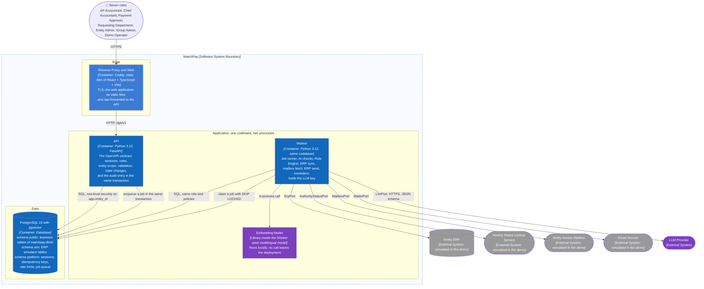

Sources: [Architecture index](docs/07-architecture/README.md), [Decisions and defaults](docs/07-architecture/00-decisions.md), [Tech stack](docs/07-architecture/05-tech-stack.md), [LLM provider](docs/07-architecture/06-llm-provider.md), [Runtime and deployment](docs/07-architecture/07-runtime-and-deployment.md).

## 4. Database Diagrams and OpenAPI 3.0 Contract

The database defines the persistence contract. The API defines the HTTP contract (4.2).

### 4.1 Database diagrams

The PostgreSQL model (assumed here, confirmed in the architecture as PostgreSQL 16 with pgvector) has 74 tables in twelve groups, including the tables added by the sync to the feature mind map (delegations, service acceptances, mailbox, authority status lookups, cancellation notices, sample expansions, batch reopenings, notifications; approved). Every business row carries its entity and the server enforces the scope; the only structure that sees the whole group is the unique index behind the exact-duplicate check. An invoice is stored with its original XML and hash, and every AI output (flow, identification, line match, anomaly finding) and every Rule Engine condition is a row with its numbers and its model and prompt version, so that a decision can be explained later. Exceptions, batches, payment requests, and signatures follow the lifecycles of BR-33, BR-34, and BR-35, a signature is bound to the version and the content hash of its request, and the audit log is append-only. Values that can be computed, such as the touchless rate and the badges, are not stored. The diagram below shows the tables that carry an invoice from upload to payment; the other groups are in the [ER diagram](docs/05-database/02-er-diagram.md), and the schema source is [matchpay.dbml](docs/05-database/matchpay.dbml).

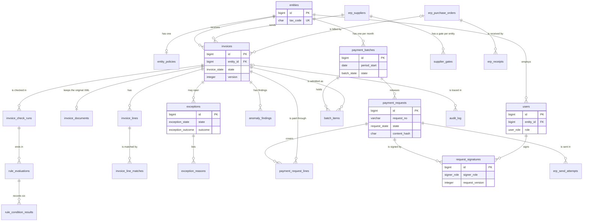

### 4.2 OpenAPI 3.0 contract

The API (draft for review) writes one HTTP contract for the web application in [`openapi.yaml`](docs/06-api/openapi.yaml): OpenAPI 3.0.4, 121 operations on 104 paths in 24 tags, and it is the source of truth for paths, bodies, roles, and errors (D-130). Every operation names its user stories, business rules, screens, and database tables (`x-stories`, `x-rules`, `x-screens`, `x-tables`), so the [API cross-check](docs/06-api/01-api-traceability.md) shows that every active story has an operation and every operation uses tables of the schema above. The conventions: a server-side session in an HttpOnly cookie with a CSRF header, the entity taken from the session and never from a path, errors as Problem Details with a stable `errorCode`, money as decimal strings, optimistic concurrency with `version`, an `Idempotency-Key` on signing, release, and resend, and 202 with a run id for work that continues in the background. The AI checks, the ERP sync, the mailbox fetch, the status lookups, the ERP send, and the reminders are jobs, not operations. The contract lints clean with Redocly. Every decision of the API contract awaits the user's review. Read the [API index](docs/06-api/README.md) and the [decisions](docs/06-api/00-decisions.md).

## Interactive prototype

A Vietnamese, clickable front end on mock data lives in [`prototype/`](prototype/README.md) (React, TypeScript, Vite; the mock API runs in the browser and follows the OpenAPI operation names). It sits next to the English wireframes, which stay the design reference. Decisions D-187..D-196 are calls that await the user's review: see [the UI/UX decisions](docs/04-uiux/00-decisions.md). Screenshots by role are in [`docs/images/prototype/`](docs/images/prototype/).

```bash
cd prototype
npm install
npm run dev
```

## Documentation

- Research: [Context and problem](docs/01-research/01-context-and-problem.md), [Goals and metrics](docs/01-research/02-goals-and-metrics.md), [Stakeholders](docs/01-research/03-stakeholders.md), [Similar products](docs/01-research/04-similar-products.md), [MVP scope](docs/01-research/05-scope.md), [Risks](docs/01-research/06-risks.md), [AI vs rule-based](docs/01-research/07-ai-vs-rule-based.md), [Glossary](docs/01-research/08-glossary.md), [Decisions](docs/01-research/00-decisions.md), [Future work](docs/01-research/09-future-work.md), [Regulatory context](docs/01-research/10-regulatory-context.md), [Invoice flows and data](docs/01-research/11-invoice-flows-and-data.md).
- Requirements: [Actors and use cases](docs/02-usecases-userstories/01-use-cases.md), [Use case specifications](docs/02-usecases-userstories/02-use-case-specifications.md), [User stories (INVEST)](docs/02-usecases-userstories/03-user-stories-invest.md), [Acceptance criteria](docs/02-usecases-userstories/04-acceptance-criteria.md), [MoSCoW](docs/02-usecases-userstories/05-moscow-prioritization.md), [Decisions and defaults](docs/02-usecases-userstories/00-decisions.md).
- Requirements catalogs: [Business rules](docs/requirements/business-rules.md).
- Information architecture: [Information architecture index](docs/03-information-architecture/README.md), [Decisions and defaults](docs/03-information-architecture/00-decisions.md), [Sitemap](docs/03-information-architecture/01-sitemap.md), [Routes and permissions](docs/03-information-architecture/02-routes-and-permissions.md), [Navigation](docs/03-information-architecture/03-navigation.md), [Screen inventory](docs/03-information-architecture/04-screen-inventory.md), [User flows](docs/03-information-architecture/05-user-flows.md), [UI states and accessibility](docs/03-information-architecture/06-ui-states-and-accessibility.md).
- Wireframes: [Wireframe gallery](docs/04-uiux/wireframes/index.html), [UI/UX index](docs/04-uiux/README.md), [Decisions and defaults](docs/04-uiux/00-decisions.md), [Design system](docs/04-uiux/01-design-system.md), [Screen notes and states](docs/04-uiux/02-screen-notes.md).
- Database: [Database index](docs/05-database/README.md), [Decisions and defaults](docs/05-database/00-decisions.md), [Data model](docs/05-database/01-data-model.md), [ER diagram](docs/05-database/02-er-diagram.md), [DBML schema](docs/05-database/matchpay.dbml).
- API: [API index](docs/06-api/README.md), [Decisions and defaults](docs/06-api/00-decisions.md), [OpenAPI contract](docs/06-api/openapi.yaml), [API traceability](docs/06-api/01-api-traceability.md).
- Architecture: [Architecture index](docs/07-architecture/README.md), [Decisions and defaults](docs/07-architecture/00-decisions.md), [System context](docs/07-architecture/01-system-context.md), [Container](docs/07-architecture/02-container.md), [Component](docs/07-architecture/03-component.md), [Code](docs/07-architecture/04-code.md), [Tech stack](docs/07-architecture/05-tech-stack.md), [LLM provider](docs/07-architecture/06-llm-provider.md), [Runtime and deployment](docs/07-architecture/07-runtime-and-deployment.md).
- Traceability: [Master traceability matrix](docs/traceability/master-traceability.md).

## Project Progress

- [x] Define the problem, measurable goals, stakeholders, and user roles (approved)
- [x] Compare similar products, define the MVP scope, risks, and AI vs rule-based reasoning (approved)
- [x] Draw the product mind map (approved)
- [x] Write the use cases and the use case diagram (approved)
- [x] Write user stories following INVEST (approved)
- [x] Write acceptance criteria (Given/When/Then) and business rules (approved)
- [x] Prioritize the backlog with MoSCoW (approved)
- [x] Design the information architecture, sitemap per role, and user flows (approved)
- [x] Design the UI/UX wireframes, including AI states and a design system (approved)
- [x] Design the database (approved)
- [x] Write the API documentation in OpenAPI 3.0 (draft for review)
- [x] Design the C4 model and choose the tech stack and LLM provider (draft for review)
- [ ] Design the code structure
- [ ] Implement the modules
