# MatchPay

MatchPay is a shared platform for a group of legal entities. AI reads each incoming invoice and checks it against its purchase order and goods receipt, and a Rule Engine admits the invoices that pass six conditions into a payment batch. Authorised people then sign consolidated payment requests per supplier, many in one action, and only exceptions are handled one by one. The MVP reads XML e-invoices; foreign invoices and the cash payment flag are Advanced. The goal is to pay the right amount, to the right entity, on time, without losing tax deductions.

## 1. Requirements — INVEST, Use Cases, and Acceptance Criteria

Requirements define what MatchPay must do, who uses it, the value delivered, and the observable conditions of success. User stories are reviewed with INVEST and mapped to use cases, business rules, and acceptance criteria.

### 1.1 Product mind map

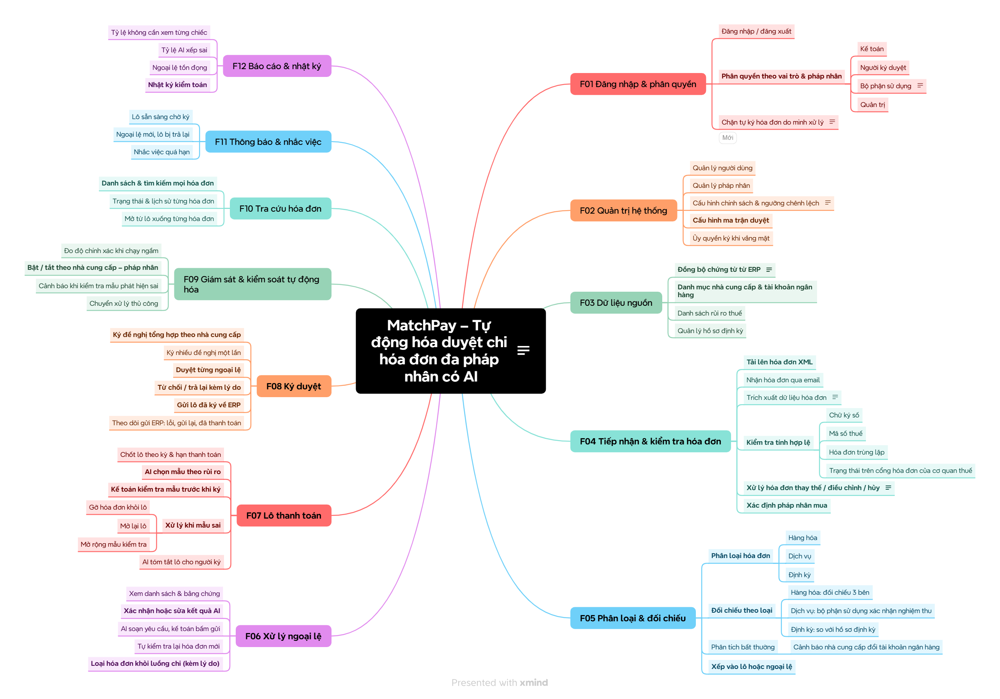

The feature map F01–F12 is described in the [product mind map](docs/mindmap.md).

The research behind the requirements covers four problems (manual matching, inconsistent item names and units, risky suppliers and wrong-entity invoices, and payment approval without a matrix), seven measurable goals, the similar products, the regulatory context, and the risks. See [Research and Problem Analysis](docs/01-research/README.md).

### 1.2 INVEST requirements

The MVP backlog has 30 user stories, one per use case and numbered like it (US-01 is UC-01). US-11 and US-22 were removed with foreign invoices and the cash payment flag, and their numbers are not reused. Before a user story is ready for development, it is checked using the INVEST criteria.

| Criterion | Meaning in MatchPay |
|---|---|
| **Independent** | Each story delivers one clear outcome and names its prerequisites (login, synced source data, the checks before the Rule Engine). |
| **Negotiable** | Screens and technical choices can change as long as the outcome, permissions, and AI guardrails stay the same. |
| **Valuable** | Each story gives value to a named role; system behaviours are written for the role that benefits. |
| **Estimable** | Roles, inputs, limits, and failure cases (including AI failure) are documented, and every story has a size. |
| **Small** | Each story covers one use case; a larger story groups its criteria by part. |
| **Testable** | Every story has Given/When/Then acceptance criteria with concrete values. |

```text
US-01–US-06   Access and configuration
US-07–US-09   Source data
US-10–US-16   Intake and AI understanding (US-11 removed)
US-17–US-23   Exceptions (US-22 removed)
US-24–US-26   Batch and signing
US-27–US-28   Oversight
US-29–US-32   Service acceptance, signing delegation, invoices by email, notifications
```

MoSCoW priority: 20 Must, 10 Should, 0 Could, and 21 Won't (Advanced items W-01..W-21).

- [User Stories (INVEST)](docs/02-usecases-userstories/03-user-stories-invest.md)
- [Acceptance Criteria](docs/02-usecases-userstories/04-acceptance-criteria.md)
- [MoSCoW Prioritization](docs/02-usecases-userstories/05-moscow-prioritization.md)

### 1.3 Use cases

One actor diagram and four use case diagrams, one per group of modules. Purple nodes use an LLM.

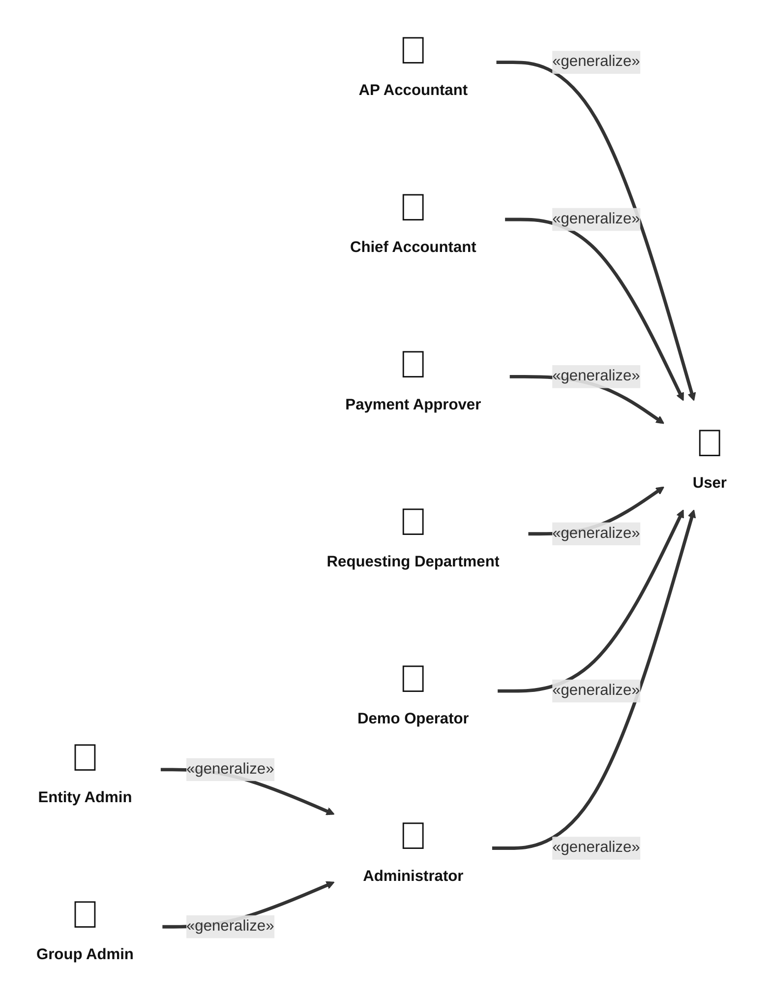

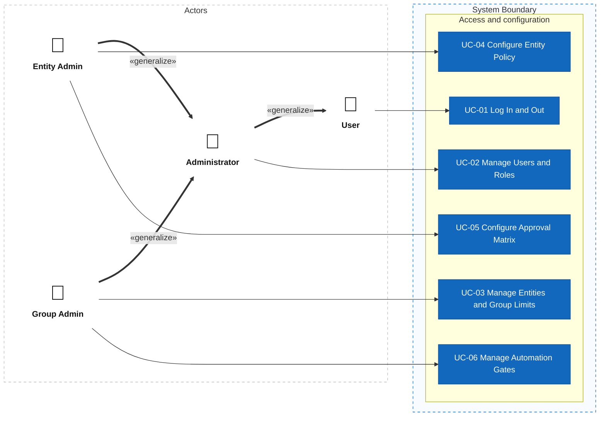


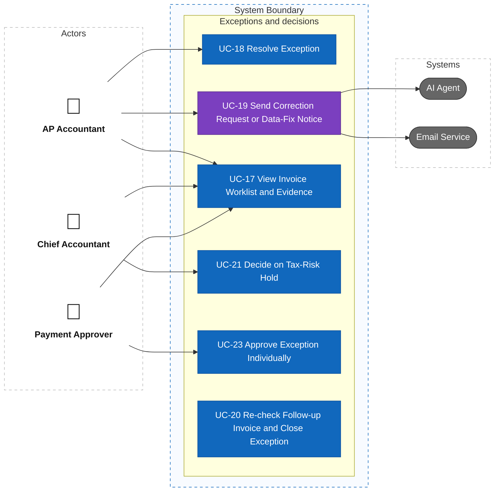

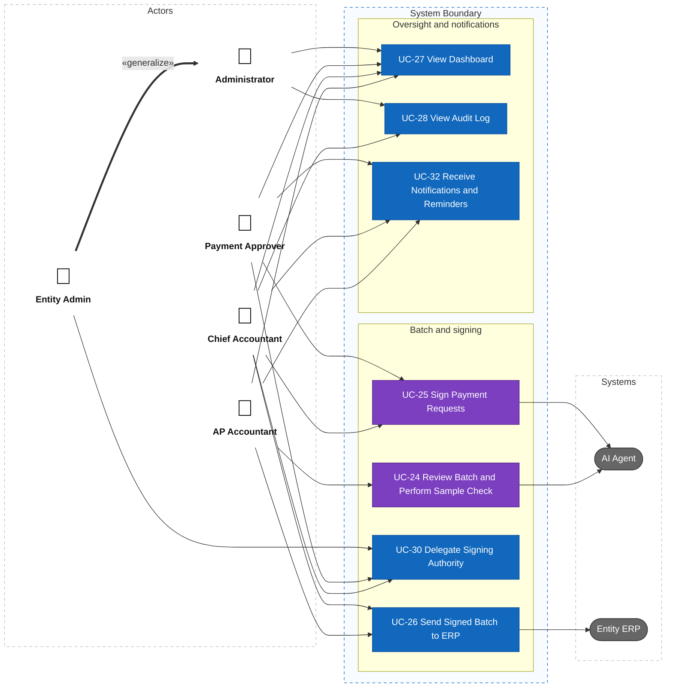

For the actors, the role and use case matrix, and the flows, see [Actors and Use Cases](docs/02-usecases-userstories/01-use-cases.md) and [Use Case Specifications](docs/02-usecases-userstories/02-use-case-specifications.md).

### 1.4 Roles and permissions

| Capability | AP Accountant | Chief Accountant | Payment Approver | Requesting Department | Entity Admin | Group Admin |
|---|---|---|---|---|---|---|
| Log in and out | Yes | Yes | Yes | Yes | Yes | Yes |
| Upload XML invoices, manage recurring profiles | Own entity | No | No | No | No | No |
| Resolve exceptions, send requests to suppliers, run the sample check | Own entity | No | No | No | No | No |
| Decide on tax-risk holds | No | Own entity | No | No | No | No |
| Approve a single exception | No | No | Own entity, own level | No | No | No |
| Confirm the acceptance of a service | No | No | No | Own entity | No | No |
| Name a delegate for signing while absent | No | Own delegation | Own delegation | No | Own entity (view, revoke) | No |
| Sign payment requests | No | Own entity, first | Own entity, own level, second | No | No | No |
| Receive notifications and reminders | Own entity | Own entity | Own entity | No | No | No |
| View the invoice worklist and evidence | Own entity | Own entity (read-only) | Own entity (read-only) | No | No | No |
| View the dashboard | Own entity | Own entity | Own entity | No | Own entity | Per-entity counts and rates |
| View the audit log | No | Own entity | No | No | Own entity | Group events only |
| Manage users and roles | No | No | No | No | Own entity | All entities |
| Configure entity policy and approval matrix | No | No | No | No | Own entity | No |
| Manage entities, group limits, and automation gates | No | No | No | No | No | Yes |

The Demo Operator, who plays the buyer and the warehouse keeper in the ERP simulator, appears only in the demo. The server enforces roles and entity scope; hiding a control in the screen serves only the user interface. The Rule Engine alone admits an invoice to a batch, from stored evidence and without an LLM; the AI supplies evidence and never decides. See [Business rules](docs/requirements/business-rules.md).

## 2. Information Architecture, Screen Hierarchy, and UI/UX

The information architecture places the 30 stories on 45 screens: 22 pages and 23 modals. Each role sees only the pages it may open, and decisions, confirmations, and forms are modals on their parent page.

### 2.1 Information architecture

Solid lines connect a parent page to a child page; dashed arrows show which areas each actor uses; purple cards are pages with AI features.

Finance-side roles: the AP Accountant, the Chief Accountant, the Payment Approver, and the Requesting Department, with the areas each one uses. The Delegations area is drawn again in the second diagram because the Entity Admin reads and revokes delegations.

```mermaid
flowchart TB
    ap["<span style='font-size:40px'>👤</span><br/><b>AP Accountant</b>"]
    ca["<span style='font-size:40px'>👤</span><br/><b>Chief Accountant</b>"]
    pa["<span style='font-size:40px'>👤</span><br/><b>Payment Approver</b>"]
    rd["<span style='font-size:40px'>👤</span><br/><b>Requesting Department</b>"]

    subgraph access["Access"]
        direction TB
        scr01["<b>SCR-01 Login</b><br/>• Email, password<br/>• Goes to the role home page"]
    end

    subgraph prep["AP preparation (AP Accountant)"]
        direction TB
        scr20["<b>SCR-20 Recurring Profiles</b><br/>• Profiles, earlier amounts<br/>• Add, deactivate"]
        scr24["<b>SCR-24 Mailbox Log</b><br/>• Messages and attachments with results<br/>• Fetch now<br/>• Last fetch time or failure"]
        scr30["<b>SCR-30 Batch Review</b><br/>• Close batch, AI sample, OK or Error<br/>• Expand sample, reopen for review<br/>• Release for signing<br/>• Request, ERP send status, resend"]
    end

    subgraph acceptance["Service acceptance (Requesting Department)"]
        direction TB
        scr22["<b>SCR-22 Acceptance Queue</b><br/>• Service invoices waiting for acceptance<br/>• Confirm or reject with a note<br/>• Own entity only"]
    end

    subgraph invoices["Invoices (AP: full · Chief Accountant, Payment Approver: read-only)"]
        direction TB
        scr10["<b>SCR-10 Invoice Worklist</b><br/>• Search by number, supplier, total<br/>• Filters by state, Due soon, source<br/>• Last ERP sync, upload XML only (AP)"]
        scr12["<b>SCR-12 Invoice Detail and Evidence</b><br/>• Document, order, receipt, line matches<br/>• Anomalies, six conditions, authority status<br/>• State history, AI text labelled AI<br/>• Action panel for the role that must decide<br/>• Record a cancellation notice (AP)"]
        scr10 --> scr12
    end

    subgraph decisions["Decisions (Chief Accountant, Payment Approver)"]
        direction TB
        scr40["<b>SCR-40 Decision Queue</b><br/>• CA: tax-risk holds<br/>• PA: exceptions at my level<br/>• Each row opens the invoice"]
    end

    subgraph signing["Signing (Chief Accountant, Payment Approver)"]
        direction TB
        scr50["<b>SCR-50 Signing Queue</b><br/>• Requests to sign, select many<br/>• Sign in one action, On behalf of mark<br/>• ERP status"]
        scr51["<b>SCR-51 Payment Request Detail</b><br/>• AI summary labelled AI<br/>• Totals, large invoices, flags<br/>• Lines, remove, decline, resend<br/>• Paid status and reference"]
        scr50 --> scr51
    end

    subgraph delegations["Signing delegations (Chief Accountant, Payment Approver; Entity Admin reads and revokes)"]
        direction TB
        scr55["<b>SCR-55 Signing Delegations</b><br/>• Delegations given and received<br/>• New delegation, revoke<br/>• Scheduled, Active, Ended, Revoked"]
    end

    subgraph notifications["Notifications (AP Accountant, Chief Accountant, Payment Approver)"]
        direction TB
        scr62["<b>SCR-62 Notifications</b><br/>• Own notices and reminders<br/>• Unread count in the top bar<br/>• Each item opens its object"]
    end

    subgraph oversight["Oversight"]
        direction TB
        scr60["<b>SCR-60 Dashboard</b><br/>• Touchless rate and AI misplacement rate<br/>• Exception backlog by state and age<br/>• Group Admin: per-entity figures only"]
        scr61["<b>SCR-61 Audit Log</b><br/>• AI, rule, human, signature entries<br/>• Filters, read-only<br/>• Group Admin: group events only"]
    end

    scr30 --> scr12
    scr40 --> scr12
    scr51 --> scr12
    scr62 --> scr12
    scr62 --> scr30
    scr62 --> scr50
    scr62 --> scr51

    ap -.-> access
    ap -.-> invoices
    ap -.-> prep
    ap -.-> notifications
    ap -.-> oversight
    ca -.-> access
    ca -.-> invoices
    ca -.-> decisions
    ca -.-> signing
    ca -.-> delegations
    ca -.-> notifications
    ca -.-> oversight
    pa -.-> access
    pa -.-> invoices
    pa -.-> decisions
    pa -.-> signing
    pa -.-> delegations
    pa -.-> notifications
    pa -.-> oversight
    rd -.-> access
    rd -.-> acceptance

    classDef actor fill:none,stroke:none,color:#111
    classDef screen fill:#fff,color:#111,stroke:#1168bd,text-align:left
    classDef ai fill:#f3ecfb,color:#111,stroke:#7b3fbf,text-align:left
    class ap,ca,pa,rd actor
    class scr01,scr10,scr20,scr22,scr24,scr40,scr50,scr55,scr60,scr61,scr62 screen
    class scr12,scr30,scr51 ai
```

Administration and demo: the Entity Admin, the Group Admin, and the Demo Operator, with the areas each one uses. Access and Oversight are drawn again because the finance roles share them.

```mermaid
flowchart TB
    entityAdmin["<span style='font-size:40px'>👤</span><br/><b>Entity Admin</b>"]
    groupAdmin["<span style='font-size:40px'>👤</span><br/><b>Group Admin</b>"]
    demo["<span style='font-size:40px'>👤</span><br/><b>Demo Operator</b>"]

    subgraph access["Access"]
        direction TB
        scr01["<b>SCR-01 Login</b><br/>• Email, password<br/>• Goes to the role home page"]
    end

    subgraph oversight["Oversight"]
        direction TB
        scr60["<b>SCR-60 Dashboard</b><br/>• Touchless rate and AI misplacement rate<br/>• Exception backlog by state and age<br/>• Group Admin: per-entity figures only"]
        scr61["<b>SCR-61 Audit Log</b><br/>• AI, rule, human, signature entries<br/>• Filters, read-only<br/>• Group Admin: group events only"]
    end

    subgraph delegations["Signing delegations (Chief Accountant, Payment Approver; Entity Admin reads and revokes)"]
        direction TB
        scr55["<b>SCR-55 Signing Delegations</b><br/>• Delegations given and received<br/>• New delegation, revoke<br/>• Scheduled, Active, Ended, Revoked"]
    end

    subgraph useradmin["User administration"]
        direction TB
        scr70["<b>SCR-70 Users</b><br/>• Users, roles, ERP link<br/>• Create, deactivate<br/>• Group Admin: entity filter"]
    end

    subgraph entityconfig["Entity configuration (Entity Admin)"]
        direction TB
        scr73["<b>SCR-73 Entity Policy</b><br/>• Tolerance, batch threshold<br/>• Sample rate, grouping mode<br/>• Group limit beside each field"]
        scr74["<b>SCR-74 Approval Matrix</b><br/>• Tiers, levels, approvers<br/>• Gap and overlap errors"]
    end

    subgraph groupadmin["Group administration (Group Admin)"]
        direction TB
        scr75["<b>SCR-75 Group Overview</b><br/>• Entities, open and closed gates<br/>• Gate alerts<br/>• Last ERP sync per entity"]
        scr76["<b>SCR-76 Entities and Group Limits</b><br/>• Entities, group maximums<br/>• Non-coded invoice sectors"]
        scr78["<b>SCR-78 Automation Gates</b><br/>• Pair state, compared count<br/>• Accuracy against 98%<br/>• Open or close"]
    end

    subgraph demoarea["Demo only"]
        direction TB
        scr80["<b>SCR-80 ERP Simulator</b><br/>• Entity and persona<br/>• Purchase orders, receipts<br/>• Marked Demo only"]
    end


    entityAdmin -.-> access
    entityAdmin -.-> oversight
    entityAdmin -.-> useradmin
    entityAdmin -.-> entityconfig
    entityAdmin -.-> delegations
    groupAdmin -.-> access
    groupAdmin -.-> oversight
    groupAdmin -.-> useradmin
    groupAdmin -.-> groupadmin
    demo -.-> access
    demo -.-> demoarea

    classDef actor fill:none,stroke:none,color:#111
    classDef screen fill:#fff,color:#111,stroke:#1168bd,text-align:left
    classDef ai fill:#f3ecfb,color:#111,stroke:#7b3fbf,text-align:left
    class entityAdmin,groupAdmin,demo actor
    class scr01,scr55,scr60,scr61,scr70,scr73,scr74,scr75,scr76,scr80 screen
    class scr78 ai
```

### 2.2 Screen hierarchy

| Role | Home page after login | Sidebar pages |
|---|---|---|
| AP Accountant | Invoice Worklist | Invoices, Batch, Mailbox, Recurring profiles, Notifications, Dashboard |
| Chief Accountant | Decision Queue | Decisions, Signing queue, Delegations, Invoices (read-only), Notifications, Dashboard, Audit log |
| Payment Approver | Signing Queue | Signing queue, Approvals, Delegations, Invoices (read-only), Notifications, Dashboard |
| Requesting Department | Acceptance Queue | Acceptance queue |
| Entity Admin | Entity Policy | Entity policy, Approval matrix, Users, Delegations, Dashboard, Audit log |
| Group Admin | Group Overview | Group overview, Automation gates, Entities and limits, Users, Dashboard, Audit log |
| Demo Operator | ERP Simulator (demo only) | ERP simulator |

Login takes each role to its home page; lists open full detail pages, and decisions, forms, and confirmations are modals on their parent page. Screen IDs and the requirement-to-screen mapping are in the [Screen Inventory](docs/03-information-architecture/04-screen-inventory.md), and the flows are in [Primary User Flows](docs/03-information-architecture/05-user-flows.md).

### 2.3 Current UI design

The design concept is "three hands": what the AI proposed, what the Rule Engine decided, and what a person decided or signed are always distinguishable. The full gallery of every screen and state is `docs/04-uiux/wireframes/index.html`; open it in a browser from a local clone.

#### Invoice worklist (AP Accountant, SCR-10)

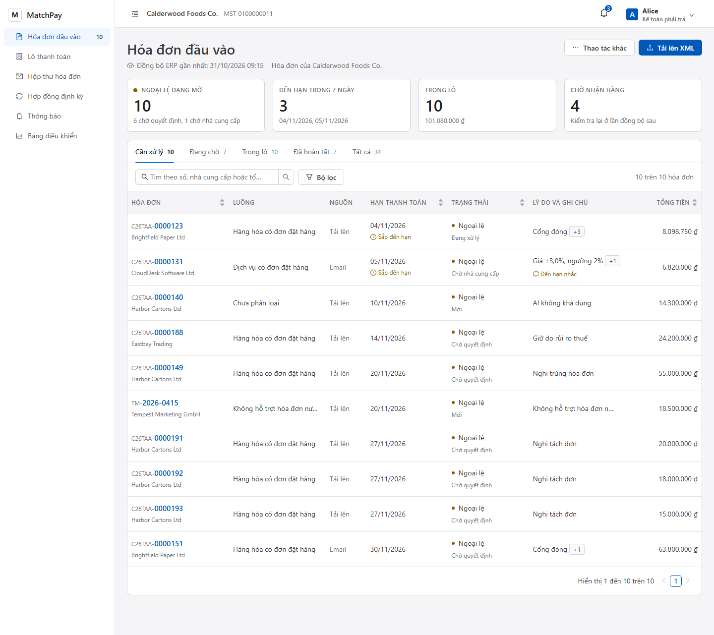

Every state chip, reasons with numbers, "Due soon", and the sync time.

#### Invoice detail with evidence (SCR-12)

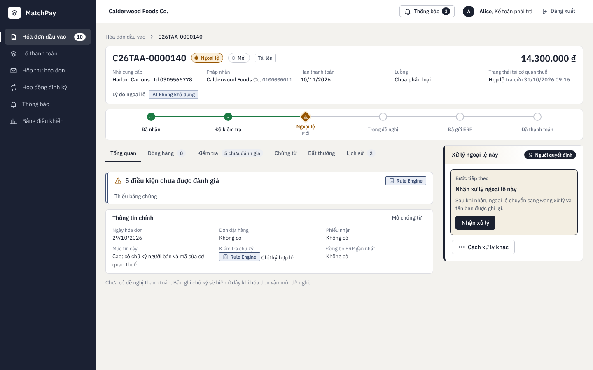

AI evidence, the six conditions with values, line matches, the decision history, and an action panel for the role.

#### Batch review (SCR-30)

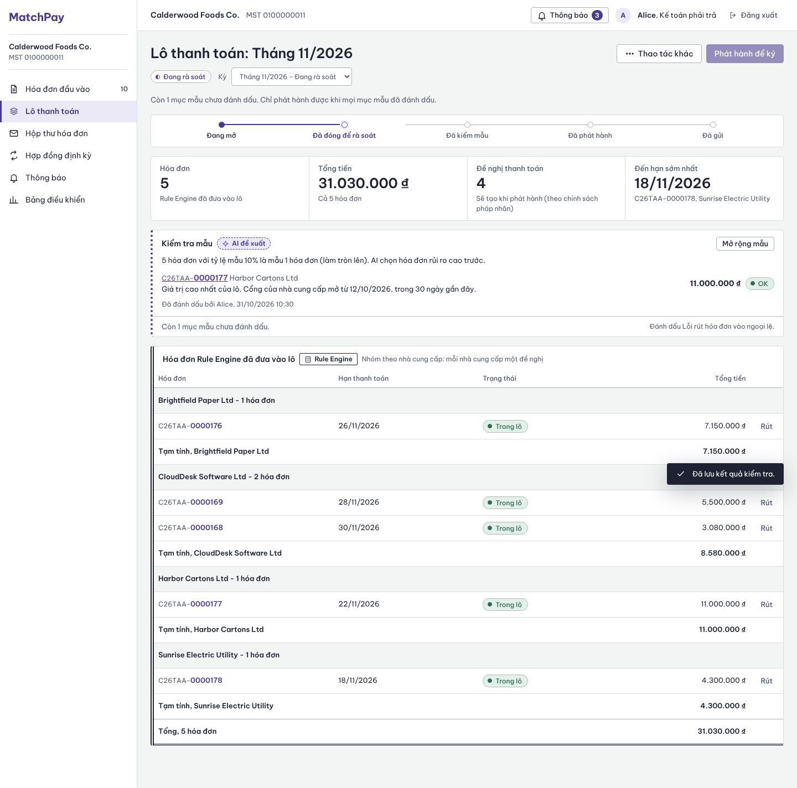

The AI-selected sample that the AP Accountant marks before release.

#### Payment request (Chief Accountant, SCR-51)

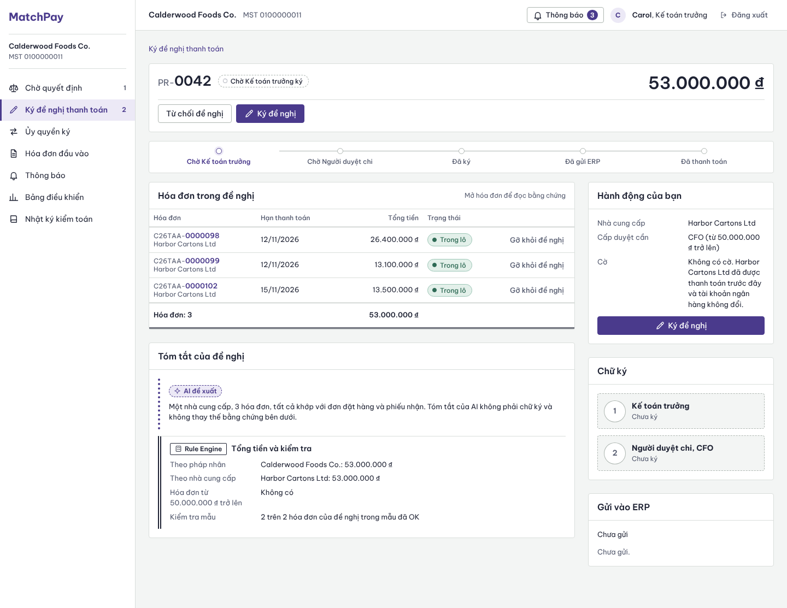

The AI summary labelled as AI, Rule Engine totals, and the signature records.

## 3. C4 Architecture

This README presents C1–C3. C4 Level 4 is in the architecture documentation.

### C1 — System Context

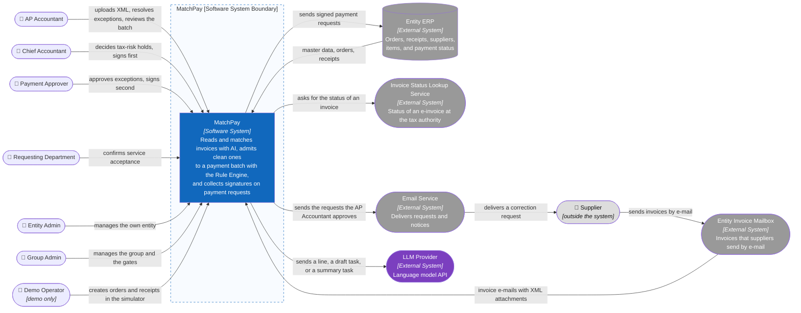

### C2 — Container


### C3 — Component

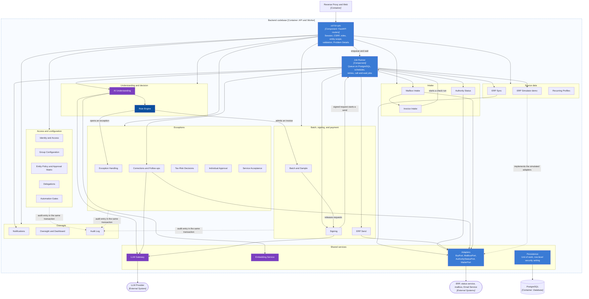

Complete documentation: [Architecture index](docs/07-architecture/README.md), [Tech stack](docs/07-architecture/05-tech-stack.md), and [LLM provider](docs/07-architecture/06-llm-provider.md).

## 4. Database Diagrams and OpenAPI 3.0 Contract

The database defines the persistence contract, and the API defines the HTTP contract that the web application uses.

### 4.1 Database diagrams

The PostgreSQL 16 model, with the pgvector extension, has 74 tables in twelve groups. Every business row carries its entity, every AI output and every Rule Engine condition is stored with its values and versions, and the audit log is append-only. The diagram shows the tables that carry an invoice from upload to payment.

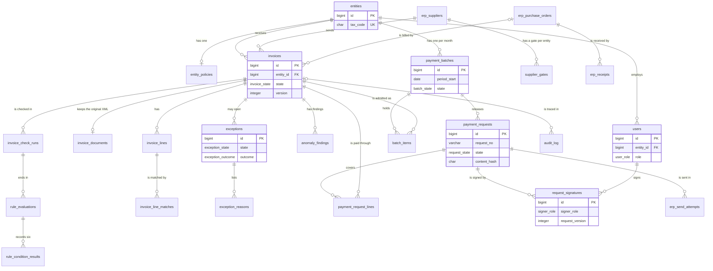

See the [data model](docs/05-database/01-data-model.md), the [full ER diagram](docs/05-database/02-er-diagram.md), and the [DBML schema](docs/05-database/matchpay.dbml).

### 4.2 OpenAPI 3.0 API documentation

The HTTP contract (draft for review) is written first and is the source of truth for paths, bodies, roles, and errors. Every operation names the stories, business rules, screens, and tables it serves.

```text
OpenAPI 3.0.4
121 operations on 104 paths, 24 tags
Cookie session (HttpOnly) with a CSRF header
Errors as Problem Details with a stable errorCode
Idempotency-Key on signing, release, and resend
Optimistic concurrency with version
202 with a run id for work that continues in the background
```

- [OpenAPI 3.0.4 specification](docs/06-api/openapi.yaml)
- [API documentation](docs/06-api/README.md)

## 5. Frontend and Backend Folder Structures

### 5.1 Current repository layout

No source code exists yet. The repository holds documents, the checker script, and the lint configuration.

```text
MatchPay/
├── docs/
│   ├── 01-research/               # Problem, goals, stakeholders, similar products, scope, risks
│   ├── 02-usecases-userstories/   # Use cases, user stories (INVEST), acceptance criteria, MoSCoW
│   ├── 03-information-architecture/  # Sitemap, routes, navigation, screen inventory, flows, UI states
│   ├── 04-uiux/                   # Design system, screen notes, HTML wireframes
│   ├── 05-database/               # Data model, ER diagram, DBML schema
│   ├── 06-api/                    # OpenAPI contract and API traceability
│   ├── 07-architecture/           # C4 levels 1-4, tech stack, LLM provider, runtime
│   ├── requirements/              # Business rules
│   ├── traceability/              # Master traceability matrix
│   ├── images/                    # Role-based wireframe screenshots and the feature mind map
│   ├── handoff/                   # Session handoff and research log
│   └── mindmap.md                 # Product mind map and feature map F01-F12
├── tools/
│   └── check_docs.py              # Documentation checks
├── redocly.yaml                   # OpenAPI lint configuration
└── README.md
```

### 5.2 Target frontend structure

Target, not yet implemented. The web application is React with TypeScript, built with Vite, with React Router in history mode and TanStack Query for server state. API types are generated from `docs/06-api/openapi.yaml`.

```text
web/
├── src/
│   ├── app/            # Routes, providers, role home pages, sidebar
│   ├── features/       # One folder per screen area: invoices, batch, signing, delegations,
│   │                   # decisions, acceptance, mailbox, profiles, notifications,
│   │                   # dashboard, audit, users, entity-config, group-admin, simulator
│   ├── components/     # Shared layout, tables, state chips, AI / rule / person labels
│   ├── api/            # Types generated from openapi.yaml and the shared client
│   └── styles/         # Tokens from the UI/UX design system
└── tests/              # End-to-end tests of the user flows
```

### 5.3 Target backend structure

Target, not yet implemented. The backend is a Python 3.12 FastAPI modular monolith: one codebase run as an `api` process and a `worker` process in front of PostgreSQL 16 with pgvector. There is one module per C3 component, and the module names follow the tags of `openapi.yaml`.

```text
backend/
├── matchpay/
│   ├── http_api/                    # Routers, session and CSRF, Problem Details
│   ├── job_runner/                  # Queue on PostgreSQL, schedules, retries
│   ├── identity_and_access/
│   ├── group_configuration/
│   ├── entity_policy_and_approval_matrix/
│   ├── delegations/
│   ├── automation_gates/
│   ├── erp_sync/
│   ├── erp_simulator/               # Demo only
│   ├── recurring_profiles/
│   ├── invoice_intake/
│   ├── mailbox_intake/
│   ├── authority_status/
│   ├── ai_understanding/
│   ├── rule_engine/
│   ├── exception_handling/
│   ├── corrections_and_follow_ups/
│   ├── tax_risk_decisions/
│   ├── individual_approval/
│   ├── service_acceptance/
│   ├── batch_and_sample/
│   ├── signing/
│   ├── erp_send/
│   ├── notifications/
│   ├── oversight_and_dashboard/
│   ├── audit_log/
│   ├── llm_gateway/
│   ├── embedding_service/
│   ├── adapters/                    # ErpPort, MailboxPort, AuthorityStatusPort, MailerPort
│   └── persistence/                 # Unit of work, row-level security setting
├── migrations/                      # Alembic, written to match matchpay.dbml
└── tests/
```

Dependency rules:

```text
A business module calls another only through its public interface; it never writes another module's tables
Rule Engine -> stored AI evidence, policy, gates, tax-risk data; never the LLM Gateway or the Embedding Service
Only the worker process starts the model, the embedding, and the adapters
Every state-changing path ends in Audit Log inside the caller's transaction
```

The detailed code structure design is still open. See [Component](docs/07-architecture/03-component.md), [Tech stack](docs/07-architecture/05-tech-stack.md), and [Runtime and deployment](docs/07-architecture/07-runtime-and-deployment.md).

## 6. Detailed Class and Sequence Design

Detailed design follows the C4 components and covers the two features where a mistake costs the most, plus the main runtime paths. These are target design views.

### 6.1 C4 Level 4 — Code

#### L4.1 Rule Engine — the six conditions (US-16)

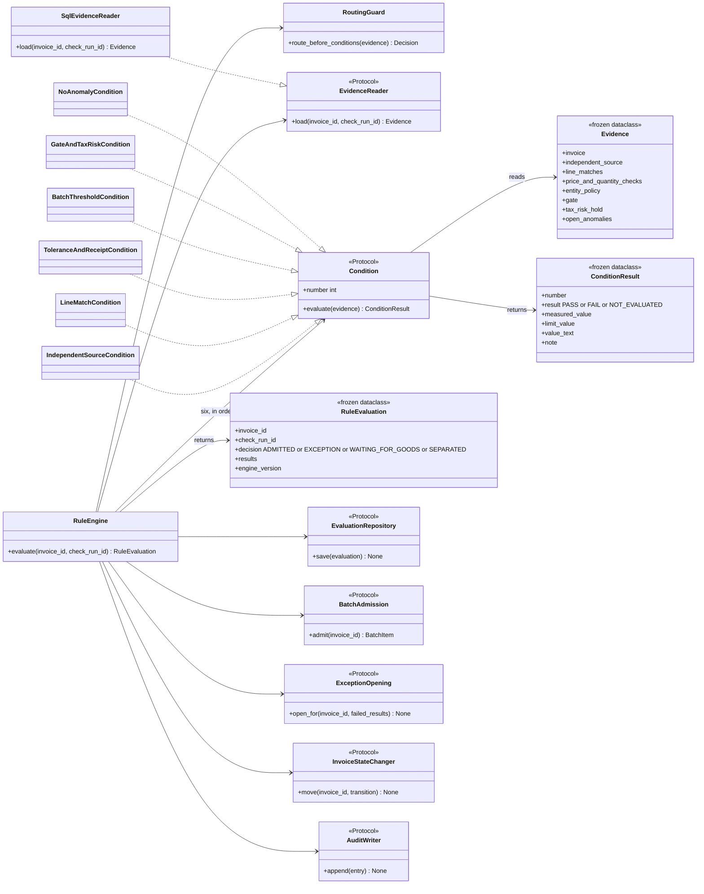

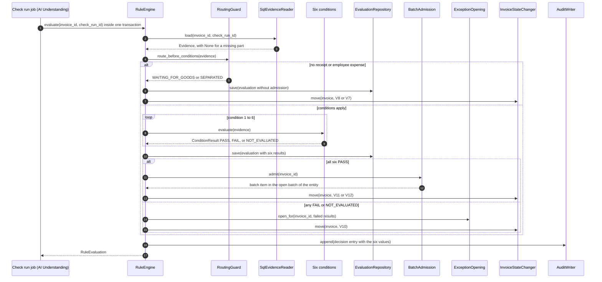

#### L4.2 Signing many payment requests in one action (US-25)

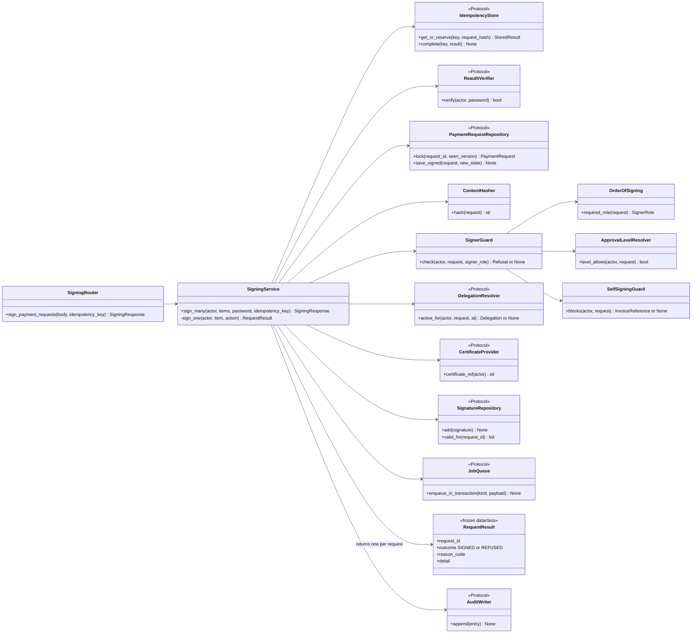

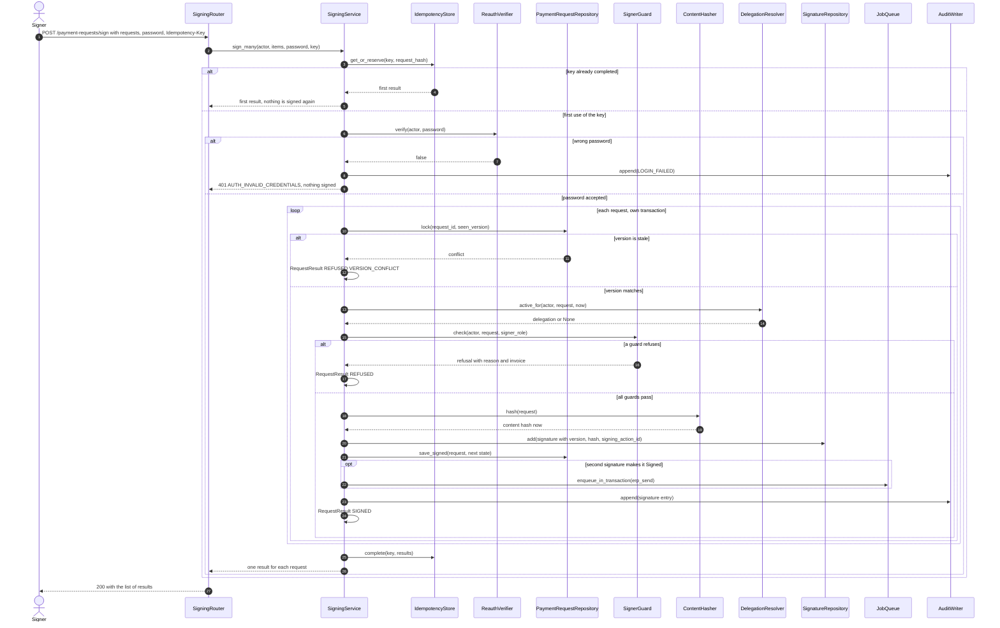

Source: [C4 Level 4 — Code](docs/07-architecture/04-code.md)

### 6.2 Runtime sequences

#### XML upload to the Rule Engine decision

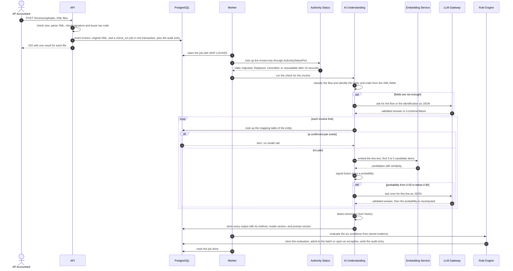

#### Batch release, signing, and sending to the ERP

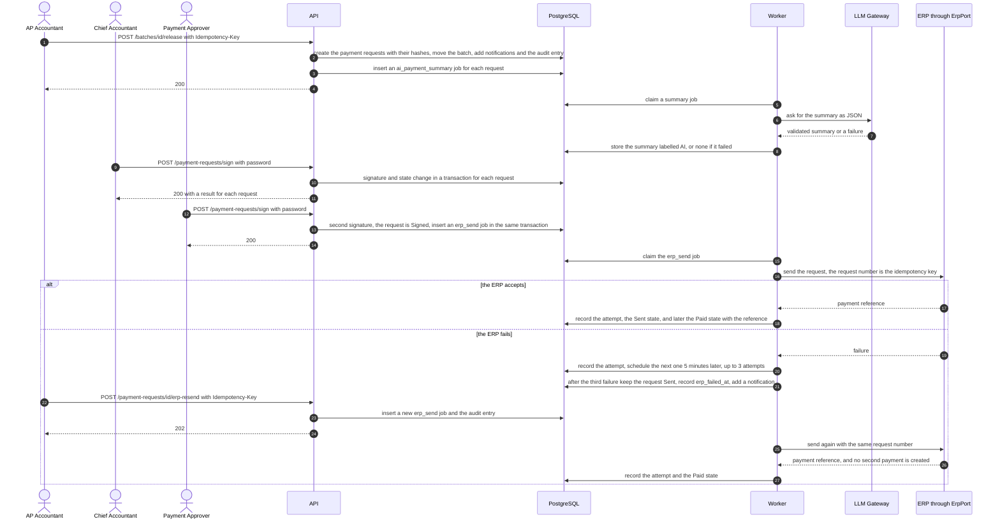

Source: [Runtime and Deployment](docs/07-architecture/07-runtime-and-deployment.md)

## Interactive prototype

A Vietnamese, clickable front end on mock data lives in [`prototype/`](prototype/README.md) (React, TypeScript, Vite, Ant Design 5; the mock API runs in the browser and follows the OpenAPI operation names). It sits next to the English wireframes, which stay the design reference. D-187, D-197, D-205, D-212, D-222, and D-230 are the user's decisions; D-188..D-196, D-198..D-204, D-206..D-211, D-213..D-221, D-223..D-229, and D-231..D-241 are calls that await the user's review (D-212 asks for a neutral enterprise look that sits next to a company ERP, and D-213..D-221 are how it was built; D-222 asks for a Three-way match view on the invoice detail page, and D-223..D-229 are how it was first built; D-230 replaces its table with a popup over the three source documents, and D-231..D-241 are how that was built): see [the UI/UX decisions](docs/04-uiux/00-decisions.md). Screenshots by role are in [`docs/images/prototype/`](docs/images/prototype/).

```bash
cd prototype
npm install
npm run dev
```

## Documentation

- Research: [Context and problem](docs/01-research/01-context-and-problem.md), [Goals and metrics](docs/01-research/02-goals-and-metrics.md), [Stakeholders](docs/01-research/03-stakeholders.md), [Similar products](docs/01-research/04-similar-products.md), [MVP scope](docs/01-research/05-scope.md), [Risks](docs/01-research/06-risks.md), [AI vs rule-based](docs/01-research/07-ai-vs-rule-based.md), [Glossary](docs/01-research/08-glossary.md), [Decisions](docs/01-research/00-decisions.md), [Future work](docs/01-research/09-future-work.md), [Regulatory context](docs/01-research/10-regulatory-context.md), [Invoice flows and data](docs/01-research/11-invoice-flows-and-data.md).
- Requirements: [Actors and use cases](docs/02-usecases-userstories/01-use-cases.md), [Use case specifications](docs/02-usecases-userstories/02-use-case-specifications.md), [User stories (INVEST)](docs/02-usecases-userstories/03-user-stories-invest.md), [Acceptance criteria](docs/02-usecases-userstories/04-acceptance-criteria.md), [MoSCoW](docs/02-usecases-userstories/05-moscow-prioritization.md), [Decisions and defaults](docs/02-usecases-userstories/00-decisions.md).
- Requirements catalogs: [Business rules](docs/requirements/business-rules.md).
- Information architecture: [Information architecture index](docs/03-information-architecture/README.md), [Decisions and defaults](docs/03-information-architecture/00-decisions.md), [Sitemap](docs/03-information-architecture/01-sitemap.md), [Routes and permissions](docs/03-information-architecture/02-routes-and-permissions.md), [Navigation](docs/03-information-architecture/03-navigation.md), [Screen inventory](docs/03-information-architecture/04-screen-inventory.md), [User flows](docs/03-information-architecture/05-user-flows.md), [UI states and accessibility](docs/03-information-architecture/06-ui-states-and-accessibility.md).
- Wireframes: [Wireframe gallery](docs/04-uiux/wireframes/index.html), [UI/UX index](docs/04-uiux/README.md), [Decisions and defaults](docs/04-uiux/00-decisions.md), [Design system](docs/04-uiux/01-design-system.md), [Screen notes and states](docs/04-uiux/02-screen-notes.md).
- Database: [Database index](docs/05-database/README.md), [Decisions and defaults](docs/05-database/00-decisions.md), [Data model](docs/05-database/01-data-model.md), [ER diagram](docs/05-database/02-er-diagram.md), [DBML schema](docs/05-database/matchpay.dbml).
- API: [API index](docs/06-api/README.md), [Decisions and defaults](docs/06-api/00-decisions.md), [OpenAPI contract](docs/06-api/openapi.yaml), [API traceability](docs/06-api/01-api-traceability.md).
- Architecture: [Architecture index](docs/07-architecture/README.md), [Decisions and defaults](docs/07-architecture/00-decisions.md), [System context](docs/07-architecture/01-system-context.md), [Container](docs/07-architecture/02-container.md), [Component](docs/07-architecture/03-component.md), [Code](docs/07-architecture/04-code.md), [Tech stack](docs/07-architecture/05-tech-stack.md), [LLM provider](docs/07-architecture/06-llm-provider.md), [Runtime and deployment](docs/07-architecture/07-runtime-and-deployment.md).
- Traceability: [Master traceability matrix](docs/traceability/master-traceability.md).

## Project Progress

- [x] Define the problem, measurable goals, stakeholders, and user roles (approved)
- [x] Compare similar products, define the MVP scope, risks, and AI vs rule-based reasoning (approved)
- [x] Draw the product mind map (approved)
- [x] Write the use cases and the use case diagram (approved)
- [x] Write user stories following INVEST (approved)
- [x] Write acceptance criteria (Given/When/Then) and business rules (approved)
- [x] Prioritize the backlog with MoSCoW (approved)
- [x] Design the information architecture, sitemap per role, and user flows (approved)
- [x] Design the UI/UX wireframes, including AI states and a design system (approved)
- [x] Design the database (approved)
- [x] Write the API documentation in OpenAPI 3.0 (draft for review)
- [x] Design the C4 model and choose the tech stack and LLM provider (draft for review)
- [ ] Design the code structure
- [ ] Implement the modules

