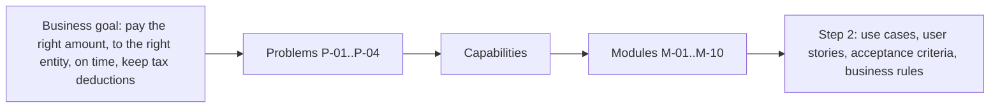

# Context and Problem

> Design status: MVP — Step 1 of 9, draft for review
>
> Implementation status: NOT STARTED

## Context

MatchPay is a shared platform for a **group of several companies**, where each company is a separate legal entity. Today each entity buys goods, receives invoices, and approves payments in its own way. The finance team of each entity is the direct beneficiary. The operations teams (buyers, warehouse keepers, the people who accept services) are a data source: they keep working in the ERP and warehouse software as before, and their data is synced into MatchPay.

The target customer is a group, or a company with several legal entities, that **already has an order process** (purchase orders and goods receipts). This documentation uses one fictional sample throughout: **Calderwood Group** with three fictional entities, Calderwood Foods Co., Calderwood Packaging Co., and Calderwood Retail Co. (D-05). The real source documents (invoices, laws, supplier names) are Vietnamese; all samples here are English equivalents (D-01).

### How an invoice is handled today

As described in the brief:

| Step | What happens today | Pain |
|---|---|---|
| 1 | A buyer creates a purchase order in the entity's ERP. | |
| 2 | A warehouse keeper confirms the goods received, or a person confirms that a service was delivered. | |
| 3 | The supplier sends an invoice: an XML file for a domestic invoice, a PDF for a foreign one. | A seller can edit a PDF and send it by email or Zalo. |
| 4 | An AP Accountant compares the invoice with the purchase order and the receipt, line by line, and converts units by hand. | P-01, P-02 |
| 5 | The accountant checks, if at all, whether the seller is on a tax-risk list and whether the buyer on the invoice is the right entity. | P-03 |
| 6 | Approval to pay is asked for by email or Zalo. There is no approval matrix per entity. | P-04 |
| 7 | Payment is made. Duplicate or late payments are found afterwards. | P-04 |

## Problem statement

> A group of legal entities approves payment of incoming invoices by hand, entity by entity. Matching an invoice with its order and receipt is slow and fails on differing item names and units, invoices from risky sellers or addressed to the wrong entity cost the entity its tax deduction, and approvals travel by email and chat without an approval matrix. As a result the group pays wrongly, pays late, pays twice, and cannot see or control order splitting.

| ID | Problem | Root cause | Consequence |
|---|---|---|---|
| P-01 | Matching an invoice with the purchase order and goods receipt is done by hand, and exceptions take most of the effort. | The order, the receipt, and the invoice sit in different systems and files; there is no automatic comparison, so each difference means a manual search and an email. | A large share of invoices still needs a person. Published touchless averages range from about one third to 60%, depending on source and definition (see [Goals and metrics](02-goals-and-metrics.md)). |
| P-02 | Item names and units of measure differ between the documents. | The supplier writes item names as free text, and the units differ (a carton on the invoice, a ream on the receipt). A rule that compares strings fails. | The accountant checks each line by hand. |
| P-03 | Invoices come from tax-risky suppliers, or are issued to the wrong buying entity. | There is no automatic check of the buyer tax code against the ordering entity, and no check of the seller against a risk list when the invoice arrives. The risk list is large and compiled from several sources: one vendor counts more than 6,042 high-risk businesses on 2026-09-22 (a compilation, not an official list). | The expense is disallowed and the VAT deduction is lost. |
| P-04 | Payment is approved by email and Zalo, with no approval matrix per entity. | There is no shared record of who may approve what amount in which entity, and no view across orders. | Late and duplicate payments, and no control over splitting an order to stay under an approval threshold. |

## Value

The value is not only speed. It is four things that people cannot do reliably today even with time:

1. **Do not pay wrongly:** catch duplicate invoices, excess quantities, and wrong prices.
2. **Do not lose the tax deduction:** hold invoices from risky sellers and invoices issued to the wrong entity.
3. **Detect fraud:** order splitting to avoid a threshold, and prices far from what the group's other entities pay.
4. **Give the signer grounds:** instead of signing blind or looking at every invoice, the signer sees a summary with evidence.

## Why now

The brief's original argument ("from 2025-06-01 businesses with revenue from VND 1 billion must use coded e-invoices") did not hold up and is replaced (D-15, D-16). The rationale that holds, from sources read on 2026-10-31:

1. **Structured input already exists.** E-invoicing between businesses has been mandatory since 2022 (L-01), so a domestic purchase invoice is an XML file at field level and needs no OCR. Item names are still free text typed by the seller, so AI is still needed to understand them.
2. **The rules were reset on 2026-07-01.** A coded e-invoice is now the general rule, with non-coded invoices limited to listed sectors (L-02, L-03). Systems that read invoices must follow the new base.
3. **Paying has a tax consequence.** A purchase of VND 5 million or more keeps its VAT deduction only if it is paid by non-cash means (L-12). Approval and payment are no longer separate from the tax goal.
4. **Risky sellers are numerous,** and a buyer who cannot prove a real transaction loses the deduction (L-08).

This page does not claim that 2026 "made" invoices structured; they already were.

## Product vision

MatchPay turns every incoming invoice into a checked document with evidence. AI helps at eight points: it classifies the flow, reads the document, identifies the entity and the order, matches lines, detects anomalies, explains and drafts exception handling, selects the sample for the sample check, and summarises the batch for the signer (see [AI vs rule-based](07-ai-vs-rule-based.md)).

**The AI provides evidence, the Rule Engine decides, and a person signs and is accountable.** The AI never signs, never decides whether an invoice joins a batch, and never sends anything outside the system by itself.

## Top-down decomposition

| Business goal | Problem | Capability | Modules | Measured by |
|---|---|---|---|---|
| Pay the right amount | P-01 | Automatic comparison of invoice, order, and receipt, with each invoice classified into the right flow | M-03, M-04, M-05, M-06, M-07 | G-01, G-02, G-05 |
| Pay the right amount | P-02 | Meaning-based line matching that learns from confirmations (mapping table, embedding, signal-fusion model, LLM only for the rest) | M-06, M-08 | G-02, G-07 |
| Pay the right entity and keep deductions | P-03 | Buyer check against the ordering entity; hold on risky sellers; duplicate and split-order detection | M-05, M-06, M-07, M-08 | G-02, G-03, G-04 |
| Pay on time, under control | P-04 | Approval matrix per entity; batch of consolidated requests per supplier; sample check; separation of duties; audit log | M-01, M-02, M-09, M-10 | G-01, G-02, G-06 |

The same chain, from problem to goal to module, is kept in the [problem traceability](../traceability/master-traceability.md) table that Step 2 completes down to use cases, stories, acceptance criteria, and business rules.

**Related:** [Step index](README.md)
