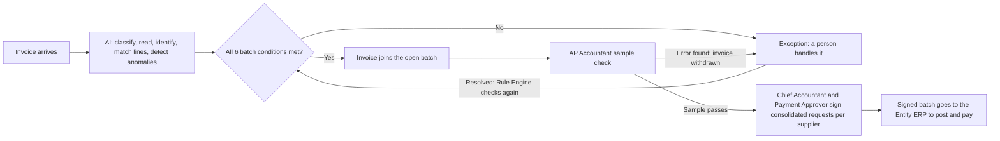

# Invoice Flows and Data

> Design status: MVP — Step 1 of 9, draft for review
>
> Implementation status: NOT STARTED

This page describes what arrives, what it is compared with, how far it is trusted, and the path one invoice takes. It states the brief's design and marks where a Step 1 decision (D-xx) or an open item (O-xx) changes it. The real source documents are Vietnamese; every sample value in these documents is an English equivalent.

## Invoice types and the documents they are matched against

Every incoming invoice is first classified into a flow. An invoice with no purchase order is not an error; it is sent to the right flow.

| # | Flow | Matched against | Scope |
|---|---|---|---|
| F-01 | Domestic goods | Purchase order + goods receipt note | MVP |
| F-02 | Domestic services | Purchase order + service acceptance record (confirmed in the system) | MVP |
| F-03 | Software subscription | Subscription profile + card transaction. When the card is charged first, the invoice is confirmed afterwards and a wrong charge leads to a refund request. | Advanced. In the MVP a fixed-price subscription follows a recurring profile (F-06). |
| F-04 | Foreign invoice (PDF; Advanced, D-33) | As F-01 or F-02 by type. A person confirms every field. Imported goods need the customs declaration and the proof of paying import-stage VAT. A service needs foreign contractor tax handled before payment. | Advanced (W-19, W-20). The user removed it from the MVP (D-33); the brief had it as "level A". In the MVP a PDF is rejected at upload, and a foreign invoice that still arrives is an "Unsupported: foreign invoice" exception (BR-17). |
| F-05 | Travel and hotel booked through agents | Approved booking request + trip confirmation | Advanced |
| F-06 | Recurring invoice without a purchase order (electricity, water, office rent) | Recurring profile (contract, fixed or usage-based price) + the history of earlier periods | MVP |
| F-07 | Employee expense without a booking request | Separated into a list waiting for a reimbursement file | Classified only; processing is out of scope (BR-23) |
| F-08 | Other documents: paper invoices printed by the tax authority, purchase lists for goods bought without an invoice | The accountant enters them by hand, always through a person | Advanced |

Invoices from F-07 are not exceptions and are left out of the G-01 denominator (D-14).

## Five groups of input data

| Group | Contents | In the demo |
|---|---|---|
| Transaction documents | Purchase orders, goods receipt notes, service acceptance records, subscription profiles, invoices | Purchase orders, receipts, and acceptances sync from the simulated ERP; the AP Accountant creates recurring profiles; sample XML invoices are uploaded |
| Master data | Entities, suppliers, goods and services, units of measure and their conversions | Syncs from the simulated ERP |
| Policy configuration | Group limits, approval matrix, tolerances, thresholds, sample-check rate | Set by the Administrator |
| External data | List of high-risk businesses for tax, card transactions | Simulated. Each risk-list entry carries a source and a date (D-21). |
| Accumulated data | Mapping table, price history, supplier reliability, sample-check results | Generated by the system |

The Entity ERP is the source of truth for purchase orders, receipts, acceptances, suppliers, and master data. MatchPay reads and never edits them. A sync that runs twice creates no duplicates, and every record keeps its sync time (BR-25).

## Source trust

The level of trust in the source decides how far an invoice can go without a person.

| Level | Source | Can join a batch without a person viewing each invoice? |
|---|---|---|
| High | XML with a digital signature and a tax-authority code | Yes, if all six batch conditions are met |
| Signed non-coded XML | XML with the seller's digital signature but no tax-authority code, from a sector listed in configuration (electricity is one, L-03). The signature confirms origin. A matching recurring profile is the independent source. | Only with a matching recurring profile and if all six batch conditions are met. Fixed price: the amount must equal the contract. Usage-based price: the profile gives only a plausibility check through the deviation threshold, not independent confirmation of the amount (D-24, O-16). No matching profile: exception. |
| Medium | PDF confirmed by an independent source (for example a matching card transaction and subscription profile). Not accepted in the MVP (D-33). | Possibly, after the automation gate has opened, with a low amount limit (Advanced, W-03) |
| Low | PDF with no independent source, scanned image, paper document. Not accepted in the MVP: the upload rejects it with "Only XML e-invoices are accepted in the MVP" (BR-17, D-33). | No (Advanced, W-19) |

Two points follow from research:

- **Non-coded XML (D-24).** Under the e-invoice rules in force since 2026-07-01, some consumer-facing sectors, including electricity, may issue invoices without a tax-authority code (L-03). The High level would then never apply to them, so they get their own level, "Signed non-coded XML", in the table above. **Limit, stated plainly:** for a usage-based price the recurring profile is only a plausibility check, not an independent confirmation of the amount, so an invoice of that kind can join a batch with its amount confirmed by nothing but its own history. This is a call for the user to review (O-16).
- **PDF next to XML (BR-18, Advanced).** In the MVP only XML is accepted, so no PDF is compared. With PDF intake (W-19), when the original XML can be obtained, the system does not accept the PDF as a data source, because a seller can edit a file and send it by email or Zalo (L-19). When PDF and XML of one invoice differ in an amount, a quantity, or a tax code, the invoice is flagged as suspected fraud.

The MVP accepts XML only (BR-17, D-33). With PDF intake (W-19), a foreign PDF would have Low or no independent trust, a person would confirm every field, and the invoice would never join a batch untouched.

## Common document model

Adapters for each source (XML and ERP in the MVP; PDF in Advanced, W-19) convert everything to one model, so matching and rules are written once. Every document carries:

| Field | Meaning |
|---|---|
| Entity code | The one legal entity the document belongs to (BR-01) |
| Supplier code | The supplier in the entity's master data |
| Internal item code | The entity's own item, after matching |
| Converted unit of measure | The supplier's unit converted to the internal unit (for example 1 carton = 5 reams) |
| Currency and exchange rate | The original currency and the rate. In the MVP every invoice is in VND; the rate matters for foreign invoices (Advanced, W-19, W-20) |
| Source and trust level | Where the document came from and how far it is trusted |

Purchase orders and receipts are internal documents and already match this model.

## End-to-end process

| Step | Who | When |
|---|---|---|
| 1. Receive the invoice, classify it, match it | AI Agent | As soon as the invoice arrives |
| 2. Admit to the batch if all conditions are met, otherwise create an exception | Rule Engine, on the AI's evidence | Right after matching |
| 3. Sample check on the batch | AP Accountant, with a sample the AI selects by risk | Before signing |
| 4. Sign the consolidated payment requests per supplier | Payment Approver and Chief Accountant | At period end. Mid-period signing is Advanced (D-10). |
| 5. Pay | In the MVP the signed batch goes to the simulated ERP, which returns a paid status. A real bank is out of scope (D-11). | After signing |
| 6. Track accuracy and update the automation gate | System; the Group Admin switches the gate by hand (D-06) | Continuously |

The AI does not sign, does not decide admission, and does not send anything outside the system. The only "pay first, check later" case is a subscription charged to a card in advance (Advanced); its risk is limited by a card limit per subscription profile, and a wrong charge leads to a refund request, a reduction of seats, or a card block.

## Sample data

The demo uses the fictional Calderwood Group and its three fictional entities (D-05). Item names come from public procurement sources and a second person writes the hard variants, so that the data is not graded by its own author (R-07). Example of a line to match: the supplier writes "Brand-X 70gsm copy paper, carton of 5 reams", and the entity's item is "A4 copy paper, grade 1" with 1 carton = 5 reams.

**Related:** [Step index](README.md) · [Scope](05-scope.md) · [Regulatory context](10-regulatory-context.md)
