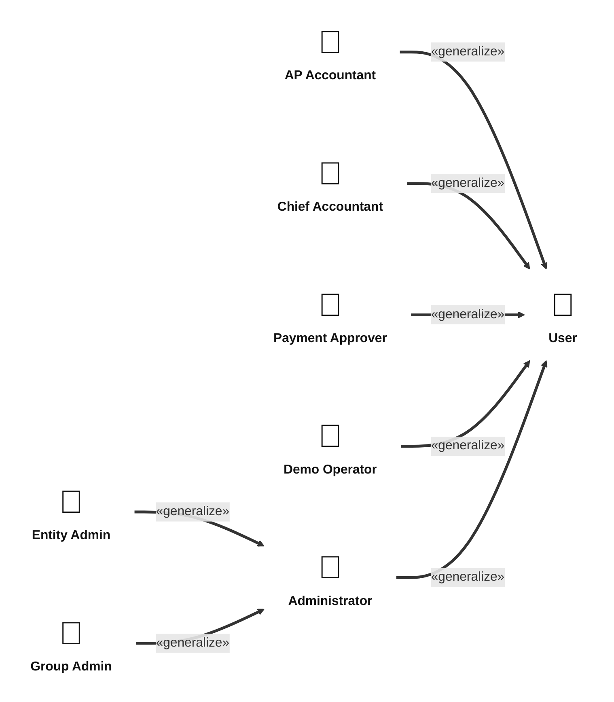
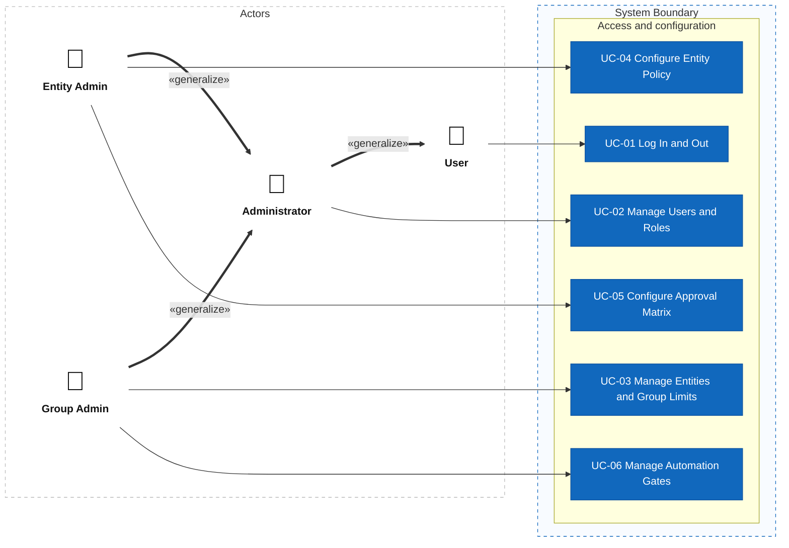
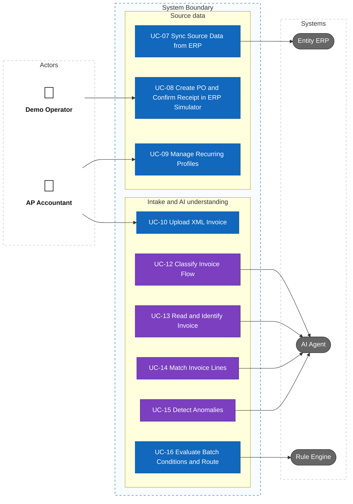
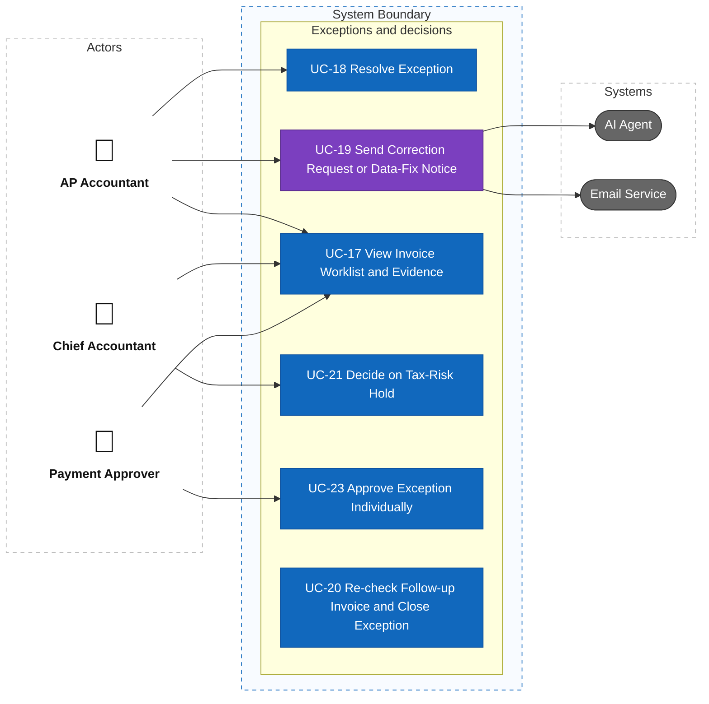
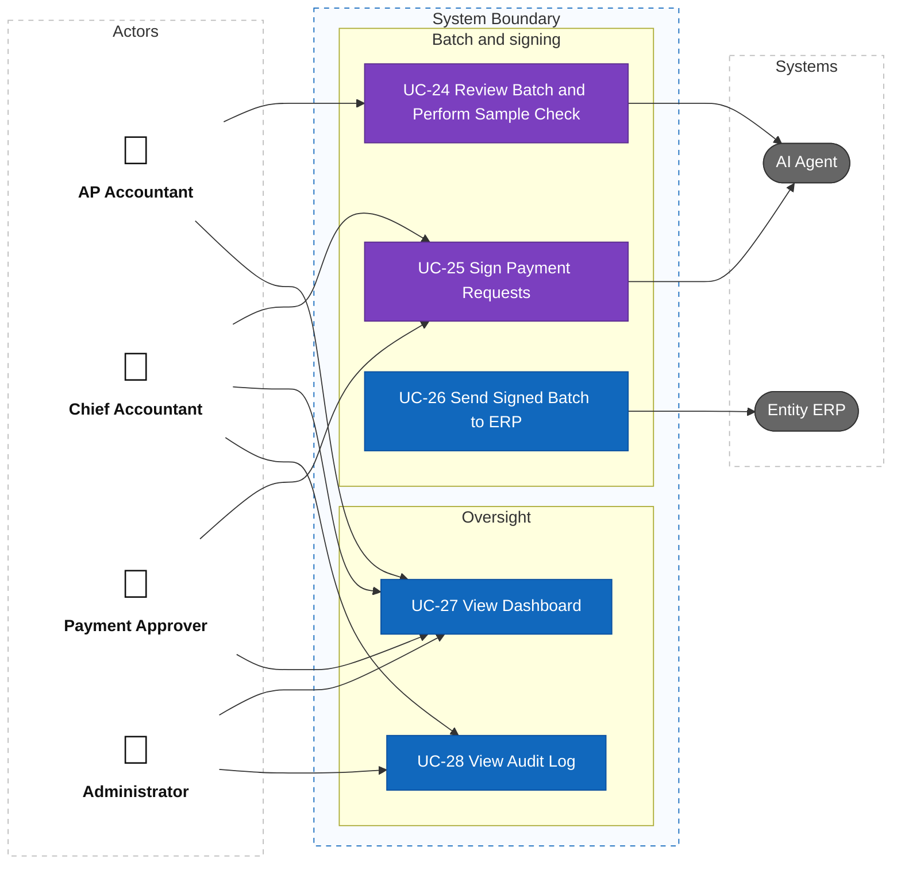
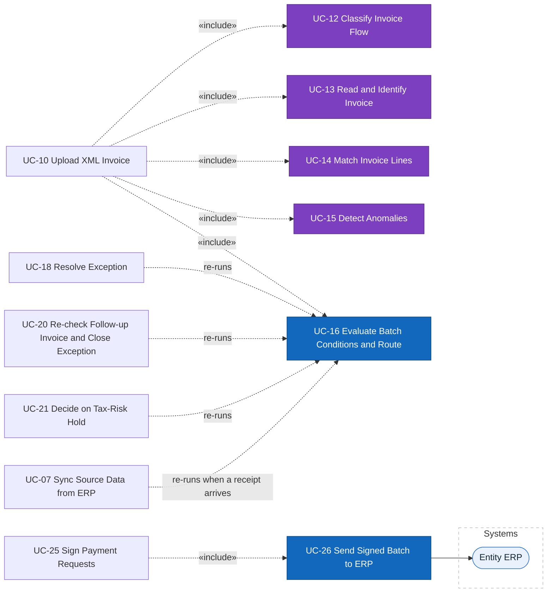

# Actors and Use Cases

> Design status: MVP — Step 2 of 9, draft for review
>
> Implementation status: NOT STARTED

## Actors and roles

Every finance user belongs to one entity and has one role (D-13, DF-14). An Administrator has a scope: **Group Admin** works across the group, **Entity Admin** works in one entity.

| Role | Display name in UI | Description |
|---|---|---|
| — | User (not shown) | Abstract actor: anyone with an account. It groups the use cases all roles share and is not a role of its own. |
| `AP_ACCOUNTANT` | AP Accountant | Main user, one entity. Uploads XML invoices, creates recurring profiles, resolves exceptions, sends supplier requests, runs the sample check. |
| `CHIEF_ACCOUNTANT` | Chief Accountant | One entity. Decides tax-risk holds and signs payment requests first. |
| `PAYMENT_APPROVER` | Payment Approver | A department head or the CFO, one entity, at a level set in the approval matrix. Signs consolidated payment requests and approves single exceptions. |
| `ADMIN` (scope Entity) | Entity Admin | Administrator of one entity. Manages the entity's users, policy, and approval matrix inside the group limits. |
| `ADMIN` (scope Group) | Group Admin | Administrator of the whole group. Adds entities, sets group limits, and manages the AI and the automation gates. |
| `DEMO_OPERATOR` | Demo Operator | Demo-only. Plays the buyer, warehouse keeper, and acceptance personas in the ERP simulator (D-12). Not part of the product. |
| — | AI Agent | Classifies flows, reads documents, identifies entities and orders, matches lines, detects anomalies, drafts requests, selects the sample, and summarises the batch. It supplies evidence and never decides or signs. |
| — | Rule Engine | Part of the System. Checks the six batch conditions with transparent rules, without an LLM, and routes each invoice (D-08). |
| — | Entity ERP | The ERP of each entity: source of truth for orders, receipts, acceptances, suppliers, and master data; receives the signed batch and returns the paid status. Simulated in the MVP. |
| — | Email Service | External system that delivers the requests the AP Accountant sends to suppliers and internal teams. |
| — | System | Runs automatic behaviour (sync, follow-up checks, sending the signed batch). |
| — | Invoice Status Lookup Service | Returns the status of an invoice at the tax authority. Advanced; no use case in the MVP (W-13). |
| — | Bank | Card statements for subscriptions. Advanced; no use case in the MVP (W-04). Real bank payment is out of scope (D-11). |

## Role and use case matrix

"Own entity" means the user sees and acts only in the entity they belong to (BR-09).

| Use case | AP Accountant | Chief Accountant | Payment Approver | Entity Admin | Group Admin | Demo Operator | Automatic |
|---|---|---|---|---|---|---|---|
| UC-01 Log In and Out | Yes | Yes | Yes | Yes | Yes | Yes | |
| UC-02 Manage Users and Roles | | | | Own entity | All entities | | |
| UC-03 Manage Entities and Group Limits | | | | | Yes | | |
| UC-04 Configure Entity Policy | | | | Own entity | | | |
| UC-05 Configure Approval Matrix | | | | Own entity | | | |
| UC-06 Manage Automation Gates | | | | | Yes | | |
| UC-07 Sync Source Data from ERP | | | | | | | System, Entity ERP |
| UC-08 Create PO and Confirm Receipt in ERP Simulator | | | | | | Yes | |
| UC-09 Manage Recurring Profiles | Own entity | | | | | | |
| UC-10 Upload XML Invoice | Own entity | | | | | | |
| UC-11 Upload Foreign PDF and Confirm Fields: Removed (D-33), now Advanced W-19 | | | | | | | |
| UC-12 Classify Invoice Flow | | | | | | | AI Agent |
| UC-13 Read and Identify Invoice | | | | | | | AI Agent |
| UC-14 Match Invoice Lines | | | | | | | AI Agent |
| UC-15 Detect Anomalies | | | | | | | AI Agent |
| UC-16 Evaluate Batch Conditions and Route | | | | | | | Rule Engine |
| UC-17 View Invoice Worklist and Evidence | Own entity | Own entity | Own entity | | | | |
| UC-18 Resolve Exception | Own entity | | | | | | |
| UC-19 Send Correction Request or Data-Fix Notice | Own entity | | | | | | AI Agent drafts |
| UC-20 Re-check Follow-up Invoice and Close Exception | | | | | | | System |
| UC-21 Decide on Tax-Risk Hold | | Own entity | | | | | |
| UC-22 Confirm Foreign Tax Obligations: Removed (D-33), now Advanced W-20 | | | | | | | |
| UC-23 Approve Exception Individually | | | Own entity, own level | | | | |
| UC-24 Review Batch and Perform Sample Check | Own entity | | | | | | AI Agent selects the sample |
| UC-25 Sign Payment Requests | | Own entity | Own entity, own level | | | | AI Agent summarises |
| UC-26 Send Signed Batch to ERP | | | | | | | System, Entity ERP |
| UC-27 View Dashboard | Own entity | Own entity | Own entity | Own entity | Per-entity aggregates | | |
| UC-28 View Audit Log | | Own entity | | Own entity | Group events only | | |

Menus and buttons are **not displayed** when the user lacks permission. A direct request without permission is rejected by the server, and an unauthorized page shows an "Access denied" page.

## Use case diagrams

The model is drawn as one actor diagram and four use case diagrams, one per group of modules, so each picture stays readable. Every use case is a separate node inside the system boundary of exactly one diagram, and the role and use case matrix above stays the source of truth for the links. Human actors stand on the left with the person icon. Systems stand on the right as rounded nodes, and each arrow points from the use case to the system it uses. UC-11 and UC-22 are not drawn: D-33 removed them and their numbers are not reused. UC-07, UC-12..UC-16, UC-20, and UC-26 have no human actor: the System, the AI Agent, or the Rule Engine runs them. The System is the platform itself and has no node of its own. Purple nodes use an LLM.

### Actors and generalization

Thick arrows marked «generalize» point from a child actor to the parent whose use cases it inherits. A Group Admin and an Entity Admin are two scopes of the Administrator.

**What the generalization means.** It says only which use cases an actor can start. Every role inherits UC-01 from User. A Group Admin and an Entity Admin inherit UC-02, UC-27, and UC-28 from Administrator, with the narrower or wider scope shown in the matrix above. In the rules and the data, the Administrator is not a finance role: an Administrator never signs, approves, or resolves an invoice.

### Access and configuration (UC-01 to UC-06)

Everyone logs in; the two administrator scopes manage users, entities, policy, the approval matrix, and the automation gates.

### Source data and intake (UC-07 to UC-10, UC-12 to UC-16)

The Demo Operator creates orders and receipts in the simulator, the AP Accountant adds profiles and uploads XML invoices, and the AI Agent and the Rule Engine do the reading, matching, and routing.

### Exceptions and decisions (UC-17 to UC-21, UC-23)

The AP Accountant resolves exceptions, the Chief Accountant decides tax-risk holds, and the Payment Approver approves single exceptions. The AI Agent drafts the request, and the Email Service delivers it.

UC-20 has no human actor: the System runs it, and it re-runs the Rule Engine (UC-16).

### Batch, signing, and oversight (UC-24 to UC-28)

The AP Accountant reviews the batch, the Chief Accountant and the Payment Approver sign, and the System sends the signed batch to the ERP. The Administrator views the dashboard and the audit log; a Group Admin and an Entity Admin do the same because they inherit from the Administrator (see the actor diagram above, and the matrix for the scope).

UC-26 has no human actor: it is part of UC-25 (see below) and the System runs it.

### Included and extending use cases

A resolved exception, a decision on a hold, a follow-up invoice, and a new receipt each re-run the Rule Engine (UC-16) on the invoice. UC-23 is not a re-run: an exception approved individually puts its invoice in the open batch, its single-invoice payment request is created when the batch is released, and the Chief Accountant co-signs it in UC-25 (DF-03, D-69). The simulated tax-risk list is loaded by UC-07 together with the other source data (D-28).

The MVP takes XML invoices only (BR-17). Foreign invoices, their tax duties, and PDF reading are Advanced (W-19, W-20); UC-11 and UC-22 were removed by D-33.

## Use cases by actor

| Actor | Use cases |
|---|---|
| User (abstract) | UC-01 Log in and out |
| AP Accountant | Inherits User · UC-09 Manage recurring profiles · UC-10 Upload XML invoice · UC-17 View invoice worklist and evidence · UC-18 Resolve exception · UC-19 Send correction request or data-fix notice · UC-24 Review batch and perform sample check · UC-27 View dashboard |
| Chief Accountant | Inherits User · UC-17 View invoice worklist and evidence · UC-21 Decide on tax-risk hold · UC-25 Sign payment requests · UC-27 View dashboard · UC-28 View audit log |
| Payment Approver | Inherits User · UC-17 View invoice worklist and evidence · UC-23 Approve exception individually · UC-25 Sign payment requests · UC-27 View dashboard |
| Administrator | Inherits User · UC-02 Manage users and roles · UC-27 View dashboard · UC-28 View audit log |
| Entity Admin | Inherits Administrator (own entity) · UC-04 Configure entity policy · UC-05 Configure approval matrix |
| Group Admin | Inherits Administrator (all entities) · UC-03 Manage entities and group limits · UC-06 Manage automation gates |
| Demo Operator | Inherits User · UC-08 Create PO and confirm receipt in ERP simulator (demo only) |
| AI Agent | UC-12 Classify invoice flow · UC-13 Read and identify invoice · UC-14 Match invoice lines · UC-15 Detect anomalies |
| Rule Engine | UC-16 Evaluate batch conditions and route |
| System | UC-07 Sync source data from ERP (with Entity ERP) · UC-20 Re-check follow-up invoice and close exception · UC-26 Send signed batch to ERP (with Entity ERP) |

**Related:** [Step index](README.md)
