# Sitemap by Role

> Design status: MVP — Step 3 of 9, approved
>
> Implementation status: NOT STARTED

**Notation** (D-34)
- **Card:** one page, with its ID and only its main content.
- **Area (box):** a group of pages that the same roles use.
- **Solid arrow:** parent page → child page (where the child is opened from).
- **Dashed arrow:** the actor uses the pages in that area. The arrows match the [page-permission table](02-routes-and-permissions.md) exactly.
- **Purple card:** a page with AI features (SCR-12, SCR-30, SCR-51, SCR-78).
- Modals, the "Access denied" page, and loading or error states are **not** cards. They are listed in the [screen inventory](04-screen-inventory.md) and the [UI states](06-ui-states-and-accessibility.md).
- The Demo Operator and the ERP simulator exist only in the demo and carry a visible "Demo only" mark.

```mermaid
flowchart TB
    ap["<span style='font-size:40px'>👤</span><br/><b>AP Accountant</b>"]
    ca["<span style='font-size:40px'>👤</span><br/><b>Chief Accountant</b>"]
    pa["<span style='font-size:40px'>👤</span><br/><b>Payment Approver</b>"]
    entityAdmin["<span style='font-size:40px'>👤</span><br/><b>Entity Admin</b>"]
    groupAdmin["<span style='font-size:40px'>👤</span><br/><b>Group Admin</b>"]
    demo["<span style='font-size:40px'>👤</span><br/><b>Demo Operator</b>"]

    subgraph access["Access"]
        direction TB
        scr01["<b>SCR-01 Login</b><br/>• Email, password<br/>• Goes to the role home page"]
    end

    subgraph invoices["Invoices (AP: full · Chief Accountant, Payment Approver: read-only)"]
        direction TB
        scr10["<b>SCR-10 Invoice Worklist</b><br/>• Invoices by state, filters<br/>• Due soon mark, last ERP sync<br/>• Upload XML only (AP)"]
        scr12["<b>SCR-12 Invoice Detail and Evidence</b><br/>• Document, order, receipt, line matches<br/>• Anomalies, six conditions, history<br/>• AI text labelled AI<br/>• Action panel for the role that must decide"]
        scr10 --> scr12
    end

    subgraph prep["AP preparation (AP Accountant)"]
        direction TB
        scr20["<b>SCR-20 Recurring Profiles</b><br/>• Profiles, earlier amounts<br/>• Add, deactivate"]
        scr30["<b>SCR-30 Batch Review</b><br/>• Close batch, AI sample, OK or Error<br/>• Release for signing<br/>• Request and ERP send status"]
    end

    subgraph decisions["Decisions (Chief Accountant, Payment Approver)"]
        direction TB
        scr40["<b>SCR-40 Decision Queue</b><br/>• CA: tax-risk holds<br/>• PA: exceptions at my level<br/>• Each row opens the invoice"]
    end

    subgraph signing["Signing (Chief Accountant, Payment Approver)"]
        direction TB
        scr50["<b>SCR-50 Signing Queue</b><br/>• Requests to sign, select many<br/>• Sign in one action<br/>• ERP status"]
        scr51["<b>SCR-51 Payment Request Detail</b><br/>• AI summary labelled AI<br/>• Totals, large invoices, flags<br/>• Lines, remove, decline<br/>• Paid status and reference"]
        scr50 --> scr51
    end

    subgraph oversight["Oversight"]
        direction TB
        scr60["<b>SCR-60 Dashboard</b><br/>• Touchless rate and AI misplacement rate<br/>• Exception backlog by state and age<br/>• Group Admin: per-entity figures only"]
        scr61["<b>SCR-61 Audit Log</b><br/>• AI, rule, human, signature entries<br/>• Filters, read-only<br/>• Group Admin: group events only"]
    end

    subgraph useradmin["User administration"]
        direction TB
        scr70["<b>SCR-70 Users</b><br/>• Users, roles, ERP link<br/>• Create, deactivate<br/>• Group Admin: entity filter"]
    end

    subgraph entityconfig["Entity configuration (Entity Admin)"]
        direction TB
        scr73["<b>SCR-73 Entity Policy</b><br/>• Tolerance, batch threshold<br/>• Sample rate, grouping mode<br/>• Group limit beside each field"]
        scr74["<b>SCR-74 Approval Matrix</b><br/>• Tiers, levels, approvers<br/>• Gap and overlap errors"]
    end

    subgraph groupadmin["Group administration (Group Admin)"]
        direction TB
        scr75["<b>SCR-75 Group Overview</b><br/>• Entities, open and closed gates<br/>• Gate alerts<br/>• Last ERP sync per entity"]
        scr76["<b>SCR-76 Entities and Group Limits</b><br/>• Entities, group maximums<br/>• Non-coded invoice sectors"]
        scr78["<b>SCR-78 Automation Gates</b><br/>• Pair state, compared count<br/>• Accuracy against 98%<br/>• Open or close"]
    end

    subgraph demoarea["Demo only"]
        direction TB
        scr80["<b>SCR-80 ERP Simulator</b><br/>• Entity and persona<br/>• Purchase orders, receipts<br/>• Marked Demo only"]
    end

    scr40 --> scr12
    scr51 --> scr12

    ap -.-> access
    ap -.-> invoices
    ap -.-> prep
    ap -.-> oversight
    ca -.-> access
    ca -.-> invoices
    ca -.-> decisions
    ca -.-> signing
    ca -.-> oversight
    pa -.-> access
    pa -.-> invoices
    pa -.-> decisions
    pa -.-> signing
    pa -.-> oversight
    entityAdmin -.-> access
    entityAdmin -.-> oversight
    entityAdmin -.-> useradmin
    entityAdmin -.-> entityconfig
    groupAdmin -.-> access
    groupAdmin -.-> oversight
    groupAdmin -.-> useradmin
    groupAdmin -.-> groupadmin
    demo -.-> access
    demo -.-> demoarea

    classDef actor fill:none,stroke:none,color:#111
    classDef screen fill:#fff,color:#111,stroke:#1168bd,text-align:left
    classDef ai fill:#f3ecfb,color:#111,stroke:#7b3fbf,text-align:left
    class ap,ca,pa,entityAdmin,groupAdmin,demo actor
    class scr01,scr10,scr20,scr40,scr50,scr60,scr61,scr70,scr73,scr74,scr75,scr76,scr80 screen
    class scr12,scr30,scr51,scr78 ai
```

The Access denied page SCR-90 is shown to any role that opens a URL without permission, so it is not drawn. Three pages are reached only from another page: SCR-12 from SCR-10, SCR-40, or SCR-51; SCR-51 from SCR-50. Every other page is reached from the sidebar. All other screens are modals on these pages.

## Screens per role

The home page is the page shown after login (DF-28).

| Role | Home page (DF-28) | Pages | Modals the role can open |
|---|---|---|---|
| AP Accountant | SCR-10 Invoice Worklist | SCR-01, SCR-10, SCR-12, SCR-20, SCR-30, SCR-60 | SCR-11, SCR-14, SCR-15, SCR-21, SCR-31, SCR-32 |
| Chief Accountant | SCR-40 Decision Queue | SCR-01, SCR-10 (read-only), SCR-12 (read-only evidence), SCR-40, SCR-50, SCR-51, SCR-60, SCR-61 | SCR-16, SCR-52, SCR-53, SCR-54 |
| Payment Approver | SCR-50 Signing Queue | SCR-01, SCR-10 (read-only), SCR-12 (read-only evidence), SCR-40, SCR-50, SCR-51, SCR-60 | SCR-18, SCR-52, SCR-53, SCR-54 |
| Entity Admin | SCR-73 Entity Policy ("entity settings") | SCR-01, SCR-60, SCR-61, SCR-70, SCR-73, SCR-74 | SCR-71, SCR-72 |
| Group Admin | SCR-75 Group Overview ("group overview") | SCR-01, SCR-60 (per-entity aggregates), SCR-61 (group events), SCR-70, SCR-75, SCR-76, SCR-78 | SCR-71, SCR-72, SCR-77, SCR-79 |
| Demo Operator | SCR-80 ERP Simulator | SCR-01, SCR-80 | SCR-81, SCR-82 |

SCR-90 is shown to every role when a URL is opened without permission. The numbers SCR-13 and SCR-17 are removed (D-33) and appear on no card, route, or role list.

**Related:** [Step index](README.md) · [Routes and permissions](02-routes-and-permissions.md) · [Screen inventory](04-screen-inventory.md)
