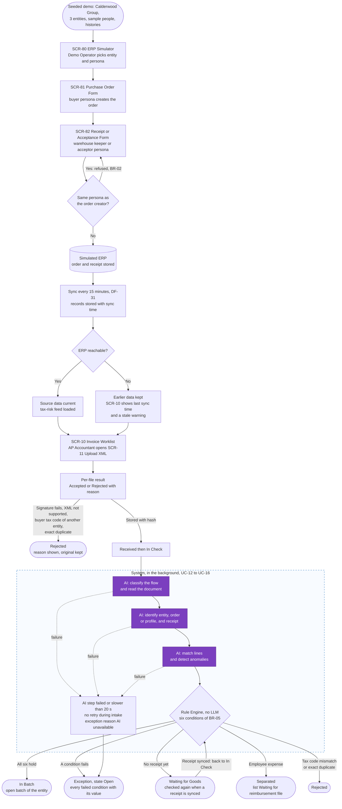
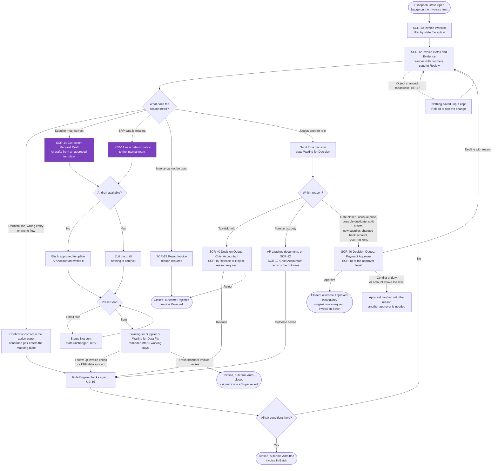
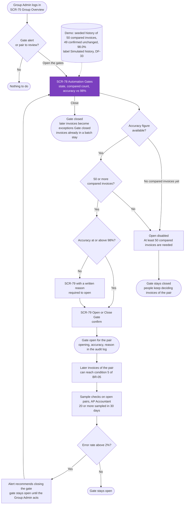

# Primary User Flows

> Design status: MVP — Step 3 of 9, draft for review
>
> Implementation status: NOT STARTED

Four flows cover the path of an invoice from the demo set-up to payment, and the one admin decision that the whole chain depends on. In every flow a **purple** step uses the AI, and every purple step has a failure path that leaves a person able to continue (BR-27, DF-08). State names are the exact names of BR-33 (invoice), BR-34 (exception), and BR-35 (batch and payment request).

## Flow 1: Demo set-up and invoice intake

Where the demo data comes from: the Calderwood Group, its three entities, and the sample people are seeded (DF-12). Orders and receipts are created by the Demo Operator in SCR-80 and reach MatchPay only through the sync (US-07). The tax-risk list entry for Eastbay Trading arrives through the same sync as a simulated feed with a source and a date (D-28). The compared history that lets a gate open is seeded (DF-33), and so are the price history and the earlier recurring periods that the price and recurring checks need (DF-42). Nothing in the chain waits for data that no step provides.

## Flow 2: AP Accountant resolves an exception

An exception holds one or more reasons. The AP Accountant resolves them one by one, and after every resolution the Rule Engine checks the invoice again from the stored evidence (UC-16). Three reasons cannot be settled by the AP Accountant and go to other roles: a tax-risk hold and foreign tax duties to the Chief Accountant, and an individual approval to the Payment Approver.

## Flow 3: Month-end batch, signing, and payment

The AP Accountant closes the batch, checks a sample, and releases it. The Chief Accountant signs first, the Payment Approver second, and the system sends the signed request to the ERP. The AI selects the sample and writes the summary, and each has a fallback.

```mermaid
flowchart TD
    start(["Batch state Open<br/>invoices admitted during the period"]) --> review["SCR-30 Batch Review<br/>AP Accountant"]
    review --> close["SCR-31 Close Batch<br/>later invoices go to the next period"]
    close --> inreview["Batch In Review"]
    inreview --> pick["AI selects the sample by risk<br/>sample size rounded up, minimum 1"]:::ai
    pick --> pickok{"AI selected?"}
    pickok -->|"No"| fallback["Highest-value invoices taken<br/>label selected without AI, DF-29"]
    pickok -->|"Yes"| marks
    fallback --> marks["Mark each sample item OK or Error"]
    marks --> err{"Error found?"}
    err -->|"Yes, reason required"| withdraw["Invoice withdrawn into exceptions<br/>counts for misplacement and gate alert"]
    err -->|"No"| all
    withdraw --> all{"Every sample item marked?"}
    all -->|"No"| marks
    all -->|"Yes"| release["SCR-32 Release Batch"]
    release --> insign["Batch In Signing<br/>requests Awaiting Chief Accountant"]

    insign --> queue["SCR-50 Signing Queue<br/>Chief Accountant selects requests"]
    queue --> detail["SCR-51 Payment Request Detail<br/>evidence, flags, links to SCR-12"]
    detail --> summary["AI summary of the batch<br/>labelled as AI"]:::ai
    summary --> sumok{"Summary available?"}
    sumok -->|"No"| nosum["Message: summary unavailable<br/>signing goes on from the evidence"]
    sumok -->|"Yes"| decide
    nosum --> decide{"Sign, remove a line,<br/>or decline?"}
    decide -->|"Remove a line"| removeline["SCR-53 Remove Line<br/>earlier signatures voided<br/>level recomputed"]
    removeline -->|"Lines remain"| again["Request Awaiting Chief Accountant<br/>signatures voided"]
    again --> queue
    removeline -->|"No line left"| cancelled(["Request Cancelled<br/>invoices return to exceptions"])
    decide -->|"Decline"| decline["SCR-54 Decline Request<br/>reason required"]
    decline --> cancelled
    decide -->|"Sign"| reauth["SCR-52 Sign with Re-authentication<br/>password entered again"]
    reauth -->|"Wrong password,<br/>outdated view, conflict of duty"| refused["Not signed<br/>reason shown per request"]
    refused --> queue
    reauth -->|"Chief Accountant signed"| awaitpa["Request Awaiting Payment Approver"]
    reauth -->|"Chief Accountant co-signs an<br/>individually approved exception"| signed
    awaitpa --> pasign["Payment Approver at the required level<br/>signs on SCR-50 or SCR-51"]
    pasign --> signed(["Request Signed<br/>invoices Signed"])

    signed --> send["System sends to the Entity ERP<br/>as a non-cash transfer instruction"]
    send --> sendok{"ERP accepted?"}
    sendok -->|"Unavailable"| retry["Retry n of 3, 5 minutes apart, DF-24<br/>request number is the idempotency key"]
    retry -->|"Still failing after 3"| alert["Failed alert on SCR-30, SCR-50, SCR-51<br/>request stays Signed"]
    retry -->|"Accepted"| paidq
    sendok -->|"Failure reply"| payfail["Invoices become exceptions<br/>reason Payment failed<br/>new request needs new signatures"]
    sendok -->|"Yes"| paidq["Invoices Sent"]
    paidq --> paid(["ERP returns paid status<br/>invoices Paid, request Paid<br/>method and reference stored<br/>batch Completed when every request is paid"])

    classDef ai fill:#7b3fbf,color:#fff,stroke:#5a2d8c
```

## Flow 4: Group Admin opens an automation gate

A new supplier and entity pair starts with its gate closed, so every invoice of the pair goes to an exception "Gate closed" and a person decides (D-29). In shadow mode the AI result is stored next to the person's decision, and the accuracy of the pair is the share of invoices where the person confirmed every AI result unchanged (DF-17). Nothing opens or closes by itself (D-06).

**Related:** [Step index](README.md) · [Screen inventory](04-screen-inventory.md) · [UI states](06-ui-states-and-accessibility.md) · [Business rules](../requirements/business-rules.md)
