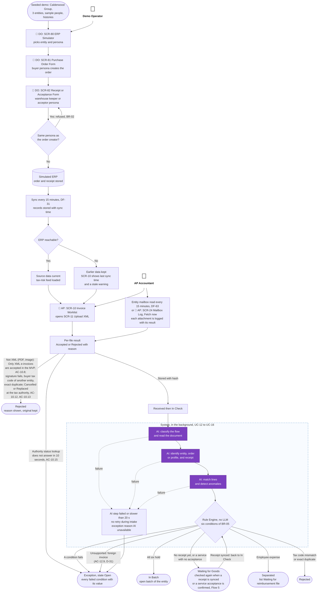
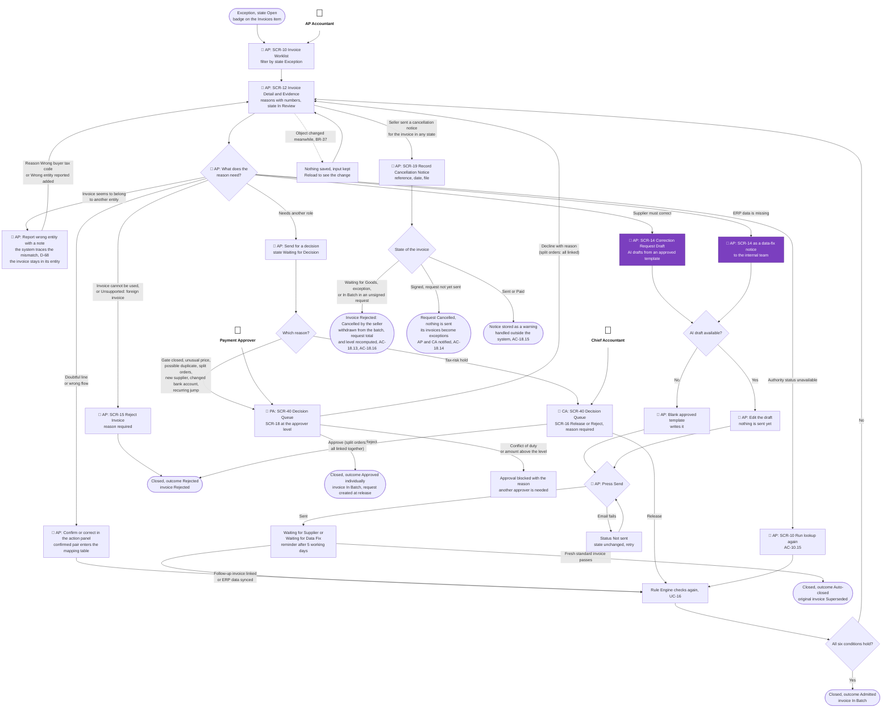
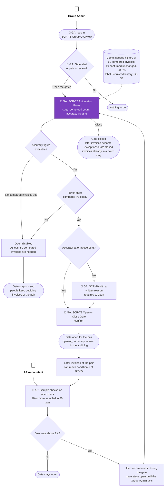
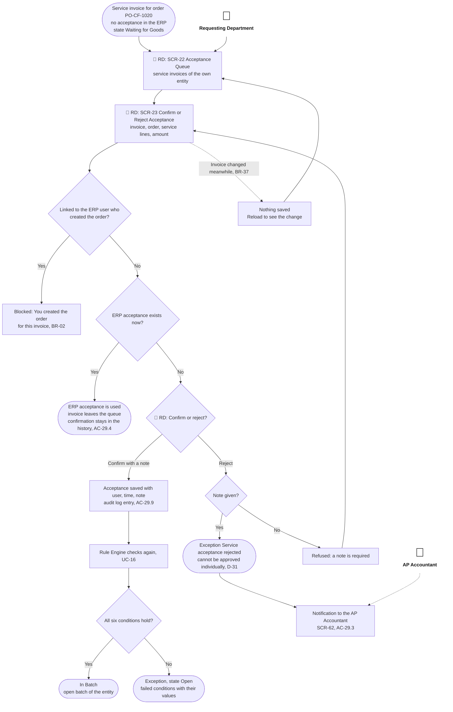
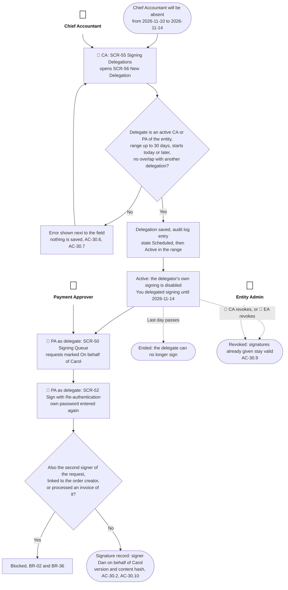
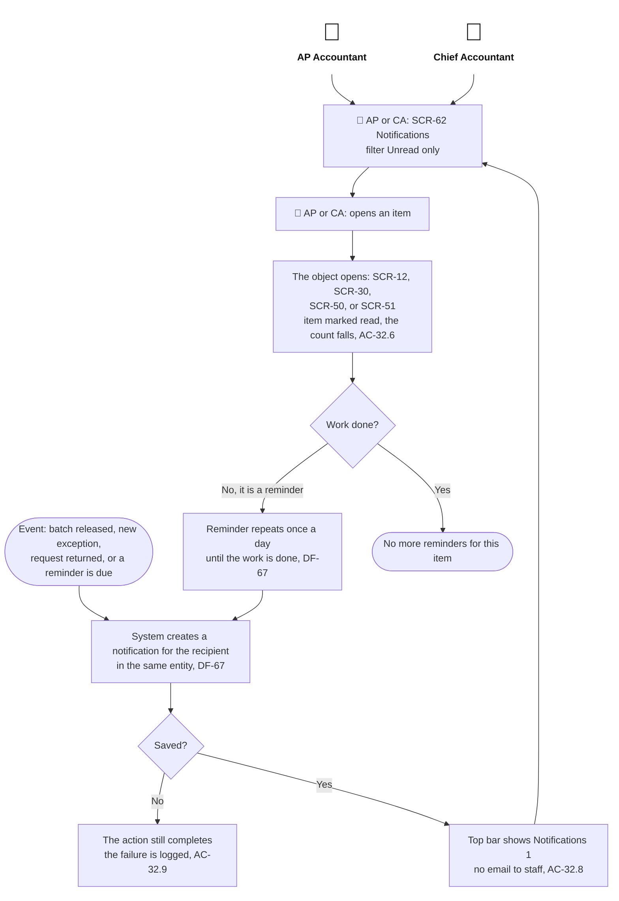

# Primary User Flows

> Design status: MVP — Step 3 of 9, approved
>
> Implementation status: NOT STARTED

Seven flows cover the path of an invoice from the demo set-up to payment, the one admin decision that the whole chain depends on, and the three flows added by the mind map sync (D-88): service acceptance, signing delegation, and notifications. Flows 1 to 3 gained branches for email intake, the authority status, cancellation notices, expanding the sample, reopening a batch, and resending to the ERP. In every flow a **purple** step uses the AI, and every purple step has a failure path that leaves a person able to continue (BR-27, DF-08). Each flow starts from the actors who enter it (person icon). A step a person performs begins with 👤 and an abbreviation: **DO** Demo Operator, **AP** AP Accountant, **CA** Chief Accountant, **PA** Payment Approver, **RD** Requesting Department, **EA** Entity Admin, **GA** Group Admin. Steps without a prefix are done by the system or the AI. State names are the exact names of BR-33 (invoice), BR-34 (exception), and BR-35 (batch and payment request).

## Flow 1: Demo set-up and invoice intake

Where the demo data comes from: the Calderwood Group, its three entities, and the sample people are seeded (DF-12). Orders and receipts are created by the Demo Operator in SCR-80 and reach MatchPay only through the sync (US-07). The tax-risk list entry for Eastbay Trading arrives through the same sync as a simulated feed with a source and a date (D-28). The compared history that lets a gate open is seeded (DF-33), and so are the price history and the earlier recurring periods that the price and recurring checks need (DF-42). Nothing in the chain waits for data that no step provides. An invoice also arrives by email: each entity has a simulated mailbox that is read every 15 minutes or at once on "Fetch now" (DF-63, D-92), and every XML attachment goes through the same checks as an upload. Before the checks, the simulated authority status of the invoice is looked up (DF-64, D-93): a cancelled or replaced invoice is rejected, and a lookup that does not answer makes an exception.

## Flow 2: AP Accountant resolves an exception

An exception holds one or more reasons. The AP Accountant resolves them one by one, and after every resolution the Rule Engine checks the invoice again from the stored evidence (UC-16). Two kinds of reason cannot be settled by the AP Accountant and go to other roles: a tax-risk hold to the Chief Accountant, and an individual approval to the Payment Approver. An "Unsupported: foreign invoice" exception (AC-12.9) can only be rejected with a reason on SCR-15; it is never sent for a decision. A reported wrong entity (D-68) never moves the invoice to another entity: the invoice stays where it was uploaded, the page traces the mismatch, and the exception gets the reason "Wrong buyer tax code" or "Wrong entity reported". It is then resolved like a wrong invoice, by a correction or reissue request on SCR-14 or by a rejection on SCR-15, and it is never sent for an individual approval. When a seller sends a cancellation notice, the AP Accountant records it on SCR-19 from the invoice; what happens depends on the state of the invoice (BR-31, D-94). An exception "Authority status unavailable" is cleared by running the lookup again from the worklist.

## Flow 3: Month-end batch, signing, and payment

The AP Accountant closes the batch, checks a sample, and releases it. The Chief Accountant signs first, the Payment Approver second, and the system sends the signed request to the ERP. The AI selects the sample and writes the summary, and each has a fallback. When the sample finds errors the AP Accountant can expand it, and while no request is signed the AP Accountant can reopen the batch for review (D-95). If the 3 automatic sends fail, the AP Accountant or the Chief Accountant can resend the same signed request (D-96). A delegate signs on behalf of an absent signer (Flow 6). A cancellation notice that arrives before the send cancels the request (Flow 2).

```mermaid
flowchart TD
    actAp["<span style='font-size:40px'>👤</span><br/><b>AP Accountant</b>"]:::actor
    actCa["<span style='font-size:40px'>👤</span><br/><b>Chief Accountant</b>"]:::actor
    actPa["<span style='font-size:40px'>👤</span><br/><b>Payment Approver</b>"]:::actor
    start(["Batch state Open<br/>invoices admitted during the period"]) --> review["👤 AP: SCR-30 Batch Review"]
    review --> close["👤 AP: SCR-31 Close Batch<br/>later invoices go to the next period"]
    close --> inreview["Batch In Review"]
    inreview --> pick["AI selects the sample by risk<br/>sample size rounded up, minimum 1"]:::ai
    pick --> pickok{"AI selected?"}
    pickok -->|"No"| fallback["Highest-value invoices taken<br/>label selected without AI, DF-29"]
    pickok -->|"Yes"| marks
    fallback --> marks["👤 AP: Mark each sample item OK or Error"]
    marks --> err{"Error found?"}
    err -->|"Yes, reason required"| withdraw["Invoice withdrawn into exceptions<br/>counts for misplacement and gate alert"]
    err -->|"No"| all
    withdraw --> more{"👤 AP: Expand the sample?"}
    more -->|"Yes: reason required"| expand["👤 AP: SCR-33 Expand Sample<br/>next invoices by risk, at least the<br/>original size again, DF-65"]
    expand --> marks
    more -->|"No"| all{"Every sample item marked?"}
    all -->|"No"| marks
    all -->|"Yes"| release["👤 AP: SCR-32 Release Batch"]
    release --> insign["Batch In Signing<br/>requests Awaiting Chief Accountant"]

    insign --> notify["Notification to the Chief Accountant<br/>requests wait for your signature<br/>SCR-62, AC-32.1"]
    insign -.->|"AP: no request signed yet"| reopen["👤 AP: SCR-34 Reopen for Review<br/>reason required; requests Cancelled<br/>invoices stay In Batch, marks kept, B7"]
    reopen --> inreview
    notify --> queue["👤 CA: SCR-50 Signing Queue<br/>selects requests"]
    queue --> detail["👤 CA: SCR-51 Payment Request Detail<br/>evidence, flags, links to SCR-12"]
    detail --> summary["AI summary of the batch<br/>labelled as AI"]:::ai
    summary --> sumok{"Summary available?"}
    sumok -->|"No"| nosum["Message: summary unavailable<br/>signing goes on from the evidence"]
    sumok -->|"Yes"| decide
    nosum --> decide{"👤 CA: Sign, remove a line,<br/>or decline?"}
    decide -->|"Remove a line"| removeline["👤 CA: SCR-53 Remove Line<br/>earlier signatures voided<br/>level recomputed"]
    removeline -->|"Lines remain"| again["Request Awaiting Chief Accountant<br/>signatures voided"]
    again --> queue
    removeline -->|"No line left"| cancelled(["Request Cancelled<br/>invoices return to exceptions"])
    decide -->|"Decline"| decline["👤 CA: SCR-54 Decline Request<br/>reason required"]
    decline --> cancelled
    decide -->|"Sign"| reauth["👤 CA: SCR-52 Sign with Re-authentication<br/>password entered again<br/>a delegate signs On behalf of, Flow 6"]
    reauth -->|"Wrong password, outdated view,<br/>conflict of duty, or the signer processed<br/>an invoice of the request, BR-36"| refused["Not signed<br/>reason shown per request"]
    refused --> queue
    reauth -->|"Chief Accountant signed"| awaitpa["Request Awaiting Payment Approver"]
    reauth -->|"Chief Accountant co-signs an<br/>individually approved exception"| signed
    awaitpa --> pasign["👤 PA: at the required level<br/>signs on SCR-50 or SCR-51"]
    pasign --> signed(["Request Signed<br/>invoices Signed"])

    signed --> send["System sends to the Entity ERP<br/>as a non-cash transfer instruction"]
    send --> sendok{"ERP accepted?"}
    sendok -->|"Unavailable"| retry["Retry n of 3, 5 minutes apart, DF-24<br/>request number is the idempotency key"]
    retry -->|"Still failing after 3"| alert["Failed alert on SCR-30, SCR-50, SCR-51<br/>request stays Signed"]
    alert --> resend["👤 AP or CA: SCR-57 Resend to ERP<br/>same request number, no new signature<br/>hash checked first, marked manual, AC-26.10"]
    resend --> sendok
    retry -->|"Accepted"| paidq
    sendok -->|"Failure reply"| payfail["Invoices become exceptions<br/>reason Payment failed<br/>new request needs new signatures"]
    sendok -->|"Yes"| paidq["Invoices Sent"]
    signed -.->|"Cancellation notice before the send<br/>V20, R9, AC-18.14"| cancelled
    paidq --> paid(["ERP returns paid status<br/>invoices Paid, request Paid<br/>payment reference stored<br/>batch Completed when every request is paid"])

    actAp --> review
    actCa --> queue
    actPa --> pasign

    classDef actor fill:none,stroke:none,color:#111
    classDef ai fill:#7b3fbf,color:#fff,stroke:#5a2d8c
```

## Flow 4: Group Admin opens an automation gate

A new supplier and entity pair starts with its gate closed, so every invoice of the pair goes to an exception "Gate closed" and a person decides (D-29). In shadow mode the AI result is stored next to the person's decision, and the accuracy of the pair is the share of invoices where the person confirmed every AI result unchanged (DF-17). Nothing opens or closes by itself (D-06).

## Flow 5: Requesting Department confirms a service acceptance

For a service invoice with no acceptance in the ERP, a user of the Requesting Department of the entity confirms or rejects the acceptance with a note (UC-29, D-90). A confirmation counts as the independent acceptance source (BR-19), and the ERP acceptance wins if both exist. A rejection makes the exception "Service acceptance rejected", which is never approved individually (D-31).

## Flow 6: Signing delegation

A Chief Accountant or Payment Approver who will be absent names a delegate of the same entity for a date range (UC-30, D-91, BR-38). The delegate signs at the level of the delegator only inside the range, and every rule of separation still applies to the delegate. Whether a delegated e-signature is legally valid is Unverified (O-17).

## Flow 7: Notification click-through

In-app notifications exist for the AP Accountant, the Chief Accountant, and the Payment Approver (UC-32, D-97). They are never emailed to staff, and a notification that cannot be saved never stops the action that caused it.

**Related:** [Step index](README.md) · [Screen inventory](04-screen-inventory.md) · [UI states](06-ui-states-and-accessibility.md) · [Business rules](../requirements/business-rules.md)
