# ER Diagram

> Design status: MVP — approved
>
> Implementation status: NOT STARTED

The PostgreSQL schema of **MatchPay** (D-47), drawn from [matchpay.dbml](matchpay.dbml): 74 tables, 68 enums, and 268 foreign keys. Table purposes, derived values, and transaction boundaries are in the [data model](01-data-model.md). Every table name below is the table name in the DBML file, and every foreign key drawn here is a `Ref` in the DBML.

## Relationships (overview)

The overview shows the tables that carry an invoice from the upload to the payment, with the people who sign. It is not complete: the groups below show every table. Arrows point from the referenced table (one) to the table that refers to it (many).

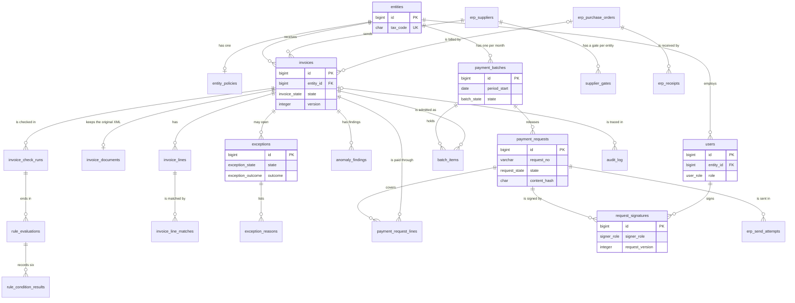

### Conventions that are not drawn

- **Entity scope.** Every table except `corporate_groups`, `group_sectors`, and `entities` has an `entity_id` that refers to `entities`. The reference is a foreign key in the DBML but is not drawn in every group, because it would join every table to one box. `audit_log.entity_id` and `users.entity_id` may be NULL (group events and group-level users).
- **Who and when.** The columns that end in `_by` (`created_by`, `decided_by`, `closed_by`, and so on) refer to `users`. They are in the DBML and the relationships table below, and are drawn only in the first group.
- **Same entity.** A child row and its parent row must belong to the same entity. SQL enforces this with a composite foreign key `(entity_id, parent_id)` (D-48); the DBML keeps single-column references.
- **Partial unique indexes** and **check constraints** are written in the DBML as indexes with a note and as `checks`. Mermaid cannot show them.

## Relationships (groups)

| Group | Tables | Purpose |
|---|---|---|
| Access and configuration | `corporate_groups`, `group_sectors`, `entities`, `users`, `entity_policies`, `approval_tiers`, `approval_tier_approvers`, `signing_delegations` | Group, entities, users, entity policy, the approval matrix, and signing delegations (US-01..US-05, US-30). |
| Automation gates | `supplier_gates`, `gate_comparisons`, `gate_alerts` | One gate per supplier and entity pair, the shadow comparisons behind its accuracy, and the alerts (US-06). |
| ERP sync and synced source data | `erp_sync_runs`, `erp_sync_rejections`, `erp_users`, `erp_suppliers`, `erp_supplier_bank_accounts`, `erp_items`, `erp_unit_conversions`, `erp_purchase_orders`, `erp_po_lines`, `erp_receipts`, `erp_receipt_lines`, `tax_risk_entries` | The read-only copy of the Entity ERP, the sync log, and the tax-risk list (US-07). |
| ERP simulator (demo only) | `sim_personas`, `sim_purchase_orders`, `sim_po_lines`, `sim_receipts`, `sim_receipt_lines`, `sim_authority_statuses` | The ERP side of the demo: personas, orders, receipts, and the simulated feed of invoice status at the tax authority (US-08, US-07, D-49, D-120). It has no foreign key to the synced copy; the sync joins them by reference. |
| Accumulated data | `item_mappings`, `recurring_profiles`, `recurring_profile_periods`, `price_history`, `supplier_entity_stats` | Mapping table, recurring profiles, price history, and supplier history of each entity (US-09, US-14, US-15, US-18). |
| Invoices | `invoices`, `invoice_documents`, `invoice_lines`, `invoice_corrections`, `invoice_receipts` | The invoice, its stored original, lines, corrections, and matched receipts (US-10, US-12, US-13). |
| Intake sources and invoice status | `mailbox_fetch_runs`, `mailbox_messages`, `mailbox_attachments`, `authority_status_lookups`, `cancellation_notices` | The simulated entity mailbox, the lookups of invoice status at the tax authority, and the cancellation notices (US-31, US-10, US-18, US-07). |
| Check runs and Rule Engine | `invoice_check_runs`, `rule_evaluations`, `rule_condition_results`, `ai_requests` | One run of the checks per invoice and trigger, the Rule Engine decision with its six conditions, and the AI request log (US-16, G-05). |
| AI outputs | `ai_flow_classifications`, `ai_identifications`, `invoice_line_matches`, `anomaly_findings`, `anomaly_finding_invoices` | What the AI proposed per task, each with its model and prompt version (US-12..US-15). |
| Exceptions and decisions | `exceptions`, `exception_reasons`, `wrong_entity_reports`, `exception_follow_up_links`, `message_templates`, `correction_requests`, `tax_risk_decisions`, `individual_approvals`, `service_acceptances` | Exceptions, their reasons, follow-up invoices, requests to suppliers, and the decisions of the Chief Accountant, the Payment Approver, and the Requesting Department (US-18..US-21, US-23, US-29). |
| Batch, signing, and ERP send | `payment_batches`, `batch_items`, `batch_sample_items`, `payment_requests`, `payment_request_lines`, `request_signatures`, `ai_payment_summaries`, `erp_send_attempts`, `sample_expansions`, `batch_reopenings` | Batches, sample check and its expansions, reopenings, payment requests, signatures, and the send to the Entity ERP (US-24..US-26, US-30). |
| Notifications | `notifications` | In-app notifications and reminders (US-32, D-97). |
| Audit log | `audit_log` | The append-only log (US-28, D-55). Its subject columns are not foreign keys because the subject can be any table. |

## Enums

Values are stored in capitals with underscores. The **UI** column gives the text a user sees, with the screen or rule that shows it. The state names are exactly those of BR-33, BR-34, and BR-35 and of the information architecture status chips. A label marked *proposed* is not named in the requirements, information architecture, and UI/UX documents.

| Enum | Values | UI |
|---|---|---|
| `user_role` | AP_ACCOUNTANT, CHIEF_ACCOUNTANT, PAYMENT_APPROVER, REQUESTING_DEPARTMENT, ENTITY_ADMIN, GROUP_ADMIN, DEMO_OPERATOR | AP Accountant, Chief Accountant, Payment Approver, Requesting Department, Entity Admin, Group Admin, Demo Operator |
| `user_status` | ACTIVE, DEACTIVATED | Active, Deactivated (login refused with the deactivation message, AC-01.3) |
| `grouping_mode` | BY_SUPPLIER, PER_INVOICE | "by supplier", "per invoice" (SCR-73, AC-04.1) |
| `gate_state` | CLOSED, OPEN | Open, Closed (SCR-78) |
| `sync_status` | RUNNING, SUCCESS, FAILED | Not shown as a word; the last SUCCESS time and the warning "ERP sync failed. Data shown is from 31/10/2026 09:15." (AC-07.7); for the mailbox, the last fetch time and the failure (AC-31.7) |
| `sync_record_type` | PURCHASE_ORDER, RECEIPT, ACCEPTANCE, SUPPLIER, ITEM, UNIT_CONVERSION, ERP_USER, TAX_RISK_ENTRY, AUTHORITY_STATUS | Not shown; sync log |
| `order_kind` | GOODS, SERVICE | Goods, Service (SCR-81) |
| `receipt_kind` | GOODS_RECEIPT, SERVICE_ACCEPTANCE | Goods receipt, Service acceptance (SCR-80, SCR-82) |
| `persona_kind` | BUYER, WAREHOUSE_KEEPER, ACCEPTOR | Buyer, Warehouse keeper, Acceptor (SCR-80) |
| `invoice_state` | RECEIVED, IN_CHECK, WAITING_FOR_GOODS, SEPARATED, REJECTED, EXCEPTION, IN_BATCH, SIGNED, SENT, PAID, SUPERSEDED | Received, In Check, Waiting for Goods, Separated, Rejected, Exception, In Batch, Signed, Sent, Paid, Superseded (BR-33 chips) |
| `invoice_flow` | GOODS_WITH_ORDER, SERVICES_WITH_ORDER, RECURRING, SUBSCRIPTION, UNSUPPORTED_FOREIGN, EMPLOYEE_EXPENSE, OTHER | Goods with order, Services with order, Recurring, Subscription (shown as the reason "Advanced flow"), Unsupported: foreign invoice, Employee expense, Other (SCR-12) |
| `invoice_kind` | ORIGINAL, ADJUSTMENT, REPLACEMENT | Original, Adjustment, Replacement (not shown as a word in the wireframes; label proposed) |
| `trust_level` | HIGH, SIGNED_NON_CODED | High, Signed non-coded XML (SCR-12 "Trust level") |
| `signature_status` | NOT_CHECKED, VALID, INVALID | Seller signature valid, checked <time> (SCR-12); failure message "XML signature check failed" (AC-10.2) |
| `rejection_reason` | SIGNATURE_FAILED, XML_NOT_SUPPORTED, BUYER_TAX_CODE_MISMATCH, EXACT_DUPLICATE, REJECTED_BY_PERSON, CANCELLED_AT_AUTHORITY, REPLACED_AT_AUTHORITY, CANCELLED_BY_SELLER | "XML signature check failed", "Unsupported XML schema version" (names the version, AC-10.3), "Buyer tax code does not match" (proposed), "An invoice with this seller, series, and number already exists" (AC-10.7), the reason a person typed, "Cancelled at the tax authority on 2026-11-03" (AC-10.12), "Replaced at the tax authority by C26TAA-0000141" (AC-10.13), "Cancelled by the seller" (AC-18.13) |
| `run_trigger` | UPLOAD, RE_RUN, RESOLUTION, ERP_SYNC, FOLLOW_UP, RISK_LIST_CHANGE, ACCEPTANCE | Not shown; "Checking..." and the re-run control on SCR-10 (DF-08), "Run lookup again" (AC-10.15) |
| `run_outcome` | RUNNING, COMPLETED, AI_FAILED | Not shown; "Checking..." while RUNNING, reason "AI unavailable" when AI_FAILED |
| `match_method` | MAPPING_TABLE, EMBEDDING_FUSION, LLM, PERSON | Mapping table, Embedding with signal fusion, LLM, Person (SCR-12 "Method") |
| `identification_method` | DETERMINISTIC, LLM | Not shown as a word; the AI reason is shown (SCR-12) |
| `anomaly_kind` | UNUSUAL_PRICE, EXACT_DUPLICATE, POSSIBLE_DUPLICATE, SPLIT_ORDERS, RECURRING_JUMP, PERIOD_ALREADY_INVOICED, NEW_SUPPLIER, BANK_ACCOUNT_CHANGED | Unusual price, Exact duplicate, Possible duplicate, Split orders, Recurring jump, Period already invoiced, New supplier, Bank account changed (SCR-12 anomaly numbers) |
| `anomaly_result` | FLAGGED, NOT_FLAGGED, SKIPPED, UNAVAILABLE | Flagged, No flag, Skipped (with the reason), Unavailable ("Anomaly check unavailable") |
| `condition_result` | PASS, FAIL, NOT_EVALUATED | Pass, Fail, Not evaluated (SCR-12 six conditions) |
| `rule_decision` | ADMITTED, EXCEPTION, WAITING_FOR_GOODS, SEPARATED, REJECTED | Not shown as a word; the resulting invoice state is shown |
| `exception_state` | OPEN, IN_REVIEW, WAITING_FOR_SUPPLIER, WAITING_FOR_DATA_FIX, WAITING_FOR_DECISION, CLOSED | Open, In Review, Waiting for Supplier, Waiting for Data Fix, Waiting for Decision, Closed (BR-34 chips) |
| `exception_outcome` | ADMITTED, APPROVED_INDIVIDUALLY, REJECTED, SUPERSEDED, AUTO_CLOSED | Admitted, Approved individually, Rejected, Superseded, Auto-closed (on the Closed chip) |
| `decision_role` | CHIEF_ACCOUNTANT, PAYMENT_APPROVER | Chief Accountant, Payment Approver (named on "Waiting for Decision") |
| `reason_code` | GATE_CLOSED, TAX_RISK_HOLD, AI_UNAVAILABLE, FLOW_UNCLEAR, ENTITY_UNCONFIRMED, WRONG_BUYER_TAX_CODE, WRONG_ENTITY_REPORTED, NO_MATCHING_PROFILE, LINE_NOT_MATCHED, PRICE_OUT_OF_TOLERANCE, QUANTITY_ABOVE_RECEIVED, TOTAL_ABOVE_THRESHOLD, NO_INDEPENDENT_SOURCE, NO_TAX_AUTHORITY_CODE, UNUSUAL_PRICE, POSSIBLE_DUPLICATE, SPLIT_ORDERS, RECURRING_OUT_OF_THRESHOLD, PERIOD_ALREADY_INVOICED, NEW_SUPPLIER, BANK_ACCOUNT_CHANGED, ANOMALY_CHECK_UNAVAILABLE, UNSUPPORTED_FOREIGN_INVOICE, ADVANCED_FLOW, ADJUSTMENT_OR_REPLACEMENT, WITHDRAWN_FROM_BATCH, APPROVAL_DECLINED, PAYMENT_FAILED, SERVICE_ACCEPTANCE_REJECTED, AUTHORITY_STATUS_UNAVAILABLE, CANCELLED_AFTER_SIGNING, REQUEST_CANCELLED_OTHER_INVOICE | Gate closed, Tax-risk hold, AI unavailable, Flow unclear, Entity unconfirmed, Wrong buyer tax code, Wrong entity reported, No matching profile, Line not matched, "Price +2.5%, tolerance 2%", Quantity above received, Unusual price, Possible duplicate, Period already invoiced, New supplier, Bank account changed, Anomaly check unavailable, No tax-authority code, Unsupported: foreign invoice, Advanced flow, Payment failed, Service acceptance rejected (AC-29.3), Authority status unavailable (AC-10.15), Cancelled after signing (AC-18.14), "Request cancelled: another invoice was cancelled" (AC-18.14). Labels proposed for TOTAL_ABOVE_THRESHOLD, NO_INDEPENDENT_SOURCE, SPLIT_ORDERS, RECURRING_OUT_OF_THRESHOLD, ADJUSTMENT_OR_REPLACEMENT, WITHDRAWN_FROM_BATCH, APPROVAL_DECLINED |
| `wrong_entity_source` | BUYER_TAX_CODE, BUYER_NAME, ORDER_REFERENCE, ERP_DATA, NOT_TRACED | Not shown as a word; the "Traced mismatch" table on SCR-12 (buyer tax code, buyer name, order reference, ERP supplier) |
| `followup_kind` | FRESH_STANDARD, ADJUSTMENT, REPLACEMENT | Not shown as a word; "follow-up marker" on SCR-10 and the link in the history of SCR-12 |
| `followup_status` | LINKED, CONFIRMED, CLOSED_AUTOMATICALLY | Not shown as a word; the tag "Waiting for AP confirmation" while LINKED (DF-39) |
| `message_kind` | CORRECTION_REQUEST, DATA_FIX_NOTICE, REISSUE_REQUEST | Correction request, Data-fix notice, Reissue request (SCR-14) |
| `recipient_type` | SUPPLIER, INTERNAL_TEAM | Supplier, Internal team (recipient on SCR-14) |
| `send_status` | DRAFT, SENT, NOT_SENT | Draft, Sent, Not sent (SCR-14, AC-19.6) |
| `hold_decision` | RELEASE, REJECT | Release, Reject (SCR-16) |
| `approval_decision` | APPROVED, DECLINED | Approve, Decline (SCR-18) |
| `batch_state` | OPEN, IN_REVIEW, IN_SIGNING, SIGNED, SENT, COMPLETED | Open, In Review, In Signing, Signed, Sent, Completed (BR-35 chips) |
| `request_state` | AWAITING_CHIEF_ACCOUNTANT, AWAITING_PAYMENT_APPROVER, SIGNED, SENT, PAID, CANCELLED | Awaiting Chief Accountant, Awaiting Payment Approver, Signed, Sent, Paid, Cancelled (BR-35 chips) |
| `admitted_via` | RULE_ENGINE, INDIVIDUAL_APPROVAL | Not shown as a word; individually approved items are marked in the batch (proposed) |
| `withdraw_reason` | SAMPLE_ERROR, WITHDRAWN_BY_AP, REMOVED_BY_SIGNER, REQUEST_DECLINED, RISK_LIST_CHANGE, CANCELLATION_NOTICE, REQUEST_CANCELLED, BATCH_REOPENED | Shown as the withdrawal reason and who withdrew (AC-18.9); labels proposed |
| `sample_method` | AI, WITHOUT_AI | AI tag, "selected without AI" (SCR-30, SCR-51) |
| `sample_reason` | HIGH_VALUE, GATE_RECENTLY_OPENED, OFTEN_MATCHED_WRONG, HIGHEST_VALUE_FALLBACK | Why it was selected, for example "Highest value first" (SCR-30) |
| `sample_mark` | PENDING, OK, ERROR | To mark, OK, Error (SCR-30) |
| `signer_role` | CHIEF_ACCOUNTANT, PAYMENT_APPROVER | Chief Accountant, Payment Approver (signature records, SCR-51) |
| `signature_state` | VALID, VOIDED | Signature record solid; a voided one is shown as voided (proposed) |
| `cancel_kind` | DECLINED, ALL_LINES_REMOVED, CANCELLATION_NOTICE, BATCH_REOPENED | Not shown as a word; Cancelled chip with the reason |
| `send_outcome` | PENDING, DELIVERED, UNAVAILABLE, REJECTED_BY_ERP, HASH_MISMATCH | Not yet sent, Sending to ERP..., "Retry 2 of 3, next attempt in 5 minutes", "Sending to the ERP failed after 3 attempts.", "Not sent: the content differs from the signed hash." (ERP send states) |
| `erp_reply` | NONE, PAID, FAILED | Paid status and payment reference; failure reason (ERP send states) |
| `period_unit` | MONTHLY, QUARTERLY, YEARLY | Monthly, Quarterly, Yearly (SCR-21 "period") |
| `price_type` | FIXED, USAGE_BASED | Fixed price, Usage-based (SCR-21) |
| `period_origin` | INVOICE, SEED | Not shown; earlier periods list on SCR-20 |
| `price_source` | INVOICE, SEED | Not shown; price history |
| `ai_task` | CLASSIFY_FLOW, IDENTIFY, MATCH_LINES, DETECT_ANOMALIES, DRAFT_REQUEST, SELECT_SAMPLE, SUMMARIZE_BATCH | Classify the flow, Identify, Match lines, Detect anomalies, Draft request, Select sample, Summarize batch (audit log "task", AC-28.1) |
| `ai_call_kind` | EMBEDDING, LLM | Not shown; AI request log |
| `ai_outcome` | SUCCESS, INVALID_OUTPUT, TIMEOUT, ERROR | Not shown; AI request log. A failed summary shows "The AI summary is unavailable. You can still sign using the evidence." |
| `acceptance_decision` | CONFIRMED, REJECTED | Accept service, Reject (SCR-23); proposed labels (DF-75) |
| `invoice_source` | UPLOAD, EMAIL | Upload, Email (the Source column and filter of SCR-10, DF-72) |
| `fetch_trigger` | SCHEDULED, FETCH_NOW | Not shown as a word; "Fetch now" on SCR-24 (AC-31.8) |
| `message_outcome` | PENDING, PROCESSED, NO_ATTACHMENT | Result of a message on SCR-24; "No attachment" (AC-31.3) |
| `attachment_outcome` | INVOICE_CREATED, REJECTED_NOT_XML, REJECTED_TOO_LARGE | Result of each attachment on SCR-24; "Only XML e-invoices are accepted in the MVP" (AC-31.2) |
| `authority_status` | VALID, ADJUSTED, REPLACED, CANCELLED | Valid, Adjusted, Replaced, Cancelled (authority status on SCR-12, AC-10.16) |
| `lookup_trigger` | INTAKE, RE_RUN, SYNC_REFRESH | Not shown; the time of the lookup is shown (AC-10.16) |
| `lookup_outcome` | ANSWERED, UNAVAILABLE | Not shown as a word; reason "Authority status unavailable" when UNAVAILABLE (AC-10.15) |
| `cancel_source` | SELLER, AUTHORITY | Cancelled by the seller, Cancelled at the tax authority (SCR-12, SCR-19) |
| `cancellation_effect` | REJECTED, WITHDRAWN_AND_REJECTED, REQUEST_CANCELLED, WARNING_ONLY, NO_EFFECT | The effect that SCR-19 names before the notice is recorded (AC-18.13..AC-18.16) |
| `notification_kind` | BATCH_RELEASED, SIGNATURE_WAITING, EXCEPTION_OPENED, REQUEST_RETURNED, REQUEST_CANCELLED, REPLY_REMINDER, SIGNATURE_REMINDER | The kind tag of an item on SCR-62 (D-109); labels proposed |
| `notification_object` | INVOICE, BATCH, PAYMENT_REQUEST | Not shown as a word; the page the item opens (DF-70) |
| `audit_actor` | USER, AI, RULE_ENGINE, SYSTEM, ERP | AI, Rule Engine, a person (name), System, Entity ERP (the five tags of the decision history, D-44) |
| `audit_event` | AI_DECISION, RULE_DECISION, PERSON_DECISION, SIGNATURE, CONFIG_CHANGE, GATE_CHANGE, INTAKE, SYNC, MESSAGE_SENT, ERP_SEND, ERP_PAID, LOGIN_FAILED, ACCESS_DENIED | AI decision, Rule Engine decision, Person decision, Signature, Configuration change, Gate change, and the other event types of the filter (SCR-61) |

## Detailed ER diagram — Access and configuration

Group, entities, users, entity policy, the approval matrix, and signing delegations (US-01..US-05, US-30). Tables drawn without columns beyond the key belong to another group and are shown only so that the relationship can be drawn.

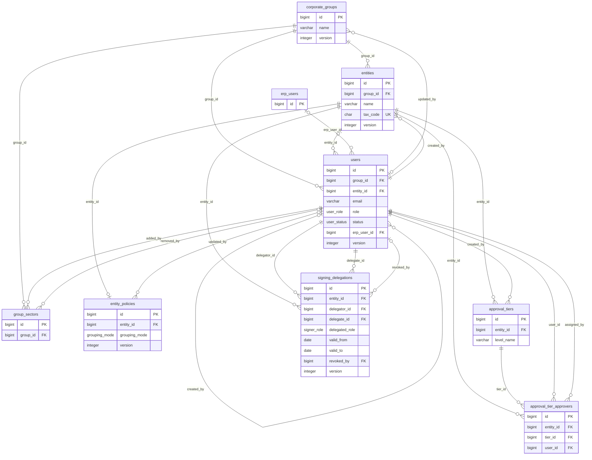

## Detailed ER diagram — Automation gates

One gate per supplier and entity pair, the shadow comparisons behind its accuracy, and the alerts (US-06). Tables drawn without columns beyond the key belong to another group and are shown only so that the relationship can be drawn.

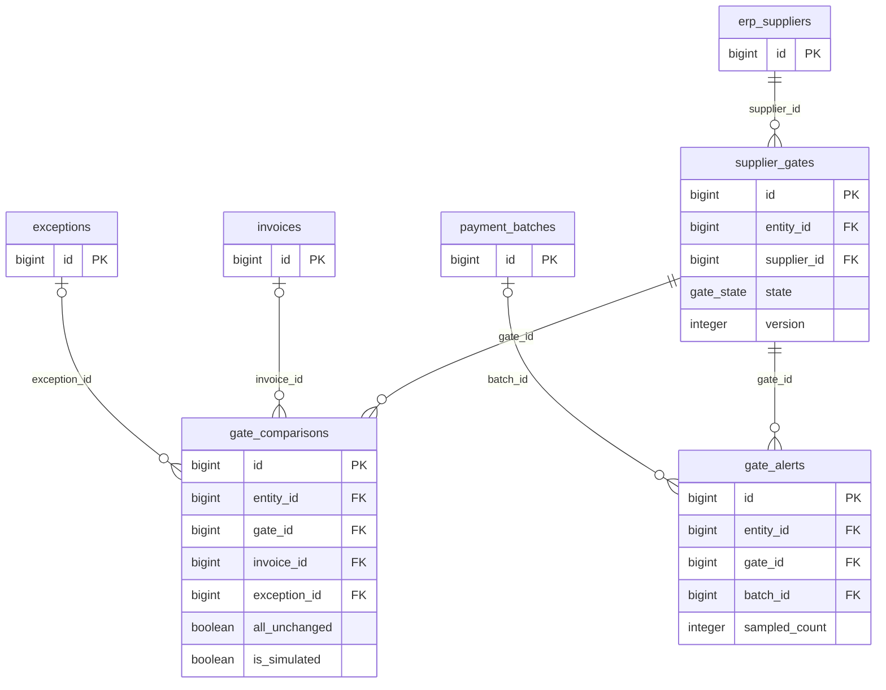

## Detailed ER diagram — ERP sync and synced source data

The read-only copy of the Entity ERP, the sync log, and the tax-risk list (US-07).

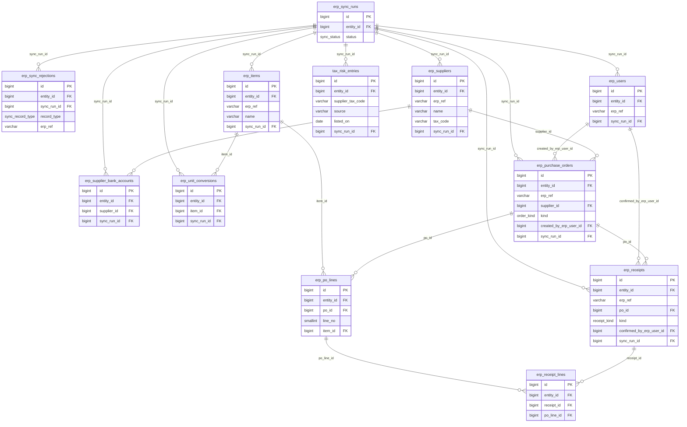

## Detailed ER diagram — ERP simulator (demo only)

The ERP side of the demo: personas, orders, receipts, and the simulated feed of invoice status at the tax authority (US-08, US-07, D-49, D-120). It has no foreign key to the synced copy; the sync joins them by reference.

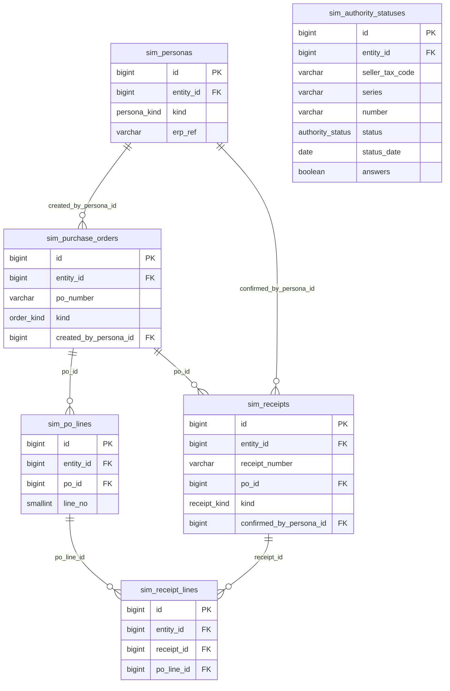

## Detailed ER diagram — Accumulated data

Mapping table, recurring profiles, price history, and supplier history of each entity (US-09, US-14, US-15, US-18). Tables drawn without columns beyond the key belong to another group and are shown only so that the relationship can be drawn.

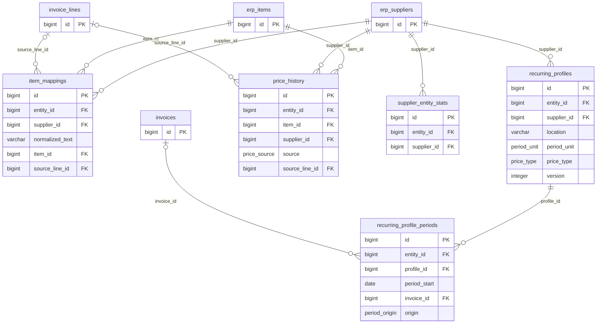

## Detailed ER diagram — Invoices

The invoice, its stored original, lines, corrections, and matched receipts (US-10, US-12, US-13). Tables drawn without columns beyond the key belong to another group and are shown only so that the relationship can be drawn.

```mermaid
erDiagram
  invoices {
    bigint id PK
    bigint entity_id FK
    bigint supplier_id FK
    varchar series
    varchar number
    date invoice_date
    date due_date
    invoice_kind invoice_kind
    signature_status signature_status
    trust_level trust_level
    invoice_flow flow
    bigint order_id FK
    bigint recurring_profile_id FK
    invoice_state state
    boolean holds_key
    rejection_reason rejection_reason
    invoice_source source
    integer version
  }

  invoice_documents {
    bigint id PK
    bigint entity_id FK
    bigint invoice_id FK
    char sha256
  }

  invoice_lines {
    bigint id PK
    bigint entity_id FK
    bigint invoice_id FK
    smallint line_no
    varchar description
  }

  invoice_corrections {
    bigint id PK
    bigint entity_id FK
    bigint correcting_invoice_id FK
    bigint original_invoice_id FK
  }

  invoice_receipts {
    bigint id PK
    bigint entity_id FK
    bigint invoice_id FK
    bigint receipt_id FK
    bigint check_run_id FK
  }

  erp_suppliers {
    bigint id PK
  }

  erp_purchase_orders {
    bigint id PK
  }

  recurring_profiles {
    bigint id PK
  }

  erp_receipts {
    bigint id PK
  }

  invoice_check_runs {
    bigint id PK
  }

  erp_suppliers |o--o{ invoices : supplier_id
  erp_purchase_orders |o--o{ invoices : order_id
  recurring_profiles |o--o{ invoices : recurring_profile_id
  invoices ||--o| invoice_documents : invoice_id
  invoices ||--o{ invoice_lines : invoice_id
  invoices ||--o{ invoice_corrections : correcting_invoice_id
  invoices |o--o{ invoice_corrections : original_invoice_id
  invoices ||--o{ invoice_receipts : invoice_id
  erp_receipts ||--o{ invoice_receipts : receipt_id
  invoice_check_runs ||--o{ invoice_receipts : check_run_id
```

## Detailed ER diagram — Intake sources and invoice status

The simulated entity mailbox, the lookups of invoice status at the tax authority, and the cancellation notices (US-31, US-10, US-18, US-07). Tables drawn without columns beyond the key belong to another group and are shown only so that the relationship can be drawn.

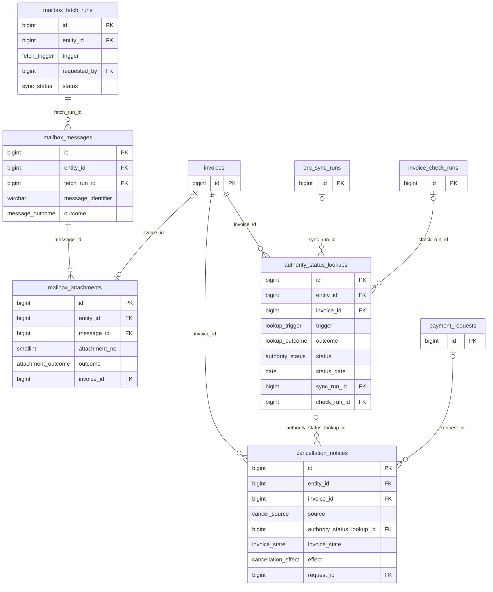

## Detailed ER diagram — Check runs and Rule Engine

One run of the checks per invoice and trigger, the Rule Engine decision with its six conditions, and the AI request log (US-16, G-05). Tables drawn without columns beyond the key belong to another group and are shown only so that the relationship can be drawn.

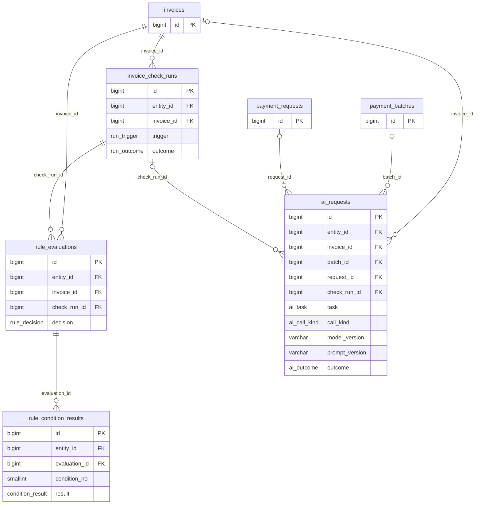

## Detailed ER diagram — AI outputs

What the AI proposed per task, each with its model and prompt version (US-12..US-15). Tables drawn without columns beyond the key belong to another group and are shown only so that the relationship can be drawn.

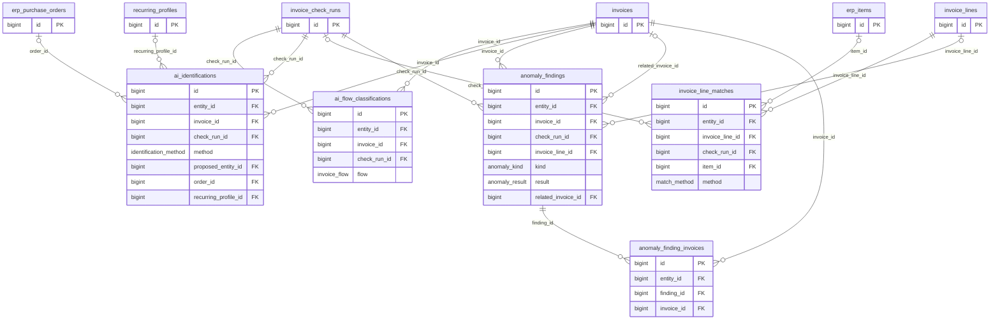

## Detailed ER diagram — Exceptions and decisions

Exceptions, their reasons, follow-up invoices, requests to suppliers, and the decisions of the Chief Accountant, the Payment Approver, and the Requesting Department (US-18..US-21, US-23, US-29). Tables drawn without columns beyond the key belong to another group and are shown only so that the relationship can be drawn.

```mermaid
erDiagram
  exceptions {
    bigint id PK
    bigint entity_id FK
    bigint invoice_id FK
    exception_state state
    exception_outcome outcome
    bigint opened_by_evaluation_id FK
    decision_role waiting_role
    bigint split_finding_id FK
    integer version
  }

  exception_reasons {
    bigint id PK
    bigint entity_id FK
    bigint exception_id FK
    reason_code reason_code
    smallint condition_no
    bigint condition_result_id FK
    bigint anomaly_finding_id FK
    bigint service_acceptance_id FK
    bigint authority_status_lookup_id FK
    bigint cancellation_notice_id FK
    withdraw_reason withdraw_reason
  }

  wrong_entity_reports {
    bigint id PK
    bigint entity_id FK
    bigint invoice_id FK
    bigint exception_id FK
    bigint exception_reason_id FK
    wrong_entity_source traced_source
  }

  exception_follow_up_links {
    bigint id PK
    bigint entity_id FK
    bigint exception_id FK
    bigint follow_up_invoice_id FK
    followup_kind kind
    followup_status status
  }

  message_templates {
    bigint id PK
    bigint entity_id FK
    message_kind kind
  }

  correction_requests {
    bigint id PK
    bigint entity_id FK
    bigint exception_id FK
    message_kind kind
    bigint template_id FK
    recipient_type recipient_type
    send_status send_status
  }

  tax_risk_decisions {
    bigint id PK
    bigint entity_id FK
    bigint exception_id FK
    bigint invoice_id FK
    bigint risk_entry_id FK
    hold_decision decision
  }

  individual_approvals {
    bigint id PK
    bigint entity_id FK
    bigint exception_id FK
    bigint invoice_id FK
    bigint approver_id FK
    approval_decision decision
    bigint required_tier_id FK
    bigint split_finding_id FK
  }

  service_acceptances {
    bigint id PK
    bigint entity_id FK
    bigint invoice_id FK
    bigint order_id FK
    acceptance_decision decision
    bigint decided_by FK
    bigint check_run_id FK
    bigint overridden_by_receipt_id FK
  }

  invoices {
    bigint id PK
  }

  erp_purchase_orders {
    bigint id PK
  }

  erp_receipts {
    bigint id PK
  }

  invoice_check_runs {
    bigint id PK
  }

  authority_status_lookups {
    bigint id PK
  }

  cancellation_notices {
    bigint id PK
  }

  rule_evaluations {
    bigint id PK
  }

  anomaly_findings {
    bigint id PK
  }

  rule_condition_results {
    bigint id PK
  }

  tax_risk_entries {
    bigint id PK
  }

  approval_tiers {
    bigint id PK
  }

  invoices ||--o{ exceptions : invoice_id
  rule_evaluations |o--o{ exceptions : opened_by_evaluation_id
  anomaly_findings |o--o{ exceptions : split_finding_id
  exceptions ||--o{ exception_reasons : exception_id
  rule_condition_results |o--o{ exception_reasons : condition_result_id
  anomaly_findings |o--o{ exception_reasons : anomaly_finding_id
  invoices ||--o{ wrong_entity_reports : invoice_id
  exceptions ||--o{ wrong_entity_reports : exception_id
  exception_reasons ||--o{ wrong_entity_reports : exception_reason_id
  exceptions ||--o{ exception_follow_up_links : exception_id
  invoices ||--o{ exception_follow_up_links : follow_up_invoice_id
  exceptions ||--o{ correction_requests : exception_id
  message_templates ||--o{ correction_requests : template_id
  exceptions ||--o{ tax_risk_decisions : exception_id
  invoices ||--o{ tax_risk_decisions : invoice_id
  tax_risk_entries ||--o{ tax_risk_decisions : risk_entry_id
  exceptions ||--o{ individual_approvals : exception_id
  invoices ||--o{ individual_approvals : invoice_id
  approval_tiers ||--o{ individual_approvals : required_tier_id
  anomaly_findings |o--o{ individual_approvals : split_finding_id
  invoices ||--o| service_acceptances : invoice_id
  erp_purchase_orders ||--o{ service_acceptances : order_id
  invoice_check_runs |o--o{ service_acceptances : check_run_id
  erp_receipts |o--o{ service_acceptances : overridden_by_receipt_id
  service_acceptances |o--o{ exception_reasons : service_acceptance_id
  authority_status_lookups |o--o{ exception_reasons : authority_status_lookup_id
  cancellation_notices |o--o{ exception_reasons : cancellation_notice_id
```

## Detailed ER diagram — Batch, signing, and ERP send

Batches, sample check and its expansions, reopenings, payment requests, signatures, and the send to the Entity ERP (US-24..US-26, US-30). Tables drawn without columns beyond the key belong to another group and are shown only so that the relationship can be drawn.

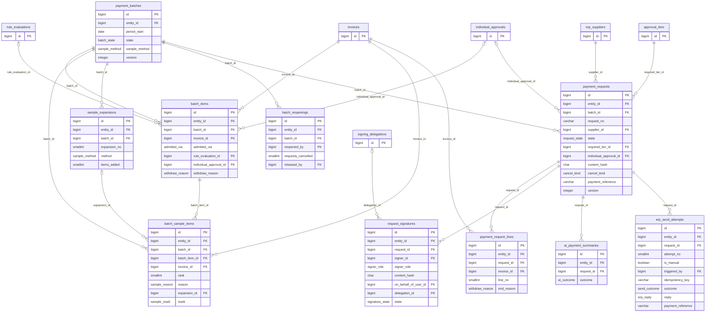

## Detailed ER diagram — Notifications

In-app notifications and reminders (US-32, D-97). The object a notification opens is an invoice, a batch, or a payment request; it is not a foreign key because it can be any of the three. Tables drawn without columns beyond the key belong to another group and are shown only so that the relationship can be drawn.

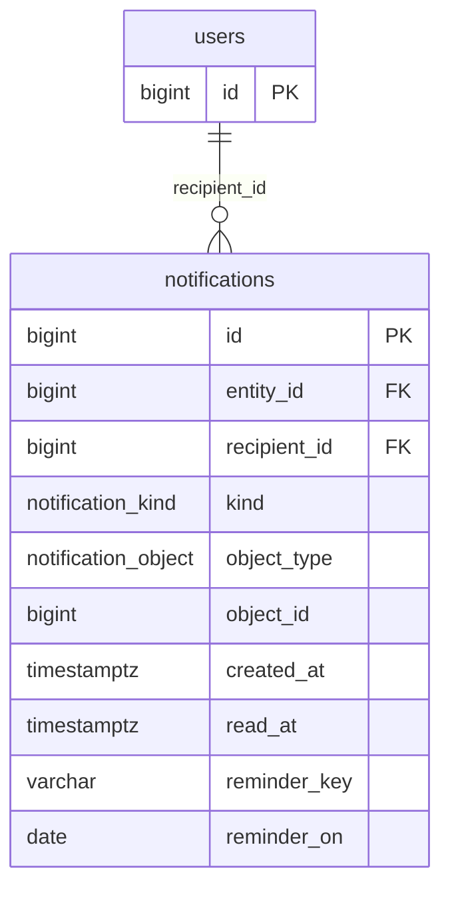

## Detailed ER diagram — Audit log

The append-only log (US-28, D-55). Its subject columns are not foreign keys because the subject can be any table. Tables drawn without columns beyond the key belong to another group and are shown only so that the relationship can be drawn.

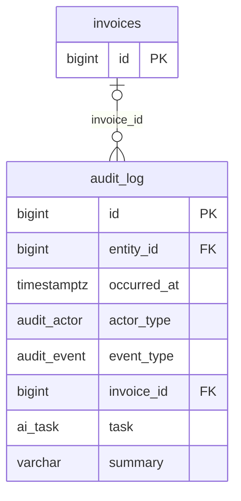

## Foreign keys to `entities` and `users`

These are in the DBML and are not repeated in every diagram. `entity_id` refers to `entities` in every table that has it. Columns that end in `_by` refer to `users`; the other user columns are listed here.

| Table | Column | Refers to | Meaning |
|---|---|---|---|
| `approval_tier_approvers` | `user_id` | `users` | The person who acts in this row |
| `individual_approvals` | `approver_id` | `users` | The person who acts in this row |
| `request_signatures` | `signer_id` | `users` | The person who acts in this row |
| `request_signatures` | `on_behalf_of_user_id` | `users` | The delegator whose signature a delegate gave (AC-30.10) |
| `signing_delegations` | `delegator_id` | `users` | The absent signer |
| `signing_delegations` | `delegate_id` | `users` | The person who signs while the delegator is absent |
| `notifications` | `recipient_id` | `users` | The person the item is for |
| `audit_log` | `actor_user_id` | `users` | The person who acts in this row |

**Related:** [Database index](README.md) · [Data model](01-data-model.md)
