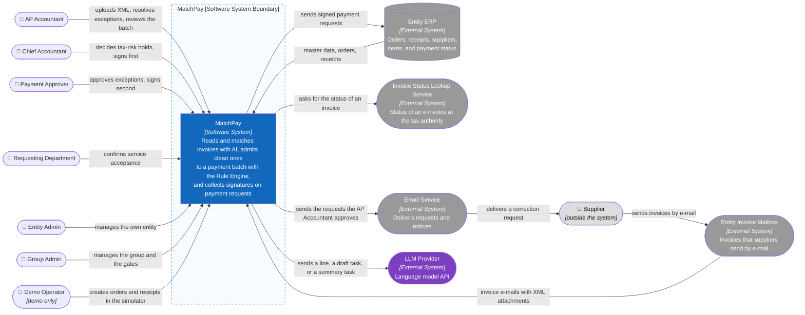

# C1 — System Context

> Design status: MVP — Step 7 of 9, draft for review
>
> Implementation status: NOT STARTED

**Purpose:** show who uses MatchPay and which outside systems it talks to, without implementation technology. The roles are the seven roles of the [Step 3 routes](../03-information-architecture/02-routes-and-permissions.md) and the `user_role` enum of the database; the outside systems are the systems of the [use case actors](../02-usecases-userstories/01-use-cases.md). In the demo, three of the outside systems are simulated inside the deployment (see [C2](02-container.md)); C1 shows them as they are in production, and the table says what the demo binds to each.

## System boundary

MatchPay is responsible for everything in the [MVP scope](../01-research/05-scope.md): reading XML e-invoices, the AI checks, the Rule Engine, exceptions, the payment batch with its sample check, signing, sending signed requests to the ERP, notifications, the dashboard, and the audit log. It is not the ERP: it keeps a read-only copy of the ERP master data, orders, and receipts, and never writes to them (BR-25). The AI supplies evidence, the Rule Engine decides, and a person signs; the AI never signs and never sends anything outside the system by itself (BR-20, BR-26).

Outside the MVP: the supplier portal and the real connection to the tax authority (W-05, W-13), PDF and foreign invoices (W-19), a bank connection, and a public API (D-130).

## People

| Person | What they do in MatchPay | Scope |
|---|---|---|
| AP Accountant | Uploads XML invoices, resolves exceptions, sends requests to suppliers, runs the sample check, releases the batch, resends to the ERP | Own entity |
| Chief Accountant | Decides tax-risk holds, signs first, names a delegate | Own entity |
| Payment Approver | Approves single exceptions, signs second, names a delegate | Own entity, own approval level |
| Requesting Department | Confirms or rejects the acceptance of a service | Own entity |
| Entity Admin | Manages users, policy, and the approval matrix; reads and revokes delegations | Own entity |
| Group Admin | Manages entities, group limits, and the automation gates; sees per-entity counts and rates only | The group |
| Demo Operator | Plays the buyer and the warehouse keeper in the ERP simulator (demo only) | The group, simulator only |
| Supplier | Receives correction requests by e-mail and sends invoices by e-mail. Has no account and no portal in the MVP (W-05) | Outside the system |

## Relationships

| # | From | To | What flows | Technology and notes | Demo binding |
|---|---|---|---|---|---|
| R1 | Seven roles | MatchPay | Requests to the web application | HTTPS, one web application, cookie session (D-131) | Same |
| R2 | Entity ERP | MatchPay | Users, suppliers and bank accounts, items and unit conversions, purchase orders, receipts, the tax-risk list (US-07) | Read through `ErpPort` by the scheduled sync, every 15 minutes (DF-31); the ERP is the source of truth (BR-25) | `SimulatedErpAdapter` reads the `sim_*` tables and seed files (D-49, D-143) |
| R3 | MatchPay | Entity ERP | A signed payment request, up to 3 attempts, the request number as the idempotency key (DF-24); the paid status and reference come back (US-26) | Sent through `ErpPort`; the failure after `Sent` is only mocked in the demo (D-67) | `SimulatedErpAdapter` records the attempt and answers as configured |
| R4 | MatchPay | Invoice Status Lookup Service | The invoice key (seller, series, number); the answer is Valid, Adjusted, Replaced, or Cancelled with a date (DF-64) | Read through `AuthorityStatusPort`; waits at most 10 seconds; no real service exists (W-13, O-10) | `SimulatedAuthorityAdapter` reads `sim_authority_statuses` |
| R5 | Entity Invoice Mailbox | MatchPay | Messages with XML attachments, read every 15 minutes or on "Fetch now" (US-31, DF-63) | Read through `MailboxPort`; the sender is not trusted | `SimulatedMailboxAdapter` reads message files from a folder per entity (seed, D-183) |
| R6 | MatchPay | Email Service | A correction request, data-fix notice, or reissue request, only when the AP Accountant presses Send (AC-19.2) | Sent through `MailerPort`; a failure leaves the status "Not sent" and the exception unchanged (AC-19.6) | `SimulatedMailerAdapter` marks the request sent and delivers nothing |
| R7 | Email Service | Supplier | The request reaches the supplier or the internal team | Outside MatchPay. The reply is recorded by hand (`recordCorrectionReply`); there is no portal (W-05) | Not applicable |
| R8 | Supplier | Entity Invoice Mailbox | An invoice as an e-mail attachment | Outside MatchPay | Seeded messages |
| R9 | MatchPay | LLM Provider | A line to match when the mapping table and the embedding model are not sure, a draft task, a summary task, and a flow or identification fallback | Over HTTPS through `LlmPort`; document text goes as data, the answer must follow a fixed JSON schema (BR-27); synthetic data only in the MVP (O-03); see [LLM provider](06-llm-provider.md) | Same provider with synthetic data |

Embeddings are not an outside relationship: the embedding model runs inside the deployment (D-180).

## Questions this level answers

- **Which systems can change a payment?** Only MatchPay's signed request, sent to the ERP. No outside system pushes a payment into MatchPay.
- **Where can data leave the deployment?** To the LLM Provider (R9) and, by e-mail, to a supplier or an internal team (R6). Nothing else leaves.
- **Which outside systems exist only as simulations?** The ERP, the status service, and the mailbox (R2 to R5); the Email Service is simulated too (R6). The LLM Provider is a real API in the demo.

**Previous:** [Step index](README.md) · **Next:** zoom into MatchPay → [C2 — Container](02-container.md).
