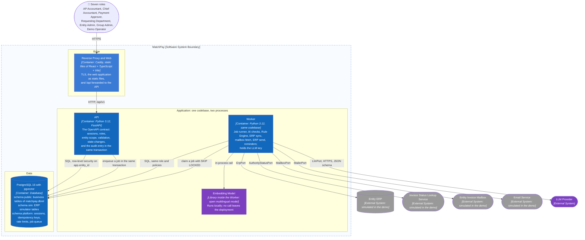

# C2 — Container

> Design status: MVP — draft for review
>
> Implementation status: NOT STARTED

**Purpose:** zoom into MatchPay and describe the runtime units, the storage, and the outside systems. The style is a modular monolith: one backend codebase deployed as two processes, `api` and `worker` (D-165).

## Responsibilities

| Container | Technology | Responsibility | Status |
|---|---|---|---|
| Reverse Proxy and Web | Caddy (Unverified: the Caddy documentation was not opened; nginx is the alternative), static files built by Vite | Terminates TLS, serves the built web application, forwards `/api/v1` to the API, and returns `index.html` for any other path so that the history-mode routes of the information architecture work (D-166) | Not started |
| API | Python 3.12, FastAPI, Pydantic v2, SQLAlchemy 2 | Implements the 121 operations of [`openapi.yaml`](../06-api/openapi.yaml): authenticates the session, checks role and entity scope, validates the CSRF token, checks versions, changes state, and writes the audit entry in the same transaction. Starts jobs by inserting them. The two operations that answer at once and need an outside system (`draftCorrectionRequest` for the LLM, `sendCorrectionRequest` for the Email Service) insert a job and wait for its result up to a timeout (D-169). Never calls the LLM, an ERP, a mailbox, the status service, or the Email Service itself | Not started |
| Worker | Same codebase and image as the API, started with another command | Runs the ten jobs of the [API traceability](../06-api/01-api-traceability.md#4-background-jobs): the check run (AI steps, then the Rule Engine), the ERP sync, the mailbox fetch, the authority status lookup, the ERP send, the daily reminders, the AI payment summary, and the demo seed loader, plus the two call-and-wait jobs (draft and send of a request) that the API waits for. The only unit that holds the LLM key and reaches the outside systems | Not started |
| Embedding Model | An open multilingual model that supports Vietnamese, run with a Python library inside the Worker (D-180) | Turns item text into vectors for the top 3 to 5 candidate items; costs nothing per call | Not started |
| PostgreSQL | PostgreSQL 16, extension pgvector | Holds everything that must survive: the business tables (74 in `matchpay.dbml`), the original XML as `bytea`, the ERP simulator tables, and the platform tables. Enforces entity isolation a second time with row-level security | Not started |
| Entity ERP, Invoice Status Lookup Service, Entity Invoice Mailbox, Email Service | Behind the ports `ErpPort`, `AuthorityStatusPort`, `MailboxPort`, and `MailerPort` | Outside systems. The demo binds a simulated adapter to each (D-171) | Simulated in the demo |
| LLM Provider | A hosted API behind `LlmPort` ([the decision record](06-llm-provider.md)) | Answers the few calls the embedding and the signal-fusion model cannot settle | Not started |

## Architecture rules

1. The browser never reaches PostgreSQL, the Worker, or an outside system. It reaches the proxy only.
2. Hiding a control in the web application is UX only; the API checks the role, the entity, the CSRF token, and the version on every request (D-133, BR-09).
3. The entity comes from the session and is added to every query. PostgreSQL row-level security on `app.entity_id` is the second layer, so a query that forgets the filter returns no rows (D-172).
4. The AI gives evidence, the Rule Engine decides, and a person signs (BR-27, BR-20). The Rule Engine uses no LLM, and the LLM Gateway is not a dependency of the Rule Engine package.
5. A job is inserted in the same transaction as the change that causes it, so a committed change never loses its job (D-169).
6. Every state-changing operation appends to `audit_log` in the same transaction, and the action fails if the entry fails (D-144, DF-30).
7. MatchPay reaches an ERP, the status service, the mailbox, and the Email Service only through a port. The demo binds a simulated adapter; nothing in the business modules knows which one (D-171).
8. The business modules never write to the ERP copy tables (`erp_*`) except through the sync, and never touch the `sim` schema except through the simulator adapters (BR-25, D-49).
9. Embeddings are computed inside the deployment. The LLM key exists only in the Worker, and document text goes to the LLM as data in a delimited field, never as instructions (BR-27, D-179).
10. The LLM Provider can be replaced by configuration: nothing outside the LLM Gateway names a provider (D-181).

## Where the database and API items land

| Item | Container |
|---|---|
| Session store (D-131), idempotency keys (DF-87), rate-limit counters (DF-88) | PostgreSQL schema `platform` |
| XML original and cancellation notice bytes (D-57, DF-81) | PostgreSQL `bytea` columns of the business schema |
| Server configuration (DF-55) | Environment variables and one YAML file per deployment, read by the API and the Worker at start ([tech stack](05-tech-stack.md#server-configuration)) |
| ERP simulator (D-143) | Module `demo_erp` in the same codebase, tables in schema `sim` |
| Simulated mailbox folders and tax-risk list | Seed files in the deployment (D-183) |

**Previous:** [C1 — System Context](01-system-context.md) · **Next:** zoom into the backend → [C3 — Component](03-component.md).
