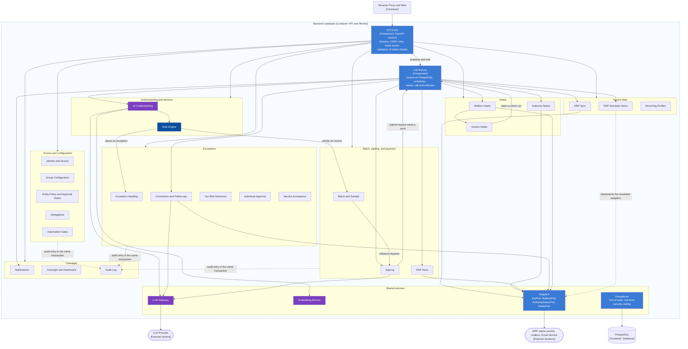

# C3 — Component — Backend

> Design status: MVP — Step 7 of 9, draft for review
>
> Implementation status: NOT STARTED

**Purpose:** zoom into the backend codebase, which the `api` and the `worker` processes share (D-165). It is a modular monolith: one Python package per module, one public interface per module, and no module reaches into the tables of another. The module names follow the tags of [`openapi.yaml`](../06-api/openapi.yaml), so a reader can go from an operation to its module. The names in the catalog are stable: the C4 Component column of the [master traceability matrix](../traceability/master-traceability.md) uses them exactly.

Dark blue marks the Rule Engine, the one module that admits an invoice. Purple marks the modules that use a model. Light blue marks cross-cutting services. All other modules are plain business modules.

## Component catalog

Operations: a tag name with a count means every operation of the tag; backticked names are single operations. All 121 operations belong to exactly one component. Jobs are the ten jobs of the [API traceability](../06-api/01-api-traceability.md#4-background-jobs), each owned by one component. Tables: the component that owns a table is the only one whose code inserts or updates it (D-185); other modules call its public interface. All 74 tables of [`matchpay.dbml`](../05-database/matchpay.dbml) have one owner. The tables of the schemas `platform` and `sim` that are not in the DBML are described below the catalog.

| Component | Kind | Owns (OpenAPI) | Jobs | Tables written | Stories |
|---|---|---|---|---|---|
| Identity and Access | Business | Session (3); Users (6) | — | `users` | US-01, US-02 |
| Group Configuration | Business | Group and entities (7) | — | `corporate_groups`, `group_sectors`, `entities` | US-03, US-04 |
| Entity Policy and Approval Matrix | Business | Entity policy (2); Approval matrix (2) | — | `entity_policies`, `approval_tiers`, `approval_tier_approvers` | US-04, US-05 |
| Delegations | Business | Delegations (5) | — | `signing_delegations` | US-30 |
| Automation Gates | Business | Automation gates (4) | — | `supplier_gates`, `gate_comparisons`, `gate_alerts` | US-06 |
| ERP Sync | Business | ERP sync (7) | Scheduled ERP sync | `erp_sync_runs`, `erp_sync_rejections`, `erp_users`, `erp_suppliers`, `erp_supplier_bank_accounts`, `erp_items`, `erp_unit_conversions`, `erp_purchase_orders`, `erp_po_lines`, `erp_receipts`, `erp_receipt_lines`, `tax_risk_entries` | US-07 |
| ERP Simulator (demo) | Demo | Demo (6) | Demo seed loader | `sim_personas`, `sim_purchase_orders`, `sim_po_lines`, `sim_receipts`, `sim_receipt_lines`, `sim_authority_statuses` | US-08 |
| Recurring Profiles | Business | Recurring profiles (5) | — | `recurring_profiles`, `recurring_profile_periods` | US-09 |
| Invoice Intake | Business | Invoices (7) | — | `invoices`, `invoice_documents`, `invoice_lines` | US-10, US-17 |
| Mailbox Intake | Business | Mailbox (5) | Mailbox fetch | `mailbox_fetch_runs`, `mailbox_messages`, `mailbox_attachments` | US-31 |
| Authority Status | Business | `runAuthorityLookup`, `listAuthorityStatusLookups` | Authority status lookup | `authority_status_lookups` | US-07, US-10 |
| AI Understanding | AI | `getInvoiceEvidence`, `listCheckRuns`, `rerunChecks`, `getCheckRun` | Check run | `invoice_check_runs`, `ai_flow_classifications`, `ai_identifications`, `invoice_receipts`, `invoice_line_matches`, `item_mappings`, `anomaly_findings`, `anomaly_finding_invoices`, `price_history`, `supplier_entity_stats` | US-12, US-13, US-14, US-15, US-17 |
| Rule Engine | Decision | — | — | `rule_evaluations`, `rule_condition_results` | US-16 |
| Exception Handling | Business | Exceptions (11) | — | `exceptions`, `exception_reasons`, `wrong_entity_reports` | US-06, US-18 |
| Corrections and Follow-ups | Business | Corrections and follow-ups (12) | Draft request (call-and-wait); Request mail send (call-and-wait) | `invoice_corrections`, `message_templates`, `correction_requests`, `exception_follow_up_links`, `cancellation_notices` | US-19, US-20 |
| Tax-Risk Decisions | Business | Tax-risk decisions (1) | — | `tax_risk_decisions` | US-21 |
| Individual Approval | Business | Individual approvals (1) | — | `individual_approvals` | US-23 |
| Service Acceptance | Business | Service acceptance (3) | — | `service_acceptances` | US-29 |
| Batch and Sample | Business | Batch (12) | — | `payment_batches`, `batch_items`, `batch_sample_items`, `sample_expansions`, `batch_reopenings` | US-06, US-16, US-24 |
| Signing | Business | Signing (5) | AI payment summary | `payment_requests`, `payment_request_lines`, `request_signatures`, `ai_payment_summaries` | US-25, US-30 |
| ERP Send | Business | ERP send (2) | ERP send worker | `erp_send_attempts` | US-26 |
| Notifications | Business | Notifications (3) | Daily reminder job | `notifications` | US-32 |
| Oversight and Dashboard | Business | Dashboard and group overview (4) | — | — | US-06, US-27 |
| Audit Log | Business | Audit log (2) | — | `audit_log` | US-01, US-28 |
| HTTP API | Cross-cutting | — | — | — | All |
| Persistence | Cross-cutting | — | — | — | All |
| Job Runner | Cross-cutting | — | — | — | All |
| LLM Gateway | Cross-cutting | — | — | `ai_requests` | US-12, US-13, US-14, US-19, US-25 |
| Embedding Service | Cross-cutting | — | — | — | US-14 |
| Adapters | Cross-cutting | — | — | — | US-07, US-08, US-19, US-26, US-31 |

## What each component does

| Component | Responsibility | Does not own |
|---|---|---|
| Identity and Access | Login and logout, the server-side session, Argon2id password check, the CSRF token, users and roles, the check of the ERP user link (DF-14), and the rule that a deactivated user's next request is refused (AC-02.5) | Approval levels and delegations |
| Group Configuration | The group, its limits, the sector list, and the entities (US-03) | The policy of one entity |
| Entity Policy and Approval Matrix | Tolerances, thresholds, the sample rate, the grouping mode, and the approval tiers of one entity (US-04, US-05) | Who may sign: that is Signing |
| Delegations | Signing delegations: create, list, revoke, the computed state (US-30, BR-38) | The signature itself |
| Automation Gates | The gate of each supplier and entity pair, its comparisons and alerts, open and close (US-06, BR-06) | Marking a sample item: that is Batch and Sample, which calls the gate |
| ERP Sync | The scheduled copy of ERP data into the `erp_*` tables, the rejections, the tax-risk list, and the per-entity lock so that two runs do not overlap (D-182) | Writing to the ERP (BR-25) |
| ERP Simulator (demo) | Orders and receipts of the Demo Operator, the personas, and the seed loader. Exists only when the demo flag is on (D-143) | Anything the product needs outside the demo |
| Recurring Profiles | Profiles and their periods for recurring invoices (US-09, BR-24) | Checking an invoice against a profile: that is AI Understanding |
| Invoice Intake | The XML upload, the parser, the signature and buyer tax code checks, the exact-duplicate insert, the original XML as `bytea`, the worklist, and the invoice lifecycle changes (BR-33) | Reading meaning from the invoice: that is AI Understanding |
| Mailbox Intake | The mailbox fetch, its log, and the hand-over of each XML attachment to Invoice Intake (US-31) | The checks of an invoice |
| Authority Status | The lookup of an invoice at the status service through `AuthorityStatusPort`, its log, and the stop of a Cancelled or Replaced invoice (BR-39) | The simulated feed: that is the ERP Simulator |
| AI Understanding | The check run: flow, identification, line matching (mapping table, then embedding, then signal fusion, then the LLM), anomaly findings, and the evidence read (D-179) | Deciding admission |
| Rule Engine | The six conditions of BR-05 evaluated from stored evidence only, with every value recorded. It imports no LLM code (BR-27) | Producing evidence |
| Exception Handling | The exception worklist and its resolutions: take, confirm a match, correct the flow, confirm the entity, report a wrong entity, record the gate comparison, reject, send for a decision (US-18) | Drafting requests |
| Corrections and Follow-ups | Templates, drafts, sending, replies, cancellation notices, and follow-up invoices (US-19, US-20) | The LLM call itself: that is the LLM Gateway |
| Tax-Risk Decisions | The Chief Accountant's decision on a hold (US-21) | The tax-risk list: that is ERP Sync |
| Individual Approval | The Payment Approver's approval of a single exception, including the combined decision on split orders (US-23, D-70) | Signing |
| Service Acceptance | The Requesting Department's acceptance queue and decision (US-29) | The independent-source rule: that is the Rule Engine |
| Batch and Sample | The monthly batch, admission, the sample check and its expansion, release, reopening, and withdrawal (US-24) | The payment requests: they are created in the release transaction through Signing |
| Signing | Payment requests, lines, signatures, the AI summary job, the signer checks of BR-02 and BR-36, and the content hash (US-25) | Sending to the ERP |
| ERP Send | The send worker, the attempts, the resend, and the paid status (US-26) | The signature |
| Notifications | In-app notifications, unread count, and the daily reminder job (US-32) | Email to staff: there is none (DF-67) |
| Oversight and Dashboard | Read-only figures: the dashboard, the figure lists, the group dashboard, and the group overview. The group figures come from aggregate functions that return numbers only (D-184) | Any table |
| Audit Log | The append-only log, its list, and the writer that every module calls inside its own transaction (D-144) | Deciding what to log: each module does |
| HTTP API | Routers generated to match the contract, session and CSRF middleware, role and scope checks, the shared error handler that writes the refusal audit entries (D-164), and rate limits | Business rules |
| Persistence | Sessions of the database connection, the unit of work, and the per-transaction setting `app.entity_id` (D-172) | Table ownership |
| Job Runner | The queue in `platform`, the claim with `SKIP LOCKED`, schedules, retries, and call-and-wait jobs for the two operations that need an outside system at once (D-169) | What a job does |
| LLM Gateway | `LlmPort`, the provider adapters, the fixed JSON schemas, the prompt and schema versions, the 20-second timeout, and one `ai_requests` row for each model call (D-179, D-181) | Deciding anything |
| Embedding Service | `EmbeddingPort` and the local model; the candidate search with pgvector (D-180) | Matching: that is AI Understanding |
| Adapters | The four ports and their production and simulated adapters (D-171) | Business rules |

## Dependency rules

1. A business module calls another only through its public interface. Reading another module's table directly is allowed for reads that the data model already needs, through a read-only view the owner exports; writing is never allowed (D-185).
2. The Rule Engine depends on AI Understanding's stored evidence and on the policy, gates, and tax-risk data, but not on the LLM Gateway or the Embedding Service.
3. Only the Worker process starts the model, the embedding, and the adapters. The API process imports the same package but never runs these (C2 rule 9).
4. Every state-changing path ends in Audit Log inside the caller's transaction.

## Tables outside the DBML

| Schema | Table | Owner | Content |
|---|---|---|---|
| `platform` | `sessions` | Identity and Access | Session id hash, user, CSRF token hash, created, last seen, expiry (D-131, DF-84) |
| `platform` | `idempotency_keys` | HTTP API | Key, operation, user, request hash, first result, expiry 24 hours (DF-87) |
| `platform` | `rate_limit_counters` | HTTP API | Counter per key and minute (DF-88) |
| `platform` | `jobs` | Job Runner | Kind, payload, entity, run time, state, attempts, lease, result (D-169) |
| `sim` | `sim_*` | ERP Simulator (demo) | The six `sim_*` tables of the DBML, moved to this schema (D-171) |

**Previous:** [C2 — Container](02-container.md) · **Next:** zoom into two features → [C4 — Code](04-code.md).
