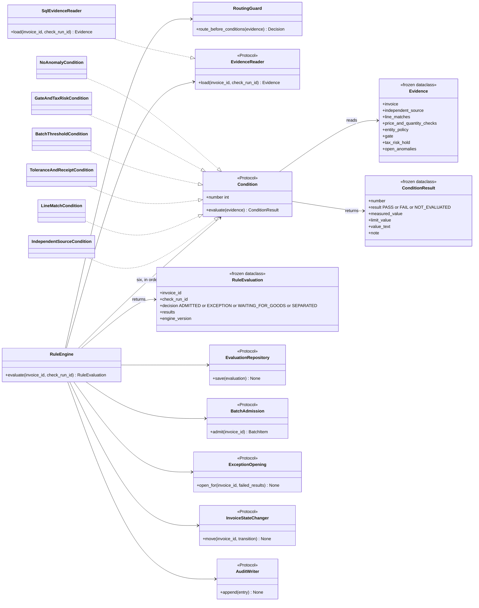
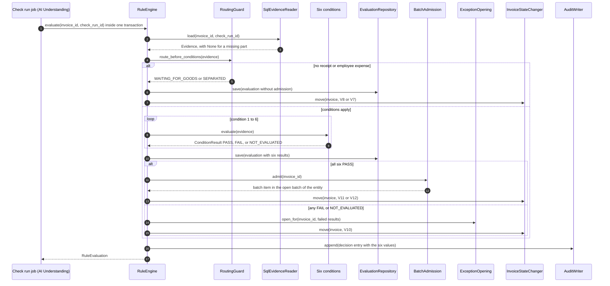
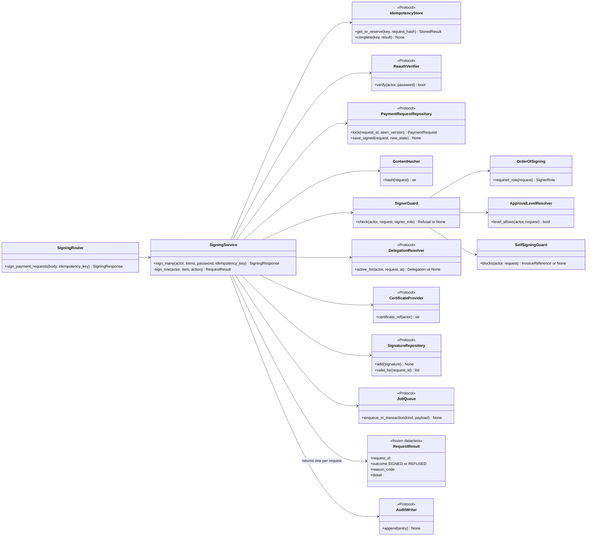
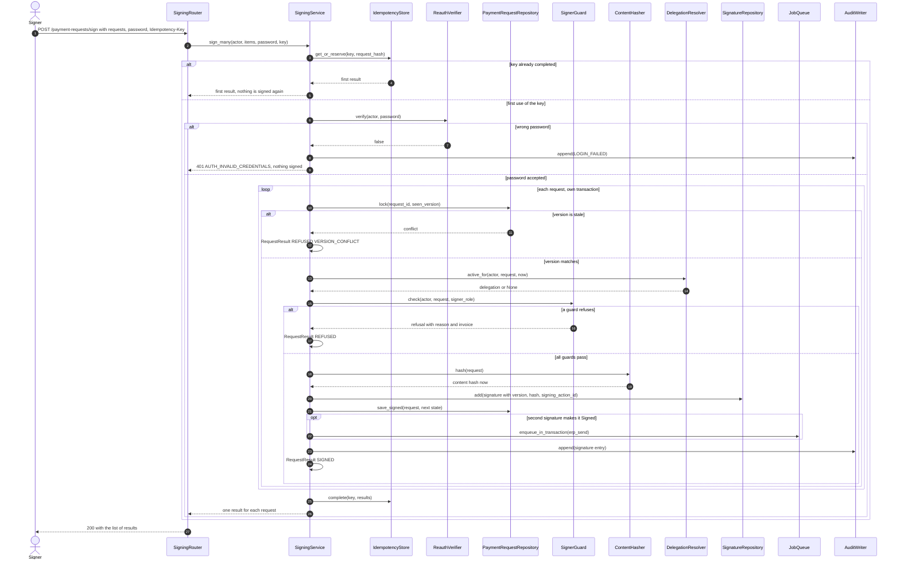

# C4 — Code — Two Core Features

> Design status: MVP — Step 7 of 9, draft for review
>
> Implementation status: NOT STARTED

**Purpose:** show the code level of the two features where a mistake costs the most: the Rule Engine's evaluation of the six batch conditions (US-16), and signing many payment requests in one action (US-25). The class names are the intended Python classes and protocols. They define responsibilities and dependency directions; the folder layout is Step 8 and the code is Step 9. Everything here is a call awaiting review.

## L4.1 Rule Engine — the six conditions (US-16)

Module: **Rule Engine** (C3). Sources: BR-05, BR-27, BR-12, BR-14, BR-23, AC-16.1 to AC-16.15, [the data model](../05-database/01-data-model.md).

The Rule Engine reads stored evidence and nothing else. It does not import the LLM Gateway or the Embedding Service, so switching the LLM off cannot change a decision (AC-16.10). A step whose evidence is missing makes its condition `NOT_EVALUATED`, which fails the invoice into an exception and never admits it (AC-16.11, BR-27).

| Class | Responsibility | Rules |
|---|---|---|
| `RuleEngine` | Runs the guard, then all six conditions in order (all six are always evaluated, so an exception lists every failure), saves the evaluation, then admits or opens the exception. Takes its collaborators as arguments, so a test runs it with fakes | BR-05, AC-16.2 |
| `RoutingGuard` | Decides the two outcomes that are not exceptions: no receipt gives `WAITING_FOR_GOODS` (BR-14), an employee-expense invoice gives `SEPARATED` (BR-23). Neither is admitted | BR-14, BR-23, AC-16.9 |
| `EvidenceReader` and `SqlEvidenceReader` | Load the stored AI outputs and the entity configuration for one check run. Return `None` for a missing part, never a guess | BR-27 |
| `IndependentSourceCondition` | Condition 1: key fields confirmed by an ERP receipt or order, a confirmed service acceptance, or a matching recurring profile for a signed non-coded invoice | BR-17, BR-19, BR-24, AC-16.3 |
| `LineMatchCondition` | Condition 2: every line has a fusion probability of at least the match threshold (0.90 by default) | BR-28, AC-16.4 |
| `ToleranceAndReceiptCondition` | Condition 3: price and quantity inside the entity tolerance, quantity not above the quantity received | BR-04, BR-15, AC-16.5 |
| `BatchThresholdCondition` | Condition 4: the total is below the entity's batch threshold (equal fails) | BR-16, AC-16.6 |
| `GateAndTaxRiskCondition` | Condition 5: the gate of the pair is open, and the supplier is not on the tax-risk list unless the Chief Accountant released this invoice | BR-06, BR-08, AC-16.7 |
| `NoAnomalyCondition` | Condition 6: no open anomaly finding | BR-10, BR-11, BR-24, BR-29, BR-30, AC-16.8 |
| `ConditionResult`, `RuleEvaluation` | Immutable results. They map one to one to `rule_condition_results` and `rule_evaluations`, which also store the tolerance and threshold in force | BR-12, AC-16.1 |
| `EvaluationRepository` | Writes the evaluation and its six rows | BR-12 |
| `BatchAdmission` | Implemented by Batch and Sample: `INSERT ... ON CONFLICT DO NOTHING` on the batch of the entity and month, then the batch item, so two admissions at once create one batch | D-10, AC-16.14 |
| `ExceptionOpening` | Implemented by Exception Handling: opens the exception with one reason for each failed condition | BR-34, AC-16.2 |
| `InvoiceStateChanger` | Implemented by Invoice Intake: applies the lifecycle transition V10, V11, V12, V7, or V8 under the version check | BR-33, BR-37 |
| `AuditWriter` | Implemented by Audit Log: the entry of the decision, in the same transaction | BR-12, D-144 |

## L4.2 Signing many payment requests in one action (US-25)

Module: **Signing** (C3). Sources: BR-20, BR-02, BR-03, BR-36, BR-37, BR-38, DF-01, DF-10, DF-86, DF-87, AC-25.2 to AC-25.12, AC-30.2 to AC-30.5, D-137, D-150, D-153.

One call carries 1 to 50 requests and the signer's password. The password is checked once for the whole action; a wrong password signs nothing (D-153). Each request is then its own transaction, so a refused request never blocks the others, and the answer lists every request as signed or refused with the reason (D-137). A signature binds to the request version and the content hash recomputed at the moment of signing (BR-37).

| Class | Responsibility | Rules |
|---|---|---|
| `SigningRouter` | The FastAPI route of `signPaymentRequests`: validates the body (1 to 50 requests), reads `Idempotency-Key`, calls the service | DF-86, D-137 |
| `SigningService` | `sign_many` checks the password once, then calls `sign_one` for each request in its own transaction and collects the results. `sign_one` locks the request with the version check, runs the guards, recomputes the hash, adds the signature, and changes the state | BR-20, AC-25.4 |
| `IdempotencyStore` | Reserves the key in `platform.idempotency_keys`. A repeat with the same body returns the first result; the same key with another body is refused with 422 | DF-87, AC-26.12 |
| `ReauthVerifier` | Implemented by Identity and Access: checks the signer's own password with Argon2id. A wrong password gives 401 `AUTH_INVALID_CREDENTIALS` and a `LOGIN_FAILED` entry | AC-25.3, D-153 |
| `PaymentRequestRepository` | `lock` runs `SELECT ... FOR UPDATE` and compares the version; a stale version is a refusal `VERSION_CONFLICT` for that request. `save_signed` bumps the version | BR-37, AC-25.10 |
| `ContentHasher` | SHA-256 of the canonical content: request number, supplier, and each active line with its invoice hash and amount. The same function creates `payment_requests.content_hash` at release | BR-37 |
| `SignerGuard` | Runs the checks in a fixed order and returns the first refusal with its reason: the order of signing, the approval level, then self-signing | BR-36, BR-03 |
| `OrderOfSigning` | The Chief Accountant signs first and the Payment Approver second; for an individually approved exception the Approver's approval already exists and the Chief Accountant co-signs | DF-01, DF-03, AC-25.2, AC-25.12 |
| `ApprovalLevelResolver` | The signer's level must cover the total of the request (BR-03). A delegate counts only at the delegator's level and inside the range | BR-03, BR-38, AC-25.5 |
| `SelfSigningGuard` | Blocks the preparer of the batch, the same person twice, a user linked to the ERP user who created the order or confirmed the receipt, and a user who processed an invoice in the request. It names the invoice | BR-02, BR-36, AC-25.8, AC-25.16 |
| `DelegationResolver` | Implemented by Delegations: finds the active, unrevoked delegation of the actor for the role the request waits for. The client cannot name a delegation | BR-38, D-150 |
| `CertificateProvider` | Implemented by the demo with a simulated certificate; the signature stores only `certificate_ref`. The client does not choose it | DF-10 |
| `SignatureRepository` | Adds a `request_signatures` row with signer, role, request version, content hash, `signing_action_id`, and the delegator when a delegate signs. Partial unique indexes stop a second valid signature of the same signer or role | O-15, AC-30.3 |
| `JobQueue` | When the second signature makes the request `Signed`, the ERP send job is inserted in the same transaction | AC-25.11, D-169 |
| `RequestResult` | One entry of the answer: `SIGNED`, or `REFUSED` with a code such as `VERSION_CONFLICT`, `LEVEL_TOO_LOW`, `NOT_YOUR_TURN`, `SEPARATION_OF_DUTIES` | D-137 |

**Previous:** [C3 — Component](03-component.md) · **Next:** [Tech stack](05-tech-stack.md).
