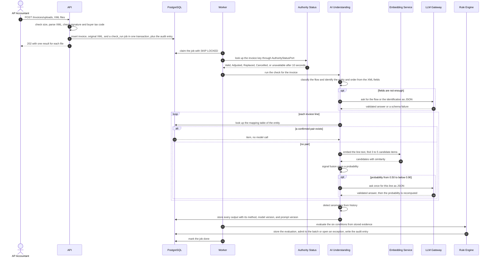
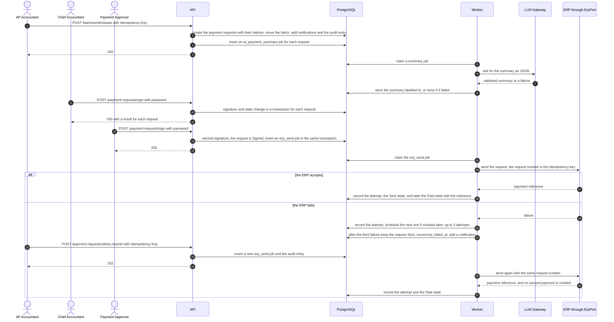
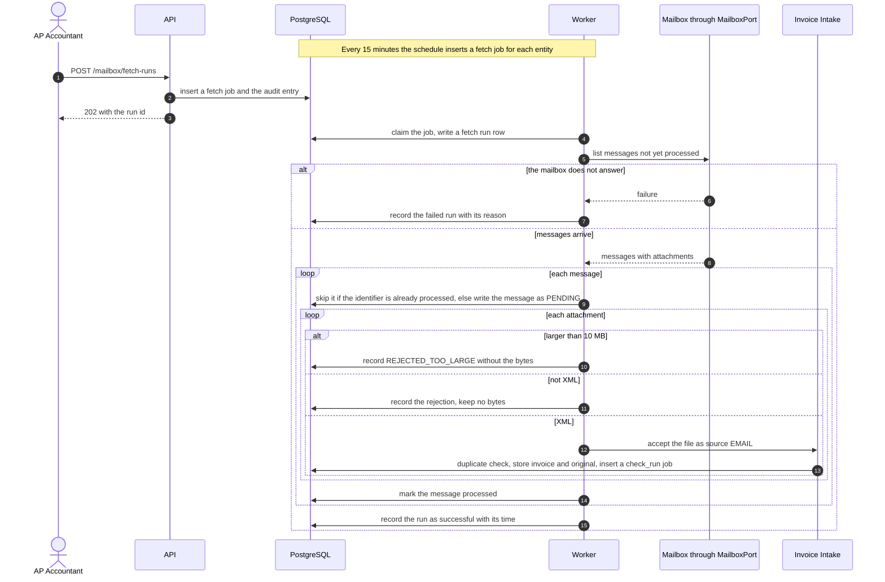
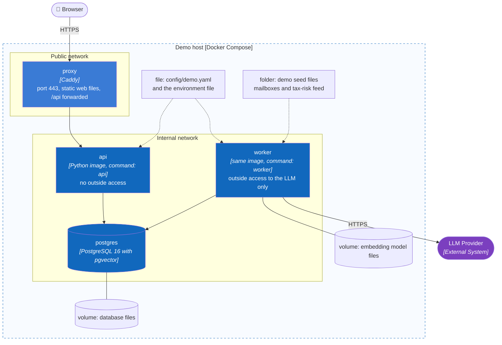

# Runtime and Deployment

> Design status: MVP — Step 7 of 9, draft for review
>
> Implementation status: NOT STARTED

**Purpose:** show how the containers of [C2](02-container.md) work together at run time for three important paths, how the demo is deployed, and which security measures sit where. The deployment is one Docker Compose environment for the demo; production hardening (backups, high availability, monitoring service, secrets manager) is future work and is not designed here (D-176).

## (a) XML upload to the Rule Engine decision

The API stores the file and the invoice and inserts one `check_run` job for each accepted invoice in the same transaction. The Worker then runs the chain: authority status lookup, the AI steps, and the Rule Engine. A failure of any AI step becomes an exception and never blocks intake (DF-08, BR-27). Sources: AC-10.1 to AC-10.16, AC-12.5, AC-14.1 to AC-14.8, AC-16.1 to AC-16.15.

Timing: G-05 asks for the 95th percentile from receipt to decision of at most 1 minute. The model calls are the slow part, so the 20-second timeout and the rule that most lines make no call are what keep that figure (G-07, DF-08).

## (b) Batch release, signing, and sending to the ERP, with a resend

`releaseBatch` and `signPaymentRequests` answer 200 because their records are saved inside the call (D-145). The summary and the send are jobs. Sources: AC-24.6, AC-25.1, AC-25.4, AC-25.11, AC-26.1 to AC-26.14, DF-24, D-67.

## (c) Mailbox fetch

The scheduled fetch and "Fetch now" use the same job. A message is processed once (unique message identifier per entity), and an XML attachment goes through the same intake path as an upload (US-31, DF-63, DF-79).

## Deployment for the demo

One host runs Docker Compose with four services. Only the proxy publishes a port. The Worker is the only service allowed to reach the internet, for the LLM call; the simulated ERP, status service, mailbox, and Email Service are code and files inside the deployment, so no outside system is needed to run the demo except the LLM Provider (D-171, D-183).

| Service | Image and command | Notes |
|---|---|---|
| `proxy` | A Caddy image with the built web files | The only service with a published port. Redirects to HTTPS and sets the security headers |
| `api` | The backend image, command `api` | Runs a one-shot migration step first (Alembic) before it accepts requests. Has no key for the LLM |
| `worker` | The same image, command `worker` | Holds `MATCHPAY_LLM_API_KEY`, the embedding model files, and the seed folder. Starts the schedules (sync, mailbox, reminders) |
| `postgres` | PostgreSQL 16 with pgvector | A named volume. Three schemas: `public`, `sim`, `platform` |

A second environment, a production topology, backups, and scaling the Worker to several replicas are not designed. The job claim with `SKIP LOCKED` and the per-entity locks already allow more than one Worker (D-169, D-182), but this is not tested (Unverified).

## Security notes

| Topic | Design | Rule |
|---|---|---|
| Session cookie | `mp_session`: opaque id, HttpOnly, Secure, SameSite=Strict; the database keeps only a hash of the id; a new id is issued at login; idle limit 30 minutes, absolute limit 12 hours | D-131, DF-84 |
| CSRF | Every POST, PUT, PATCH, and DELETE must send `X-CSRF-Token`; a missing or wrong token is 403 `ACCESS_DENIED` | D-131 |
| Entity scope | The API adds the entity of the session to every query. PostgreSQL row-level security on `app.entity_id` is the second layer. The application connects as a role that is not the table owner and has no `BYPASSRLS`; the tables are set to `FORCE ROW LEVEL SECURITY` | BR-09, D-172 |
| Group-level reads | The Group Admin sees counts and rates through database functions that return numbers only, owned by a separate role; no query returns an invoice row of another entity | DF-23, D-184 |
| Audit | The application role has `INSERT` and `SELECT` on `audit_log`, and a trigger refuses `UPDATE` and `DELETE`; the entry is written in the action's transaction | D-55, DF-30, D-144 |
| Secrets | In environment variables: the database URL, the session secret, and the LLM key. The key exists only in the Worker's environment | D-174 |
| LLM data | Document text is passed as data in a delimited field; the answer must match a fixed schema; synthetic data only in the MVP; no document text or prompt is stored in `ai_requests` | BR-27, O-03, R-11 |
| Passwords | Argon2id hashes; a signing action asks for the password again; a wrong password is 401 and a `LOGIN_FAILED` entry | D-175, D-153 |
| Rate limits | Login 10 a minute for one email or address; 600 a minute for one session; counters in `platform.rate_limit_counters` | DF-88 |
| Uploads | At most 20 files, 10 MB each, 200 MB per request; the XML parser must not resolve external entities or fetch network resources. This setting is a standard measure that is not confirmed in the parser documentation (not opened), so it is Unverified and Step 9 tests it with a hostile file | DF-85, BR-17 |
| Logs | JSON lines with the `traceId`; no document text, no password, no session id | D-178 |
| Demo routes | `/demo/erp-simulator/...` answers 404 when `MATCHPAY_DEMO_MODE` is off | D-143 |

**Previous:** [LLM provider](06-llm-provider.md) · **Next:** [Step index](README.md).
