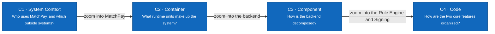

# 07 — Architecture

> Design status: MVP — Step 7 of 9, draft for review
>
> Implementation status: NOT STARTED

Step 7 turns the [API contract](../06-api/README.md), the [database schema](../05-database/README.md), and the AI design of [Step 1](../01-research/07-ai-vs-rule-based.md) into a C4 architecture, a tech stack, and an LLM provider recommendation. MatchPay is a modular monolith: one backend codebase deployed as two processes, `api` for the 121 operations and `worker` for the ten background jobs, with 30 components named after the tags of the contract (D-165). The database is PostgreSQL 16 with pgvector in three schemas (business, `sim`, `platform`); entity isolation has a server filter and row-level security (D-172); the AI gives evidence, the Rule Engine decides, and a person signs. Item embeddings run locally, and the hosted LLM sits behind a port, so the provider can be changed by configuration. Step 7 also answers every question that Steps 3, 5, and 6 left to it, fills the C4 Component column of the [master traceability matrix](../traceability/master-traceability.md), and recommends an LLM on vendor pages opened on 2026-11-01, with what stayed Unverified. Every decision of this step is a call that awaits the user's review.

| File | Content |
|---|---|
| [00-decisions.md](00-decisions.md) | Decisions D-165..D-186 and defaults DF-89..DF-93, all awaiting review; the items deferred to Step 7 and their answers; differences from Steps 1 to 6; gaps found in approved steps; doubts for the user |
| [01-system-context.md](01-system-context.md) | C1: the seven roles, MatchPay, the outside systems, and a table of every relationship |
| [02-container.md](02-container.md) | C2: proxy and web, API, Worker, local embedding model, PostgreSQL with three schemas, outside systems; responsibilities and architecture rules |
| [03-component.md](03-component.md) | C3: 30 components, the catalog of operations, jobs, tables, and stories, and the dependency rules |
| [04-code.md](04-code.md) | C4: classes, protocols, and sequences for the Rule Engine's six conditions (US-16) and for signing many requests in one action (US-25) |
| [05-tech-stack.md](05-tech-stack.md) | Layer by layer: choice, version line, reason, alternatives; the server configuration; the answers to the deferred items |
| [06-llm-provider.md](06-llm-provider.md) | The decision record: needs, criteria, four candidates, a comparison with sources, a cost estimate, the recommendation, and how to reverse it |
| [07-runtime-and-deployment.md](07-runtime-and-deployment.md) | Sequences for the upload-to-decision chain, batch release to ERP send with a resend, and the mailbox fetch; the Docker Compose deployment; security notes |

**Related:** [README](../../README.md) · [Previous: API contract](../06-api/README.md) · [Master traceability](../traceability/master-traceability.md)

## Color Conventions

- Dark blue: the primary unit being described.
- Light blue: a neighboring or cross-cutting element in the same system.
- Purple: an element that uses a model (the LLM Gateway, the embedding model, AI Understanding).
- Gray: an outside system, or an element outside the boundary being zoomed.
- Dashed line: a Software System or Container boundary.

## Implementation Status

| Unit | Status |
|---|---|
| Web application, API, Worker, database migrations | Not started (Step 9) |
| Code structure and folders | Step 8 |
| Embedding model choice | Open until ES-03 compares the two candidates on Vietnamese lines |
| LLM provider | Recommended, not contracted; synthetic data only (O-03) |

The diagrams describe the **target architecture**.
