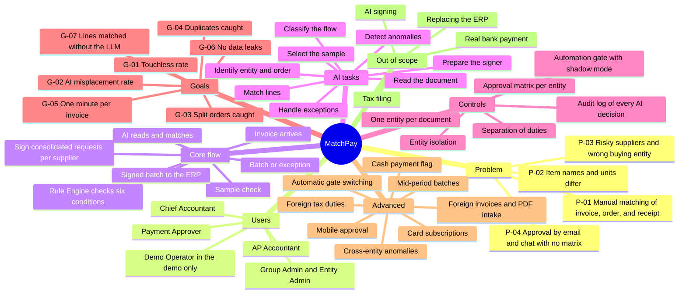

# MatchPay Product Mind Map

> Design status: MVP — Step 1 of 9, draft for review
>
> Implementation status: NOT STARTED

The mind map replaces a drawn image. It is written in English, like all documentation (D-01). Solid branches are in the MVP; the branch "Advanced" is designed but not built.

**Related:** [README](../README.md) · [Step 1 index](01-research/README.md)
