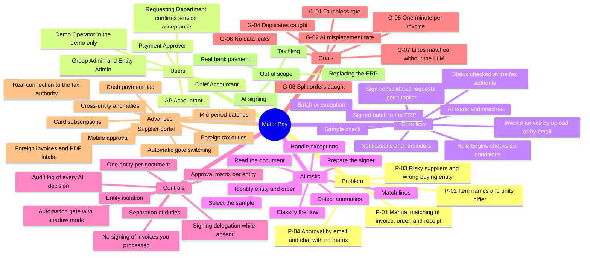
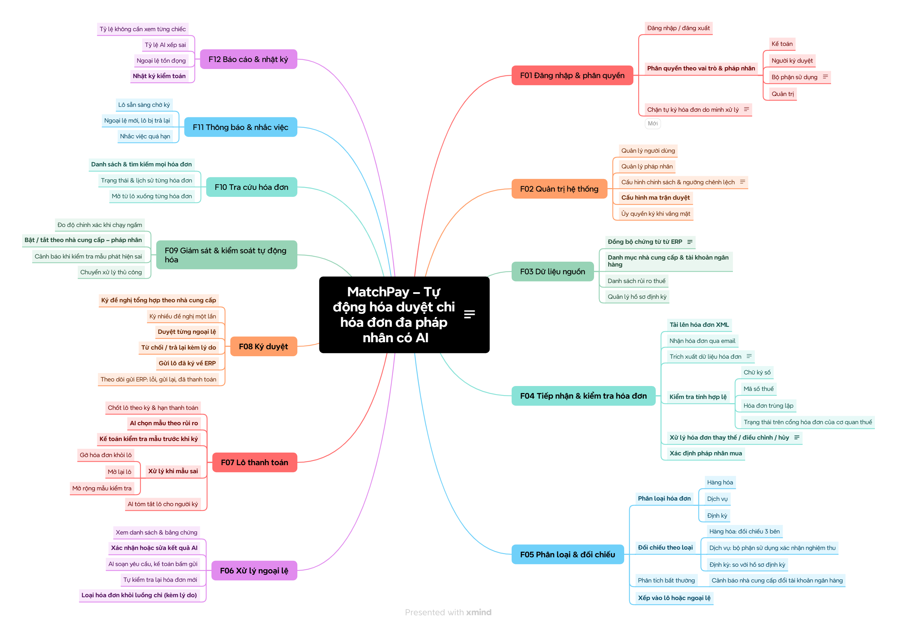
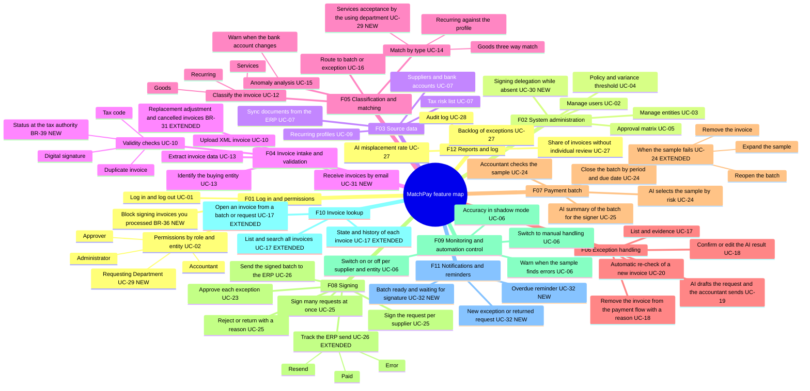

# MatchPay Product Mind Map

> Design status: MVP — approved
>
> Implementation status: NOT STARTED

The mind map replaces a drawn image. It is written in English, like all documentation (D-01). Solid branches are in the MVP; the branch "Advanced" is designed but not built. This page has two maps: the product map below, and the [feature map F01..F12](#feature-map-f01f12), which mirrors the feature mind map the user attached on 2026-11-01 (D-88).

## Feature map (F01..F12)

This English Mermaid map mirrors the user's final feature mind map, which the user confirmed on 2026-11-01 (D-88). The original image is [feature-mind-map.png](images/source/feature-mind-map.png) and is embedded below. The image is in Vietnamese because it is a source document, like the brief; it is not translated or edited.

The Mermaid map is the English reading of it. Each leaf carries the use case or story that delivers it. Leaves marked NEW were added by the sync to that mind map (D-88); leaves marked EXTENDED existed and gained behaviour. Everything in this map is in the MVP.

Kept in the documents although the feature map does not show them: the ERP simulator and the Demo Operator (UC-08, demo only), the tax-risk hold (UC-21), split-order handling (BR-10), employee-expense invoices (BR-23), and group limits (UC-03). See D-99 in the [Requirements decisions](02-usecases-userstories/00-decisions.md#sync-to-the-feature-mind-map-user-decision-d-88-2026-11-01).

**Related:** [README](../README.md) · [Research index](01-research/README.md)
