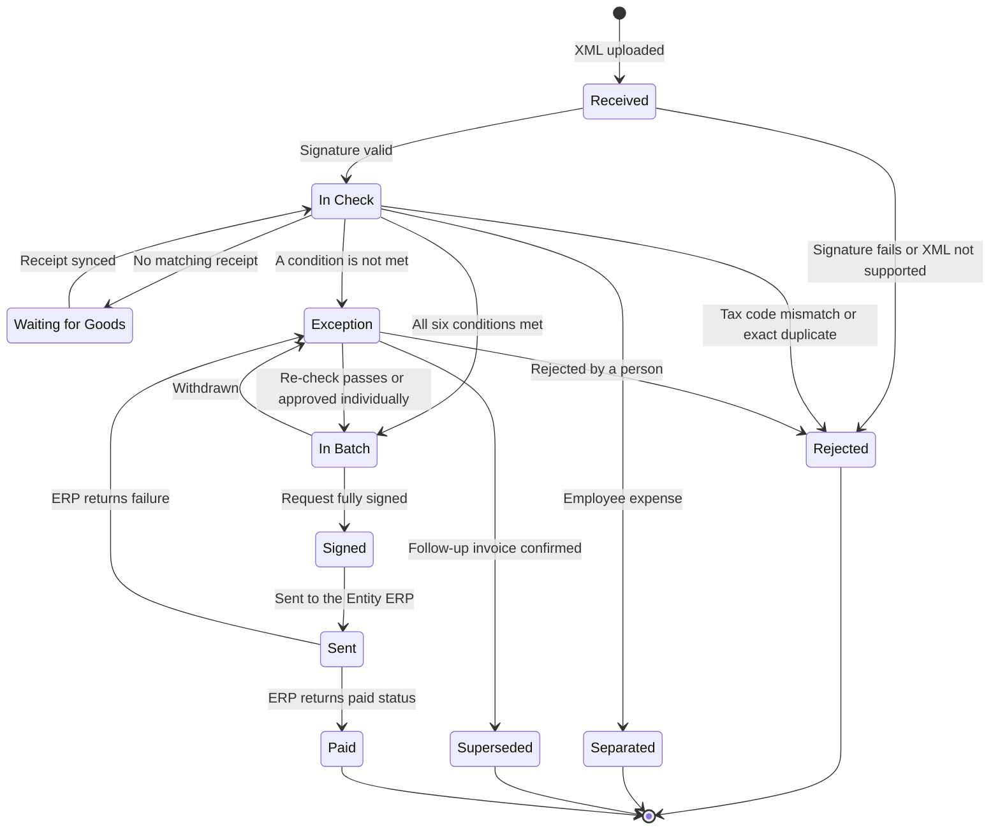
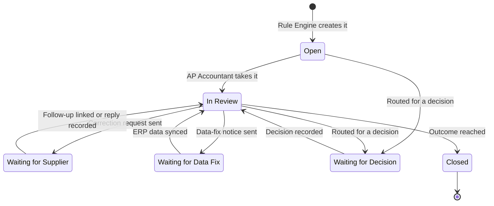
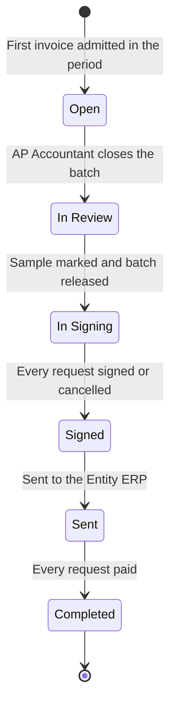
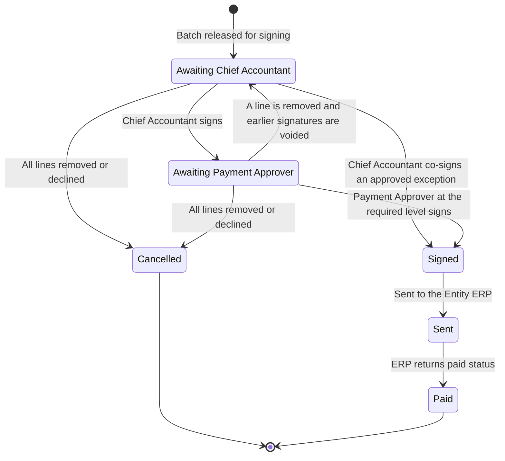

# Business Rules — MatchPay MVP

> Design status: MVP — Step 2 of 9, draft for review
>
> Implementation status: NOT STARTED

BR-01..BR-31 are the rules of the brief and keep their number and meaning. Where this page words a rule differently, the change comes from a decision and is named in the rule (D-08, D-24, D-26, D-33). BR-32..BR-37 are new. The user's scope change D-33 removed foreign invoices and the cash payment flag from the MVP: BR-21 and BR-32 read "Removed (D-33)" and are carried by the Advanced items W-20 and W-21, and BR-18 is entirely Advanced (W-19, W-09); they keep their number and have no user story. Values marked DF-xx are defaults pending confirmation; see [Step 2 defaults](../02-usecases-userstories/00-decisions.md#defaults-pending-confirmation). The brief's example numbers are the demo configuration of each entity (DF-11); thresholds are parameters set per entity inside the group limits (BR-16). The Related API lines are filled in by Step 6. A rule that spans the MVP and Advanced says which part is which.

## BR-01 — One entity per document

- **Source:** brief (BR-01), D-26
- **Related US:** US-03, US-10, US-13, US-19
- **Related API:** TBD (Step 6)
- **Rule:**
  - Every document (order, receipt, acceptance, invoice, payment request) belongs to exactly one entity. Entities are identified by a unique tax code.
  - An invoice whose **buyer tax code** does not match the tax code of the ordering entity is rejected (state `Rejected`, BR-33), and the supplier is asked to reissue it. The correction follows the BR-31 path: an adjustment or replacement invoice, always handled by a person (D-26).
  - A buyer **name** that differs while the tax code matches is a warning shown to the AP Accountant and does not reject the invoice (D-26; this rests on one secondary summary of Circular 91/2026, Art 10).

## BR-02 — Separation of duties

- **Source:** brief (BR-02)
- **Related US:** US-02, US-08, US-23, US-25
- **Related API:** TBD (Step 6)
- **Rule:**
  - For one transaction, the person who created the purchase order, the person who confirmed the receipt, and the person who approves payment must be three different people.
  - The creator and the confirmer come from ERP data. A platform user can be linked to an ERP user (DF-14), so the check can tell whether two roles are the same person.
  - A user who is linked to the creator or the confirmer of any invoice in a payment request cannot sign or approve that request (see BR-36).

## BR-03 — Approval matrix

- **Source:** brief (BR-03), DF-02
- **Related US:** US-05, US-23, US-25
- **Related API:** TBD (Step 6)
- **Rule:**
  - Each entity has an approval matrix by amount. Example: under VND 50,000,000 the department head approves; from VND 50,000,000 the CFO approves.
  - The tiers must cover every amount without gaps or overlaps, and the top tier needs at least one active approver.
  - The approval level of a **consolidated payment request** is decided by the request total, and is recomputed when a line is removed (DF-02).
  - The level of an **individually approved exception** is decided by the invoice amount, or by the combined amount of aggregated split orders (BR-10).

## BR-04 — Tolerance

- **Source:** brief (BR-04), DF-11
- **Related US:** US-04, US-16
- **Related API:** TBD (Step 6)
- **Rule:**
  - Price and quantity tolerances are set per entity inside the group limits (BR-16). Example: price ±2%; the quantity may not exceed the quantity received.
  - The price of a line is compared after unit conversion. A deviation of exactly 2.0% passes; above 2.0% fails the condition.

## BR-05 — Admission to a batch

- **Source:** brief (BR-05), D-08
- **Related US:** US-16, US-18, US-24, US-27
- **Related API:** TBD (Step 6)
- **Rule:**
  - The **Rule Engine** admits an invoice to the open batch of its entity only when all six conditions hold; the AI supplies the evidence and does not decide. If one condition is missing, the invoice becomes an exception (BR-34).
    1. The key fields (seller, amount, quantity) are confirmed by an independent source (BR-17).
    2. Every line is matched with confidence at or above the threshold (BR-28).
    3. Price and quantity are inside the entity's tolerance, and the quantity does not exceed the quantity received (BR-04, BR-15).
    4. The total is below the entity's batch threshold (BR-16).
    5. The automation gate of the supplier and entity pair is open, and the supplier is not on the tax-risk list unless the Chief Accountant has released this invoice (BR-06, BR-08).
    6. There is no anomaly (BR-10, BR-11, BR-24, BR-29, BR-30).
  - The Rule Engine uses no LLM. It reads the stored evidence, records every condition with its value (BR-12), and never admits an invoice whose evidence is missing (BR-27).
  - An invoice in a batch can be withdrawn until its payment request is fully signed (DF-07).
  - An invoice with no matching receipt is `Waiting for Goods` (BR-14), and an employee-expense invoice is separated (BR-23); neither is an exception.

## BR-06 — Automation gate

- **Source:** brief (BR-06), D-06, D-27, D-29, DF-16, DF-17
- **Related US:** US-06, US-16, US-18, US-24, US-28
- **Advanced part:** W-01, automatic opening and closing
- **Related API:** TBD (Step 6)
- **Rule:**
  - **MVP part.**
    - There is one gate for each supplier and entity pair. A new pair starts closed (D-29).
    - While a gate is closed, the invoice goes to an exception with the reason "Gate closed". The AI's proposal is recorded next to the person's decision; this is shadow mode. Accuracy of a pair = invoices where the person confirmed every AI result unchanged, divided by invoices compared (DF-17).
    - The Group Admin sees the accuracy next to the threshold (example 98%) and opens or closes the gate by hand. The pair needs at least 50 compared invoices before it can be opened, and opening below the threshold needs a written reason (DF-16). In the demo the seed data supplies a labelled "Simulated history" for chosen pairs, which is left out of the G-01 and G-02 figures (DF-33).
    - After at least 20 sampled invoices of an open pair in the last 30 days, a sample error rate above 2% (100% minus the 98% threshold) raises an alert to the Group Admin and recommends closing the gate. The gate stays as it is until the Group Admin acts.
  - **Advanced part (W-01).** The gate opens by itself when shadow-mode accuracy reaches the threshold and closes by itself when sample checks find errors above it.

## BR-07 — Sample check

- **Source:** brief (BR-07), DF-06, DF-29
- **Related US:** US-04, US-06, US-24, US-27
- **Related API:** TBD (Step 6)
- **Rule:**
  - Before signing, the AP Accountant checks a part of the batch (example 10%). The AI selects the sample by risk: high-value invoices first, then suppliers whose gate opened recently, then items often matched wrongly. Each selected invoice shows why it was selected.
  - Sample size = rate times invoices in the batch, rounded up, minimum 1 (DF-06). If the AI cannot select, the highest-value invoices are taken and the sample is labelled "selected without AI" (DF-29).
  - An invoice found wrong is withdrawn from the batch into exceptions. The batch cannot be released for signing until every selected invoice is marked.
  - Results are shown on the signing screen and feed the misplacement rate (G-02) and the gate alert (BR-06).

## BR-08 — Tax-risk suppliers

- **Source:** brief (BR-08), D-21, D-28
- **Related US:** US-07, US-16, US-21
- **Related API:** TBD (Step 6)
- **Rule:**
  - An invoice from a supplier on the tax-risk list is held, and the Chief Accountant decides, per invoice, to release or reject it. The system never rejects such an invoice by itself.
  - The list is a simulated external feed loaded through UC-07. Every entry carries a source and a date, and an entry without them is rejected (D-21, D-28).
  - When the list changes, invoices of a newly listed supplier that are in a batch and not fully signed are moved back to exceptions as a hold.

## BR-09 — Entity isolation

- **Source:** brief (BR-09), D-09, DF-23
- **Related US:** US-01, US-02, US-03, US-04, US-05, US-06, US-07, US-08, US-09, US-10, US-13, US-14, US-15, US-17, US-18, US-19, US-20, US-23, US-24, US-25, US-26, US-27, US-28
- **Advanced part:** W-07, comparison across entities
- **Related API:** TBD (Step 6)
- **Rule:**
  - **MVP part.**
    - Every record carries an entity code. A user sees only the data of their own entity. A Group Admin sees configuration and, for each entity, counts and rates only, never invoice-level data (DF-23).
    - The mapping table, price history, supplier reliability, and sample-check results belong to one entity and are not shared.
    - The check for an exact duplicate (supplier, series, number) runs across the whole group, but it reveals only that a duplicate exists: no entity name, amount, or content (D-09).
    - The server enforces these rules on every request (G-06).
  - **Advanced part (W-07).** A comparison across entities shows aggregates only, such as the group median price, and is hidden when fewer than 3 entities buy the item.

## BR-10 — Split orders

- **Source:** brief (BR-10), DF-11
- **Related US:** US-15, US-16, US-23
- **Related API:** TBD (Step 6)
- **Rule:**
  - Several orders from one entity to the same supplier within a short window (example 7 days), each below the approval threshold but together reaching it, are combined. The combined amount decides the approval level (BR-03), which is higher.
  - The invoices of the combined orders become one exception for individual approval by the Payment Approver (UC-23). The window is measured on the order dates.

## BR-11 — No duplicate payment

- **Source:** brief (BR-11), D-09, DF-19
- **Related US:** US-10, US-15, US-16, US-20
- **Related API:** TBD (Step 6)
- **Rule:**
  - An invoice with the same supplier, series, and number as an existing invoice is blocked (state `Rejected`). This check covers the whole group (D-09, BR-09).
  - An invoice whose content is nearly the same goes to a person to check: the same supplier and entity, the same total, an invoice date within 3 days, and a different number (DF-19). This check is within one entity in the MVP.
  - A replacement invoice that corrects an earlier invoice is not a duplicate of it (BR-31).

## BR-12 — Audit log

- **Source:** brief (BR-12), DF-30
- **Related US:** US-01, US-02, US-03, US-04, US-05, US-06, US-07, US-09, US-10, US-12, US-13, US-14, US-15, US-16, US-17, US-18, US-20, US-21, US-25, US-26, US-28
- **Related API:** TBD (Step 6)
- **Rule:**
  - Every AI decision stores its reason, confidence, method (mapping table, embedding with the signal-fusion model, or LLM), model version, and prompt version.
  - Every Rule Engine decision stores each condition with its value. Every decision by a person, every signature, every configuration change, and every gate change stores who and when.
  - The audit log cannot be edited or deleted through the application. If an entry cannot be written, the action does not complete (DF-30).

## BR-13 — Goods receipt note

- **Source:** brief (BR-13)
- **Related US:** US-07, US-08
- **Related API:** TBD (Step 6)
- **Rule:**
  - A goods receipt note is made only by the warehouse keeper from the quantity actually received, and refers to a purchase order. It is never generated from an invoice.
  - MatchPay only reads receipts. The ERP simulator enforces the rule when a receipt is created, and a sync rejects a receipt that has no purchase order reference or that is marked as created from an invoice.

## BR-14 — Waiting for goods

- **Source:** brief (BR-14), DF-07
- **Related US:** US-07, US-13, US-16, US-24
- **Related API:** TBD (Step 6)
- **Rule:**
  - An invoice with no matching receipt is `Waiting for Goods`. It cannot be admitted to a batch or paid. This covers an invoice that arrives before the goods.
  - It is re-evaluated after every sync (UC-07). It is a state of its own and is not an exception.

## BR-15 — Quantity paid

- **Source:** brief (BR-15)
- **Related US:** US-08, US-16
- **Related API:** TBD (Step 6)
- **Rule:**
  - The quantity paid cannot exceed the quantity received. An invoice for more than was received fails condition 3 of BR-05 and becomes an exception.
  - A short delivery keeps the purchase order open for the rest.

## BR-16 — Group limits

- **Source:** brief (BR-16), DF-13
- **Related US:** US-03, US-04, US-16
- **Related API:** TBD (Step 6)
- **Rule:**
  - The Entity Admin sets tolerance and batch threshold only inside the maximums set by the Group Admin and cannot go above them. Demo maximums: price tolerance 5%, batch threshold VND 300,000,000 (DF-13).
  - When the Group Admin lowers a maximum below an entity's current value, that value is lowered to the new maximum and the change is recorded.

## BR-17 — Independent source

- **Source:** brief (BR-17), D-08, D-24, DF-25, D-33
- **Related US:** US-03, US-10, US-12, US-16
- **Advanced part:** W-03, medium-trust PDF; W-19, PDF intake and foreign invoices
- **Related API:** TBD (Step 6)
- **Rule:** The Rule Engine admits an invoice only when an independent source confirms the seller, the amount, and the quantity. The brief says that the AI puts the invoice in the batch; this page rewords it according to D-08, because the AI supplies evidence and the Rule Engine decides. A document with no independent source always goes through a person.
  - **MVP part.**
    - **Only XML e-invoices are accepted (D-33).** A PDF, an image, or any other file that is not XML is rejected at upload with the reason "Only XML e-invoices are accepted in the MVP". The reading of PDF and of images by a multimodal LLM is Advanced (W-19).
    - **High:** an XML invoice with the seller's digital signature and a tax-authority code.
    - **Signed non-coded XML (D-24):** an XML invoice with the seller's digital signature and no tax-authority code, accepted only from sellers in a sector listed in configuration (DF-25; the default list holds electricity). The signature confirms where the invoice came from. A matching recurring profile (BR-24) is the independent source. With no matching profile the invoice goes to an exception. For a **fixed price** the amount must equal the contract. For a **usage-based price** the profile gives only a plausibility check through the BR-24 deviation threshold; it is not an independent confirmation of the amount. This limit is a call for the user to review (O-16).
    - **Unsupported: foreign invoice.** A foreign invoice that still arrives, for example an XML whose seller has no Vietnamese tax code, or a foreign supplier invoice that the flow classifier recognises (UC-12), is classified "Unsupported: foreign invoice" and becomes an exception. It cannot be approved individually (D-31) and cannot join a batch. The AP Accountant resolves it by rejecting it with a reason, and it is handled outside the system. This reading of D-33 is a call awaiting user review.
  - **Advanced part (W-03, W-19).** A PDF confirmed by an independent source, such as a matching card transaction and subscription profile, may join a batch after the gate opens, with a low amount limit (W-03). A PDF, a scanned image, or a paper document with no independent source (Low trust), and a foreign PDF invoice whose fields the AP Accountant confirms, always take the exception path (W-19, DF-04).

## BR-18 — PDF and XML of the same invoice (Advanced)

- **Source:** brief (BR-18), D-33
- **Related US:** none in the MVP; this rule is entirely Advanced and is carried by W-19 and W-09
- **Related API:** TBD (Step 6)
- **Rule:** *(Advanced, W-19 and W-09; status Advanced, not Removed)*
  - The MVP accepts XML only (BR-17), so no PDF exists to compare with an XML file.
  - When PDF intake exists (W-19): if the PDF and the XML of one invoice differ in an amount, a quantity, or a tax code, the invoice is flagged as suspected fraud and goes to an exception.
  - When the original XML is available, the system does not accept the PDF as a data source. An XML invoice whose signature check fails is not used as a source either; it is `Rejected` (UC-10).

## BR-19 — Received quantity and acceptance

- **Source:** brief (BR-19)
- **Related US:** US-07, US-08
- **Related API:** TBD (Step 6)
- **Rule:**
  - The quantity received and the acceptance of a service come from the confirmation of the warehouse keeper or the acceptor in the ERP or warehouse software.
  - A scan with a handwritten signature is only an attachment. The AI does not verify handwritten signatures.

## BR-20 — Signing and consolidated payment requests

- **Source:** brief (BR-20), D-19, DF-01, DF-10, O-15
- **Related US:** US-04, US-25, US-26
- **Related API:** TBD (Step 6)
- **Rule:**
  - Every payment needs the e-signature of the person with authority and of the Chief Accountant before the money is paid. The AI never signs.
  - A batch holds **consolidated payment requests**, one per supplier by default or one per invoice, as the entity sets in its policy (grouping mode, UC-04). The request is this platform's own document, not the paper form 05-TT (D-19). It lists every invoice it covers.
  - The signer may remove lines before signing. Every invoice can be traced to the signature that approved it.
  - The signing screen shows totals by entity and supplier, large invoices, the sample-check result, the evidence for each invoice, the flags of BR-30, and an AI summary that is labelled as AI.
  - **MVP signing:** a platform e-signature with a simulated certificate and a re-authentication step (DF-10). One user action can sign many requests, and it creates **one signature record per request** with the signer, the time, the request version, and a hash of the request content (O-15). Legal confirmation of this model stays open (O-05, O-15).
  - The order and the separation of signers are in BR-36, the approval level in BR-03, and the lifecycle in BR-35.

## BR-21 — Foreign invoices

- **Source:** brief (BR-21), O-07, D-33
- **Related US:** none; Removed (D-33), now Advanced W-20
- **Related API:** TBD (Step 6)
- **Rule:** **Removed (D-33), now Advanced W-20.** The design below is kept for W-20. Nothing here applies to the MVP, which accepts XML only (BR-17); a foreign invoice that still arrives is an "Unsupported: foreign invoice" exception (BR-17).
  - **Foreign service:** payment is blocked until the Chief Accountant records the outcome for foreign contractor tax: the entity handled the tax (payment proof attached), the supplier is registered directly in Vietnam (registration evidence attached; the status of this outcome under Tax Administration Law No. 108/2025/QH15, which Circular 91 guides, is Unverified, O-07), or the tax does not apply (reason recorded).
  - **Imported goods:** the customs declaration and the proof of paying import-stage VAT must be attached before the invoice can join a batch. The AP Accountant attaches the documents.
  - The original currency and the exchange rate are stored.
  - Advanced W-20 only flags and blocks. The AI does not suggest a tax type (W-08).

## BR-22 — Subscriptions charged to a card (Advanced)

- **Source:** brief (BR-22)
- **Related US:** none in the MVP; this rule is entirely Advanced and is carried by W-04
- **Related API:** TBD (Step 6)
- **Rule:** *(Advanced, W-04)*
  - A subscription charged to a card has a card limit set in its subscription profile.
  - The invoice is confirmed afterwards. When the number of seats or the unit price differs from the profile, or the same period is charged twice, the system requests a refund, a reduction of seats, or a card block.
  - In the MVP a fixed-price subscription follows a recurring profile (BR-24).

## BR-23 — Employee-expense invoices

- **Source:** brief (BR-23), D-14
- **Related US:** US-12, US-27
- **Related API:** TBD (Step 6)
- **Rule:**
  - An invoice for an employee expense with no booking request (hotel, restaurant, taxi) is separated into a list waiting for a reimbursement file. It is not an exception and is left out of the denominator of the touchless rate (G-01).
  - Whether the seller falls under the purchase-list rule is decided by the accountant, not by the AI.

## BR-24 — Recurring invoices

- **Source:** brief (BR-24), D-24, DF-11
- **Related US:** US-09, US-13, US-15, US-16
- **Related API:** TBD (Step 6)
- **Rule:**
  - A recurring invoice (electricity, water, office rent, fixed-price subscription) is checked against its recurring profile: the right supplier, entity, location, and period. Each period can have only one invoice.
  - **Fixed price:** the amount must equal the contract.
  - **Usage-based price:** an amount that deviates by more than the threshold (example 30%) from the average of the earlier periods becomes an exception. With fewer than 3 earlier periods the check cannot run and the invoice becomes an exception.
  - A signed non-coded XML invoice depends on this rule for its independent source (BR-17, D-24).

## BR-25 — The Entity ERP is the source of truth

- **Source:** brief (BR-25), DF-31
- **Related US:** US-07, US-18, US-19, US-20, US-26
- **Related API:** TBD (Step 6)
- **Rule:**
  - The ERP of each entity is the source of truth for purchase orders, receipts, acceptances, suppliers, and master data. MatchPay reads them and never edits them; the only thing it sends is the signed batch (UC-26).
  - When data differs, the responsible team is told, with a draft written by the AI, so that it fixes the data in the ERP, and the data is synced again.
  - A sync that runs again creates no duplicate records. Every record stores its sync time.

## BR-26 — Correction requests and follow-up invoices

- **Source:** brief (BR-26), D-07, DF-21
- **Related US:** US-18, US-19, US-20
- **Related API:** TBD (Step 6)
- **Rule:**
  - The AI drafts a request to the supplier from an approved template. Only the AP Accountant presses Send, and the AI never sends anything outside the system.
  - The AI tracks the reply deadline (5 working days, DF-21) and reminds the AP Accountant inside the system.
  - A new invoice from the same supplier is linked to the old exception and checked again. A **fresh standard invoice** that passes closes the exception and joins the batch. A legal **adjustment or replacement invoice** is linked and checked again but waits for the AP Accountant's confirmation (D-07, BR-31).

## BR-27 — Document content is data

- **Source:** brief (BR-27), DF-08
- **Related US:** US-12, US-13, US-14, US-16, US-19
- **Related API:** TBD (Step 6)
- **Rule:**
  - The content of a document (item names, notes, any text inside the file) is always data and never an instruction.
  - The LLM output must follow a fixed schema. A wrong schema, a timeout, or an unavailable LLM sends the invoice to an exception, and intake never blocks (DF-08).
  - An LLM result never puts an invoice in a batch by itself.

## BR-28 — Line matching confidence

- **Source:** brief (BR-28), DF-15
- **Related US:** US-14, US-16
- **Related API:** TBD (Step 6)
- **Rule:**
  - The confidence the LLM reports about itself is never the only basis for a decision. A match combines the similarity of the embeddings, the match of price and quantity, and the matching history, in the signal-fusion model.
  - A line is matched at a probability of at least 0.90. Thresholds are calibrated on a labelled data set, and a new model version replaces the current one only when it does better on the test set (DF-15).
  - A pair a person has confirmed enters the mapping table of that entity, and later lines with the same text match without an LLM call (G-07).

## BR-29 — Unusual price

- **Source:** brief (BR-29), DF-11, DF-20
- **Related US:** US-15, US-16
- **Related API:** TBD (Step 6)
- **Rule:**
  - The price of each line is compared with the entity's own purchase history. A deviation of more than the threshold (example 20% from the 6-month median) becomes an exception, even when the order, the receipt, and the invoice match each other. This catches an order placed at a high price from the start.
  - The check needs at least 3 purchases of the item in the last 6 months. With fewer, it is skipped and the skip is recorded (DF-20).

## BR-30 — New supplier or changed bank account

- **Source:** brief (BR-30), DF-05
- **Related US:** US-15, US-16, US-23, US-24, US-25
- **Related API:** TBD (Step 6)
- **Rule:**
  - A new supplier (no previously paid invoice for the supplier and entity pair) and a supplier whose bank account changed in the period never join a batch untouched. Both take the exception path and are approved individually (D-31).
  - The change is flagged on the signing screen.

## BR-31 — Adjustment and replacement invoices

- **Source:** brief (BR-31), D-07, D-26
- **Related US:** US-10, US-18, US-19, US-20
- **Related API:** TBD (Step 6)
- **Rule:**
  - An adjustment or replacement invoice is recognised from its type and its reference to the original. This includes one adjustment invoice that corrects several wrong invoices of the same month.
  - In the MVP it always goes to a person. It is never admitted to a batch automatically. When the AP Accountant confirms it, the original invoices it corrects become `Superseded` (BR-33).
  - The correction of a wrong buyer tax code follows this path (BR-01).

## BR-32 — Non-cash payment

- **Source:** D-25, D-33, [Regulatory context](../01-research/10-regulatory-context.md) L-12
- **Related US:** none; Removed (D-33), now Advanced W-21
- **Related API:** TBD (Step 6)
- **Rule:** **Removed (D-33), now Advanced W-21.** The design below is kept for W-21. In the MVP, a signed batch is a non-cash transfer instruction by design (D-11, BR-35), and UC-26 records only the paid status and the payment document reference. The non-cash rule of L-12 stays as regulatory background.
  - A signed batch is a non-cash transfer instruction by design (D-11).
  - When the Entity ERP returns the paid status, MatchPay records the payment method and the payment document reference returned with it (W-21).
  - If a recorded payment is cash, and the amount is at or above the configured threshold (VND 5,000,000 including VAT, summing the purchases from one seller on the same day, DF-26), the invoice is flagged with a warning that its VAT deduction is at risk, and the flag is written to the audit log (BR-12).
  - The platform does not block the payment, because the payment happens outside the platform.

## BR-33 — Invoice lifecycle

- **Source:** Step 2 (new rule)
- **Related US:** US-10, US-12, US-13, US-16, US-18, US-26
- **Related API:** TBD (Step 6)
- **Rule:** An invoice is always in exactly one state, and only the transitions below are allowed. `Rejected`, `Separated`, `Superseded`, and `Paid` are final.

| # | From | To | Trigger | Who or what |
|---|---|---|---|---|
| V1 | — | `Received` | XML invoice uploaded and stored unchanged with a hash | AP Accountant (UC-10) |
| V2 | — | — | Removed (D-33). The foreign PDF path moved to W-19 | — |
| V3 | — | — | Removed (D-33). The foreign PDF path moved to W-19 | — |
| V4 | `Received` | `In Check` | Signature check passed and schema version supported | System |
| V5 | `Received` | `Rejected` | Signature check failed, or XML not well-formed or not supported | System |
| V6 | `In Check` | `Rejected` | Buyer tax code mismatch (BR-01) or exact duplicate (BR-11) | Rule Engine |
| V7 | `In Check` | `Separated` | Classified as an employee expense (BR-23) | Rule Engine |
| V8 | `In Check` | `Waiting for Goods` | No matching receipt (BR-14) | Rule Engine |
| V9 | `Waiting for Goods` | `In Check` | A receipt is synced (BR-14) | System |
| V10 | `In Check` | `Exception` | A condition of BR-05 is not met, or an AI step failed (BR-27) | Rule Engine |
| V11 | `In Check` | `In Batch` | All six conditions are met | Rule Engine |
| V12 | `Exception` | `In Batch` | The check passes again after resolution, or the Payment Approver approves it individually | Rule Engine, Payment Approver |
| V13 | `Exception` | `Rejected` | Rejected with a reason | AP Accountant, Chief Accountant |
| V14 | `Exception` | `Superseded` | A follow-up invoice is confirmed (BR-31), or a fresh invoice closes the exception (BR-26) | AP Accountant, System |
| V15 | `In Batch` | `Exception` | Withdrawn: sample-check error, a signer removes or declines, the AP Accountant withdraws, or a risk-list change (BR-08) | AP Accountant, signer, System |
| V16 | `In Batch` | `Signed` | Its payment request is fully signed (BR-35) | System |
| V17 | `Signed` | `Sent` | The instruction is sent to the Entity ERP | System |
| V18 | `Sent` | `Paid` | The ERP returns the paid status (UC-26) | System |
| V19 | `Sent` | `Exception` | The ERP returns a failure | System |

V2 and V3 were removed by D-33 together with the state `Awaiting Field Confirmation`; their numbers are not reused.

## BR-34 — Exception lifecycle

- **Source:** Step 2 (new rule)
- **Related US:** US-18, US-20, US-21, US-23
- **Related API:** TBD (Step 6)
- **Rule:** An exception holds one or more reasons and is always in one state. `Closed` is final and carries an outcome. A new problem with the same invoice creates a new exception.

| # | From | To | Trigger | Who or what |
|---|---|---|---|---|
| E1 | — | `Open` | The invoice becomes an exception (V10, V15, V19) with its reasons | Rule Engine |
| E2 | `Open` | `In Review` | The AP Accountant starts work on it | AP Accountant |
| E3 | `In Review` | `Waiting for Supplier` | A correction request is sent (UC-19) | AP Accountant |
| E4 | `In Review` | `Waiting for Data Fix` | A data-fix notice is sent (UC-19) | AP Accountant |
| E5 | `Open`, `In Review` | `Waiting for Decision` | Routed to the Chief Accountant (tax-risk hold) or to the Payment Approver (individual approval) | System, AP Accountant |
| E6 | `Waiting for Supplier` | `In Review` | A follow-up invoice is linked (UC-20), a reply is recorded, or the reminder date passes | System, AP Accountant |
| E7 | `Waiting for Data Fix` | `In Review` | A sync brings changed ERP data (UC-07) | System |
| E8 | `Waiting for Decision` | `In Review` | A decision is recorded | Chief Accountant, Payment Approver |
| E9 | `In Review` | `Closed` | Outcome **Admitted**: the check passes and the invoice joins a batch | Rule Engine |
| E10 | `In Review` | `Closed` | Outcome **Approved individually** (UC-23) | Payment Approver |
| E11 | `In Review` | `Closed` | Outcome **Rejected**: the invoice is rejected with a reason | AP Accountant, Chief Accountant |
| E12 | `In Review` | `Closed` | Outcome **Superseded**: a follow-up invoice is confirmed (BR-31) | AP Accountant |
| E13 | `In Review` | `Closed` | Outcome **Auto-closed**: a fresh standard invoice passes (BR-26) | System |

## BR-35 — Batch and payment request lifecycle

- **Source:** Step 2 (new rule), D-10, D-11, DF-01..DF-03
- **Related US:** US-23, US-24, US-25, US-26
- **Related API:** TBD (Step 6)
- **Rule:** There is one open batch per entity per period (DF-18). A batch and each of its payment requests are always in one state, and only these transitions are allowed. `Completed`, `Cancelled`, and `Paid` are final.

| # | Object | From | To | Trigger | Who or what |
|---|---|---|---|---|---|
| B1 | Batch | — | `Open` | The first invoice of the period is admitted | System |
| B2 | Batch | `Open` | `In Review` | The AP Accountant closes the batch for review; later invoices go to the next period | AP Accountant |
| B3 | Batch | `In Review` | `In Signing` | Every selected invoice is marked and the batch is released; the payment requests are created | AP Accountant |
| B4 | Batch | `In Signing` | `Signed` | Every request is `Signed` or `Cancelled` | System |
| B5 | Batch | `Signed` | `Sent` | The requests are sent to the Entity ERP (UC-26) | System |
| B6 | Batch | `Sent` | `Completed` | Every request is `Paid` | System |
| R1 | Request | — | `Awaiting Chief Accountant` | The batch is released. An individually approved exception keeps the Approver's recorded approval (DF-03) | System |
| R2 | Request | `Awaiting Chief Accountant` | `Awaiting Payment Approver` | The Chief Accountant signs (DF-01) | Chief Accountant |
| R3 | Request | `Awaiting Payment Approver` | `Signed` | A Payment Approver at the required level (BR-03) signs | Payment Approver |
| R4 | Request | `Awaiting Chief Accountant` | `Signed` | The Chief Accountant co-signs a request for an individually approved exception, whose Approver's approval is already recorded (DF-03). It skips the Payment Approver state | Chief Accountant |
| R5 | Request | `Awaiting Payment Approver` | `Awaiting Chief Accountant` | A line is removed or the content changes; earlier signatures are voided (BR-37) | AP Accountant, signer |
| R6 | Request | `Awaiting Chief Accountant`, `Awaiting Payment Approver` | `Cancelled` | All lines are removed, or a signer declines the request with a reason; its invoices return to exceptions | AP Accountant, signer |
| R7 | Request | `Signed` | `Sent` | Sent to the Entity ERP | System |
| R8 | Request | `Sent` | `Paid` | The ERP returns the paid status | System |

Invoices can leave a batch (V15) while the batch is `Open`, `In Review`, or `In Signing`, and only until their request is `Signed` (DF-07).

## BR-36 — Signer separation

- **Source:** Step 2 (new rule), DF-01, BR-02
- **Related US:** US-02, US-23, US-25
- **Related API:** TBD (Step 6)
- **Rule:**
  - The Chief Accountant signs first and the Payment Approver second (DF-01), except for an individually approved exception, where the Approver's approval comes first and the Chief Accountant co-signs (DF-03). The two must be different people, and no one can sign the same request twice.
  - The user who prepared the batch cannot sign it.
  - A user linked to the ERP user who created the purchase order, or who confirmed the receipt, of any invoice in a request cannot sign or approve that request (BR-02). Another signer is needed for that request.
  - The signer needs the approval level that the request total requires (BR-03).

## BR-37 — Concurrent-change detection

- **Source:** Step 2 (new rule), D-30, DF-27
- **Related US:** US-18, US-21, US-23, US-24, US-25, US-26
- **Related API:** TBD (Step 6)
- **Rule:**
  - Every invoice, exception, batch, and payment request has a version number that changes with each change (DF-27).
  - A state-changing action carries the version the user saw. If the object has changed since, the action is rejected, nothing is saved, and the user is asked to reload. Signing and withdrawal are the critical cases (D-30).
  - A signature is bound to the version and the content hash of the request, so a signature never covers content that was changed after it was given.

**Related:** [Use cases and user stories](../02-usecases-userstories/README.md) · [Master traceability](../traceability/master-traceability.md) · [Step 1 decisions](../01-research/00-decisions.md)
